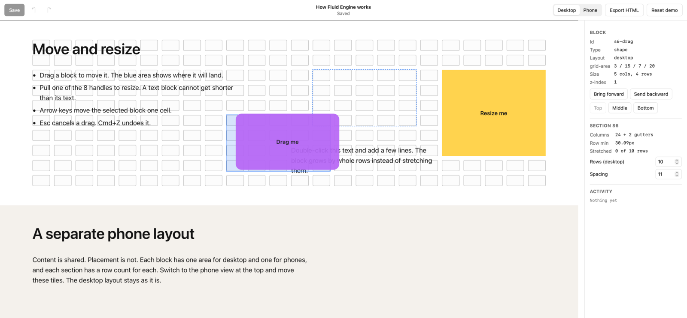

[](docs/ROADMAP.md)

[](docs/PARITY.md)

## Vision

A grid editor that behaves like Squarespace Fluid Engine, 1:1. Same grid, same published CSS, same feel when you drag, resize and type. We copy behaviour by watching it, never by copying Squarespace code ([0001](docs/decisions/0001-black-box-oracle.md)).

"1:1" is a number here. A real Squarespace trial site is the oracle, and three gates compare against it: CSS round trip, block boxes at 5 widths, and recorded gestures replayed in both editors ([0002](docs/decisions/0002-three-gates.md)).



## What we get

| Reward | Milestone |
|---|---|
| 1:1 becomes a number we can watch go up | M0 |
| The demo page exists on real Squarespace to compare against | M1 |
| Published pages match the oracle at every width | M2 |
| Nothing left to guess: every unknown has a recorded answer | M3 |
| Drag, resize and type feel the same | M4 |
| It looks like the real editor, with every block type | M5 |
| Save, publish and keyboard use are ready for real work | M6 |

## What happened

<!-- timeline:start -->
- **Today** · 42 changes
  - X2: top-corner line wording per the lead (between 0 and 2 px, 1 inferred; frozen count 3 of 6; phone not read) ([#583](https://github.com/FRIKKern/fluid-editor/pull/583))
  - X2: a Text's top-corner line at 1px (CAP-X2TOPLINE, ours 3 of 6), refit 1 ([#582](https://github.com/FRIKKern/fluid-editor/pull/582))
- **Yesterday** · 65 changes
  - R2: rule S refit 1 (left edge) read: 10 of 12 fresh, ties S, S stays ([#541](https://github.com/FRIKKern/fluid-editor/pull/541))
- **Last week** · 457 changes, 3 milestones closed
<!-- timeline:end -->

## Where things live (one fact, one home)

| What | Where |
|---|---|
| Milestones | [`docs/ROADMAP.md`](docs/ROADMAP.md) |
| Every item and its status, with evidence | [`parity/items.json`](parity/items.json), listed in [`docs/PARITY.md`](docs/PARITY.md) |
| Status of milestones, who does what | Goal issue [#1](https://github.com/FRIKKern/fluid-editor/issues/1) and its sub-issues. Never in docs |
| The journeys (the spec of "works") | [`JOURNEYS.md`](JOURNEYS.md) |
| The quality bar and the gates | [`QUALITY.md`](QUALITY.md) |
| Captured oracle CSS, stamped | [`fixtures/`](fixtures/README.md) |
| Gate results; what the corpus covers | [`parity/`](parity/): `gate-a.json`, `gate-b.json`, `gate-c.json`, `corpus.json` |
| Recorded oracle gestures | [`traces/`](traces/README.md) |
| What the oracle shows that ours does not | `docs/MISSING.md`, from `npm run review` ([QUALITY.md](QUALITY.md#finding-what-is-missing)) |
| How we work | [`CONTRIBUTING.md`](CONTRIBUTING.md), [`AGENTS.md`](AGENTS.md) |
| Decisions | [`docs/decisions/`](docs/decisions/), one page each |

## Layout

```
app/          the editor: index.html shell, site.html canvas, src/ renderer + editor
fixtures/     oracle CSS per section (css/, index.json); raw pages stay local
parity/       items.json (one home for item status), gate results
scripts/      gates, generators for the pictures and the timeline, doc checks
```

## Run it

```sh
npm run dev        # the editor on http://127.0.0.1:5178
npm run check      # Gate A, item, trace and doc rules
npm run status     # progress per milestone and area
npm run capture && npm run fixtures   # grow the corpus politely, then extract CSS
node scripts/box-diff.mjs --oracle <url> --swap      # Gate B in a cmux tab
node scripts/oracle-record.mjs --id T0002-… --keys ArrowDown   # H6, on the oracle
node scripts/replay.mjs           # Gate C: replay every trace in our editor
eval "$(npm run -s surfaces)"; npm run review   # gap inventory, pixel diff, Barkpark paper
```

The oracle is the page "How Fluid Engine works" on `halibut-keyboard-jlhd.squarespace.com`, driven through cmux ([0004](docs/decisions/0004-oracle-page-and-preview-frame.md)). `app/page.html` is our published version of it.
