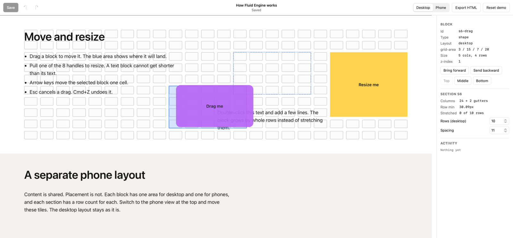

[](docs/ROADMAP.md)

[](docs/PARITY.md)

## Vision

A grid editor that behaves like Squarespace Fluid Engine, 1:1. Same grid, same published CSS, same feel when you drag, resize and type. We copy behaviour by watching it, never by copying Squarespace code ([0001](docs/decisions/0001-black-box-oracle.md)).

"1:1" is a number here. A real Squarespace trial site is the oracle, and three gates compare against it: CSS round trip, block boxes at 5 widths, and recorded gestures replayed in both editors ([0002](docs/decisions/0002-three-gates.md)).



## What we get

| Reward | Milestone |
|---|---|
| 1:1 becomes a number we can watch go up | M0 |
| The demo page exists on real Squarespace to compare against | M1 |
| Published pages match the oracle at every width | M2 |
| Nothing left to guess: every unknown has a recorded answer | M3 |
| Drag, resize and type feel the same | M4 |
| It looks like the real editor, with every block type | M5 |
| Save, publish and keyboard use are ready for real work | M6 |

## News

<!-- news:start -->
**Friday 27 November.** 19 pull requests merged, one of them the News for Thursday. A Wave Intensity drag on a Scrolling block now acts as the oracle's while it is held: the phone view shows the fall rows, Cmd+Z takes back the drag so far, a change the range fires mid-drag takes no step, and arrow keys keep the range's focus through Cmd+Z. On the desktop, the blocks around a Scrolling block follow its foot on a growth or a fall as the oracle's do, a fall to 0 included. scrolling-check grew from 898 to 1,357 rows, and three checks stopped going red on a busy machine or a blocked package source. [The full day](docs/news/2026-11-27.md)
- **Holding a Wave drag:** the phone shows the fall rows; Cmd+Z takes back the drag so far; a mid-drag change takes no step; keys keep the focus through Cmd+Z ([#809](https://github.com/FRIKKern/fluid-editor/pull/809), [#810](https://github.com/FRIKKern/fluid-editor/pull/810), [#814](https://github.com/FRIKKern/fluid-editor/pull/814), [#818](https://github.com/FRIKKern/fluid-editor/pull/818))
- **Blocks around the foot:** a growth moves every block below; a fall leaves a block that starts on or above the new foot; a fall to 0 moves the rest by the landing block's move ([#811](https://github.com/FRIKKern/fluid-editor/pull/811), [#821](https://github.com/FRIKKern/fluid-editor/pull/821), [#823](https://github.com/FRIKKern/fluid-editor/pull/823), [#827](https://github.com/FRIKKern/fluid-editor/pull/827))
- **Checks:** scrolling-check 898 to 1,357 rows; a drag is one call; row-check's frames start at the move; a blocked package source no longer fails setup ([#819](https://github.com/FRIKKern/fluid-editor/pull/819), [#825](https://github.com/FRIKKern/fluid-editor/pull/825), [#817](https://github.com/FRIKKern/fluid-editor/pull/817))

**Thursday 26 November.** 9 pull requests merged, one of them the News for Wednesday. A Wave Intensity drag on a Scrolling block now ends as the oracle's does: Escape while it is held takes the let go's rows and one undo step, the let go keeps the range's focus so an arrow key steps the value, and only the pointer that holds the drag lets it go. On the desktop a drag that grows again takes down only a block the new foot reaches, and in the phone view a Cmd+Z back up to a fall's step gives back the rows a growth takes. scrolling-check grew from 820 to 898 rows. [The full day](docs/news/2026-11-26.md)
- **Ending a Wave drag:** Escape while held ends it as the let go does; the let go keeps the range's focus; only the holding pointer lets go ([#802](https://github.com/FRIKKern/fluid-editor/pull/802), [#803](https://github.com/FRIKKern/fluid-editor/pull/803), [#808](https://github.com/FRIKKern/fluid-editor/pull/808))
- **Rows after a drag or an undo:** a desktop growth takes down only a block the new foot reaches; a phone Cmd+Z back up gives the rows a growth takes ([#800](https://github.com/FRIKKern/fluid-editor/pull/800), [#801](https://github.com/FRIKKern/fluid-editor/pull/801))
- **scrolling-check:** 820 to 898 rows, with new rows for a refit's follow guard and the last read back in Desktop View; the Escape row now also holds the selection ([#804](https://github.com/FRIKKern/fluid-editor/pull/804), [#805](https://github.com/FRIKKern/fluid-editor/pull/805), [#807](https://github.com/FRIKKern/fluid-editor/pull/807))
<!-- news:end -->

## Where things live (one fact, one home)

| What | Where |
|---|---|
| Milestones | [`docs/ROADMAP.md`](docs/ROADMAP.md) |
| Every item and its status, with evidence | [`parity/items.json`](parity/items.json), listed in [`docs/PARITY.md`](docs/PARITY.md) |
| Status of milestones, who does what | Goal issue [#1](https://github.com/FRIKKern/fluid-editor/issues/1) and its sub-issues. Never in docs |
| The journeys (the spec of "works") | [`JOURNEYS.md`](JOURNEYS.md) |
| The quality bar and the gates | [`QUALITY.md`](QUALITY.md) |
| Captured oracle CSS, stamped | [`fixtures/`](fixtures/README.md) |
| Gate results; what the corpus covers | [`parity/`](parity/): `gate-a.json`, `gate-b.json`, `gate-c.json`, `corpus.json` |
| Recorded oracle gestures | [`traces/`](traces/README.md) |
| What the oracle shows that ours does not | `docs/MISSING.md`, from `npm run review` ([QUALITY.md](QUALITY.md#finding-what-is-missing)) |
| How we work | [`CONTRIBUTING.md`](CONTRIBUTING.md), [`AGENTS.md`](AGENTS.md) |
| Decisions | [`docs/decisions/`](docs/decisions/), one page each |

## Layout

```
app/          the editor: index.html shell, site.html canvas, src/ renderer + editor
fixtures/     oracle CSS per section (css/, index.json); raw pages stay local
parity/       items.json (one home for item status), gate results
scripts/      gates, generators for the pictures, doc checks
```

## Run it

```sh
npm run dev        # the editor on http://127.0.0.1:5178
npm run check      # Gate A, item, trace and doc rules
npm run status     # progress per milestone and area
npm run capture && npm run fixtures   # grow the corpus politely, then extract CSS
node scripts/box-diff.mjs --oracle <url> --swap      # Gate B in a cmux tab
node scripts/oracle-record.mjs --id T0002-… --keys ArrowDown   # H6, on the oracle
node scripts/replay.mjs           # Gate C: replay every trace in our editor
eval "$(npm run -s surfaces)"; npm run review   # gap inventory, pixel diff, Barkpark paper
```

The oracle is a Squarespace trial site, set by `FLUID_ORACLE_SITE` and driven through cmux. A new trial follows [QUALITY.md, "A new trial"](QUALITY.md#a-new-trial). Its page "How Fluid Engine works" is built by `scripts/oracle-build.mjs` ([0004](docs/decisions/0004-oracle-page-and-preview-frame.md)). `app/page.html` is our published version of it.
