[](docs/ROADMAP.md)

[](docs/PARITY.md)

## Vision

A grid editor that behaves like Squarespace Fluid Engine, 1:1. Same grid, same published CSS, same feel when you drag, resize and type. We copy behaviour by watching it, never by copying Squarespace code ([0001](docs/decisions/0001-black-box-oracle.md)).

"1:1" is a number here. A real Squarespace trial site is the oracle, and three gates compare against it: CSS round trip, block boxes at 5 widths, and recorded gestures replayed in both editors ([0002](docs/decisions/0002-three-gates.md)).


## What we get

| Reward | Milestone |
|---|---|
| 1:1 becomes a number we can watch go up | M0 |
| The demo page exists on real Squarespace to compare against | M1 |
| Published pages match the oracle at every width | M2 |
| Nothing left to guess: every unknown has a recorded answer | M3 |
| Drag, resize and type feel the same | M4 |
| It looks like the real editor, with every block type | M5 |
| Save, publish and keyboard use are ready for real work | M6 |

## News

<!-- news:start -->
**Monday 23 November.** 8 pull requests merged. A Scrolling block now keeps its rows when Fade edges or Item Spacing is pressed after a wave fall or on a block made taller by hand, as the oracle does. In its link editor, Escape with nothing picked now leaves the editor open, and Cmd+D, Cmd+Shift+H and Cmd+Shift+D no longer set off Chrome's own bookmark or home shortcuts, which Sunday's change had let through. A short Quote's next gesture moves a block above its line by where the block's middle sits, read in 11 new cases. [The full day](docs/news/2026-11-23.md)
- **Scrolling block:** Fade edges and Item Spacing keep the rows after a fall or a hand resize; phone drags read and pinned ([#770](https://github.com/FRIKKern/fluid-editor/pull/770), [#766](https://github.com/FRIKKern/fluid-editor/pull/766))
- **Link editor:** Escape with nothing picked leaves it open; Cmd+D, Cmd+Shift+H and Cmd+Shift+D cancel Chrome's own shortcut again ([#764](https://github.com/FRIKKern/fluid-editor/pull/764), [#767](https://github.com/FRIKKern/fluid-editor/pull/767), [#771](https://github.com/FRIKKern/fluid-editor/pull/771))
- **Quote:** a block above a short Quote's line moves by its middle line; blocks starting below its top move too ([#765](https://github.com/FRIKKern/fluid-editor/pull/765), [#768](https://github.com/FRIKKern/fluid-editor/pull/768))

**Saturday 21 November.** 6 pull requests merged, one of them Friday's News. A Scrolling block's line of words now sits in the middle of its rows at any wave, as on the oracle, the real editor our checks compare with. Two Undo and Redo paths inside a Text's edit now end as the oracle's do: a widened desktop Text's undone hold comes back and lets go of its extra rows on release, and a narrowing redone and undone there leaves the Text as it was. Two more pull requests made checks harder to fool: scrolling-check fails if the words stand still in Preview, on the saved page or in the export. [The full day](docs/news/2026-11-21.md)
- **Scrolling block:** the line is centred in its rows at any wave intensity; scrolling-check now also wants the words moving in Preview, on the saved page and in the export ([#749](https://github.com/FRIKKern/fluid-editor/pull/749), [#750](https://github.com/FRIKKern/fluid-editor/pull/750))
- **Editor:** Undo and Redo inside a Text's edit bring back a widened desktop Text's hold, and undo a narrowing, as the oracle does ([#746](https://github.com/FRIKKern/fluid-editor/pull/746), [#751](https://github.com/FRIKKern/fluid-editor/pull/751))
- **Checks:** mid-check's cross-block row fails when its own drag or double-click misses ([#753](https://github.com/FRIKKern/fluid-editor/pull/753))
<!-- news:end -->

## Where things live (one fact, one home)

| What | Where |
|---|---|
| Milestones | [`docs/ROADMAP.md`](docs/ROADMAP.md) |
| Every item and its status, with evidence | [`parity/items.json`](parity/items.json), listed in [`docs/PARITY.md`](docs/PARITY.md) |
| Status of milestones, who does what | Goal issue [#1](https://github.com/FRIKKern/fluid-editor/issues/1) and its sub-issues. Never in docs |
| The journeys (the spec of "works") | [`JOURNEYS.md`](JOURNEYS.md) |
| The quality bar and the gates | [`QUALITY.md`](QUALITY.md) |
| Captured oracle CSS, stamped | [`fixtures/`](fixtures/README.md) |
| Gate results; what the corpus covers | [`parity/`](parity/): `gate-a.json`, `gate-b.json`, `gate-c.json`, `corpus.json` |
| Recorded oracle gestures | [`traces/`](traces/README.md) |
| What the oracle shows that ours does not | `docs/MISSING.md`, from `npm run review` ([QUALITY.md](QUALITY.md#finding-what-is-missing)) |
| How we work | [`CONTRIBUTING.md`](CONTRIBUTING.md), [`AGENTS.md`](AGENTS.md) |
| Decisions | [`docs/decisions/`](docs/decisions/), one page each |

## Layout

```
app/          the editor: index.html shell, site.html canvas, src/ renderer + editor
fixtures/     oracle CSS per section (css/, index.json); raw pages stay local
parity/       items.json (one home for item status), gate results
scripts/      gates, generators for the pictures, doc checks
```

## Run it

```sh
npm run dev        # the editor on http://127.0.0.1:5178
npm run check      # Gate A, item, trace and doc rules
npm run status     # progress per milestone and area
npm run capture && npm run fixtures   # grow the corpus politely, then extract CSS
node scripts/box-diff.mjs --oracle <url> --swap      # Gate B in a cmux tab
node scripts/oracle-record.mjs --id T0002-… --keys ArrowDown   # H6, on the oracle
node scripts/replay.mjs           # Gate C: replay every trace in our editor
eval "$(npm run -s surfaces)"; npm run review   # gap inventory, pixel diff, Barkpark paper
```

The oracle is a Squarespace trial site, set by `FLUID_ORACLE_SITE` and driven through cmux. A new trial follows [QUALITY.md, "A new trial"](QUALITY.md#a-new-trial). Its page "How Fluid Engine works" is built by `scripts/oracle-build.mjs` ([0004](docs/decisions/0004-oracle-page-and-preview-frame.md)). `app/page.html` is our published version of it.
