# Parity

107 of 118 items done, 11 partial, 0 open, 0 unknown.
Generated from [`parity/items.json`](../parity/items.json) by `npm run parity`. Edit the JSON, never this page.

## Harness and oracle

| Id | Item | Milestone | Status | Gate or evidence |
|---|---|---|---|---|
| H1 | CSS round trip check, `scripts/check-render.mjs` | M0 Harness | ✓ done | Gate: 351 of 351 sections match. Evidence: parity/gate-a.json |
| H2 | Fixture capture tool: URL list in, section CSS, markup, URL, date and sha256 out | M0 Harness | ✓ done | Gate: recapturing a page gives the same sha. Evidence: scripts/capture.mjs: robots.txt for "*", sitemap, 1 request per second. Recapture of alignflow-fluid-demo home: 11 of 11 section shas match fixtures/index.json, 2026-11-03 |
| H3 | Corpus of at least 300 sections from at least 30 public sites | M0 Harness | ✓ done | Gate: covers gap 0 and 11, bleed blocks, overlap, every block type in area 3. Evidence: parity/corpus.json and Gate A 385 of 385 sections from 56 sites incl. the 5 oracle pages and footer. Gap 0 in 18 sections and 11 in 365; 66 bleed blocks; 61 sections with overlap. Every block type area 3 builds is there: text 789, image 223, button 103, shape 54, line 46, social links 25, form 11, scrolling 11, accordion 8, code 8, video 2, embed 1, map 5. Maps: 2 on pages read before, which the type reader missed (a Map block names itself only by its component, not data-sqsp-block; scripts/corpus-report.mjs now reads both), and 3 from three contact and location pages added on 2026-11-07 (5 sections). npm run corpus counts types from local raw pages; the trial site's pages are private and not counted. Out of scope (docs/decisions): 0005: gallery blocks (Fluid Engine has none, parity/findings/T8.json) |
| H4 | Box diff: load an oracle page and our render, compare every `.fe-block` rect | M0 Harness | ✓ done | Gate: reports pass or fail per block per width. Evidence: parity/gate-b.json: achromatic-fluid-demo home, our CSS swapped in, 70 of 70 boxes at 5 widths. With --fault the gate fails 0 of 14 at 1280px Decided 2026-11-04 (docs/decisions/0006): the box diff compares inside one engine and refuses a mix. Headless Chrome against headless Chrome: demo 375 of 375, services 115 of 115, home 220 of 225, about 133 of 140, contact 65 of 65 (57 of 65 until the form was re-read, T9), with each gap named in 0006. It also compares the button inside each block, after a screenshot showed one overflowing its block at 768. WebKit was not run again. |
| H5 | Trace format, `traces/<id>.json`: before state, gesture, after state, oracle URL, date | M0 Harness | ✓ done | Gate: schema written and one trace stored. Evidence: scripts/lib/trace.mjs (format and Gate C diff), scripts/check-traces.mjs in npm run check |
| H6 | Trace recorder through cmux on the trial site | M0 Harness | ✓ done | Gate: records one keyboard move and undoes it. Evidence: traces/T0001-key-right.json: recorded by scripts/oracle-record.mjs; oracle back to the saved layout after reload |
| H7 | Trace replay in our editor through cmux | M0 Harness | ✓ done | Gate: replays H6's trace and diffs the end state. Evidence: scripts/replay.mjs: Gate C 2 of 2 traces, undo 2 of 2 (parity/gate-c.json) |
| H8 | Status report: `npm run status` prints counts per area and milestone | M0 Harness | ✓ done | Gate: runs in CI or by hand with no errors. Evidence: npm run status prints milestones and areas with board state |
| H9 | Git repo with fixtures and traces kept out of history | M0 Harness | ✓ done | Gate: first commit made. Evidence: FRIKKern/fluid-editor, first commit 383848b, checks and housekeeping green |
| O1 | Build the 8 demo sections on the trial site, page "How Fluid Engine works" | M1 Oracle page | ✓ done | Evidence: scripts/oracle-build.mjs and scripts/oracle/demo-spec.mjs; parity/oracle-build.json: 56 blocks, 54 at the spec area, 2 text blocks grown by the oracle's content guard; saved 2026-11-03 |
| O2 | Capture the 8 sections as fixtures, both layouts | M1 Oracle page | ✓ done | Evidence: scripts/oracle-import.mjs: fixtures/oracle/demo-page.json, 8 section CSS files in fixtures/css, app/src/demo-data.js; Gate A 359 of 359 |
| O3 | Match the oracle fonts, type sizes and button sizing in app/src/site.css | M1 Oracle page | ✓ done | Evidence: Trial site fonts switched to Poppins (Google Fonts) for headings, paragraphs, misc and 3 button styles. Gate B 280 of 280 block boxes at 375, 767, 768, 1280, 1920 on the demo page (parity/gate-b.json) |

## Published grid CSS

| Id | Item | Milestone | Status | Gate or evidence |
|---|---|---|---|---|
| C1 | 26 tracks, 24 or 8 content columns plus 2 gutter tracks | M2 Renderer | ✓ done | Evidence: parity/gate-a.json |
| C2 | `--cell-max-width` from site max width and gap | M2 Renderer | ✓ done | Evidence: parity/gate-a.json |
| C3 | Row minimum: container width times 0.0215 on desktop, 24px on phones | M2 Renderer | ✓ done | Evidence: parity/gate-a.json |
| C4 | Gap subtracted from the outer gutter | M2 Renderer | ✓ done | Evidence: parity/gate-a.json |
| C5 | Mobile-first CSS, switch at `min-width: 768px` | M2 Renderer | ✓ done | Evidence: parity/gate-a.json |
| C6 | `grid-area` start and end lines and z-index per layout | M2 Renderer | ✓ done | Evidence: parity/gate-a.json |
| C7 | `justify-content` and `align-items` per layout | M2 Renderer | ✓ done | Evidence: parity/gate-a.json |
| C8 | `overflow-x: clip` | M2 Renderer | ✓ done | Evidence: parity/gate-a.json |
| C9 | Inset content width: CSS emitted, no setting yet | M2 Renderer | ✓ done | Evidence: Sections carry background-width--full-bleed or --inset, imported from the oracle. Inset CSS (4vw section padding, background layer inset by 4vw, --inset-padding from 768px) matches parity/findings/INSET.json within 1px at 375, 768, 1280 and 1600px |
| C10 | Content of the `@media (max-width: 767px)` block inside each block rule | M2 Renderer | ✓ done | Evidence: Empty in all 1347 block rules of 351 captured sections; Gate A 351 of 351 |
| C11 | Other per-block CSS for other block types and settings | M2 Renderer | ✓ done | Evidence: Gate A 351 of 351: the only other per-block CSS is sticky (C12). Gallery and map blocks not in the corpus yet (H3) |
| C12 | Sticky blocks: position sticky with a top, center or bottom anchor and an offset, desktop only | M2 Renderer | ✓ done | Evidence: Found in 11 corpus blocks; Gate A 359 of 359. The oracle block toolbar has a Pin button, likely the sticky setting (not tried) |
| C13 | Separate row gap and column gap; the column gap sets the gutter and cell width | M2 Renderer | ✓ done | Evidence: just-my-type and river demos use 11px rows with 27px and 20px columns; Gate A 351 of 351 |

## Page and site context

| Id | Item | Milestone | Status | Gate or evidence |
|---|---|---|---|---|
| P1 | Site variables for the trial site | M2 Renderer | ✓ done | Evidence: Scripted cmux run on the prototype, 2026-11-03. Not yet a stored trace |
| P2 | Section wrapper styles | M2 Renderer | ✓ done | Evidence: Section markup, min-height, wrapper padding and vertical centering match: every section's height and grid offset within 1px (parity/gate-b.json: 320 of 320 boxes incl. 8 section boxes at 375, 767, 768, 1280, 1920; parity/gate-b-600-767.json 300 of 300 at 600, 650, 700 and 767) |
| P3 | Section height settings and padding | M2 Renderer | ◐ partial | Evidence: parity/findings/P3.json, SETTINGS.json, FILL-SCREEN.json: height S/M/L = min-height 33/66/100vh with wrapper padding 3.3/6.6/10vmax; Custom height starts at 1 (1vh, 0.1vmax padding); unchecking Fill Screen makes the section fit its content (custom height, no minimum, no padding) and hides Height and Alignment. Our Edit Section panel has all of these and npm run section-check: 26 of 26 readings match (parity/section-check.json). Gate B 365 of 365. The custom height's range (parity/findings/P3.json, range; lab page, unsaved): the more button brings a slider, 1 to 100 in steps of 1, 237 wide, and a 28 wide field; the field also takes 0 and more than 100, read up to 1000, with min-height the value in vh of the frame and the slider stopping at 100. Ours the same, npm run marks-check (npm run section-check needs WebKit and was not run for this change). Read 2026-11-06 (parity/findings/CAP-P3FIELD.json, probe page, unsaved): no cap above 1000, 100000 gives 945000, and ours the same. The section follows the slider while held. The field reads a whole number each time it changes: 12.5 and 12abc give 12, words and empty show NaN with slider 51 and the height kept, a negative stays in the field with slider 1 and the height of 0. By real keys abc gives NaN, -1 then stays NaN, 7 gives 7 and 12.5 gives 125. Ours the same, each read compared in npm run marks-check. Undo, read 2026-11-08 on a probe page with predictions first (parity/findings/CAP-P3UNDO.json, CAP-P3UNDO2.json) and built as read: each field change on Enter is one undo step; the open panel keeps the number and slider it showed after Undo until it opens again (99); the slider makes an undo step per move while held, so Undo walks back 25, 68, 50 (100); after NaN the panel opened again shows an empty field and the slider at 51, the height kept (101, a single read). npm run marks-check checks each, with ours then 12 of 14 and 11 of 11 on the panel reads (the 2 misses are round 1's real keys, which did not reach the oracle's field). Alignment on a Custom height section, read 2026-11-08 with named presses only (parity/findings/CAP-P3PANELELS.json names the panel's controls; CAP-P3ALIGN.json the first read), a rule pushed before each read: CAP-P3ALIGN2-PREDICTED.json 6 of 10, refit 1 CAP-P3ALIGN3-PREDICTED.json 8 of 11, and its last score frozen, CAP-P3ALIGN4-PREDICTED.json 12 of 12. Built: a field change to N sets min-height N vh and padding 0.1N vmax on each edge at center, or 0.2N vmax on the far edge only at top or bottom, no gutter on the near edge (103); a Vertical press on a Custom height section drops min-height and padding to 0 until the next height change (102); the panel opened again then shows S and no slider, and Custom height starts again at 1 (104). After Undo the open panel's Height and Alignment buttons also keep what they showed (99, read in CAP-P3ALIGN, CAP-P3ALIGN2 and CAP-P3ALIGN4). npm run marks-check replays CAP-P3ALIGN4, CAP-P3ALIGN2, CAP-P3ALIGN3 and the six CAP-P3VERT runs on ours, and CAP-P3ALIGN's panel buttons, 90 reads. This explains CAP-P3UNDO2's two leftover readings: its second positional press at 1538,534 hit Vertical bottom, not Custom (the slider row had moved the rows down), so Undo 3 landed at 456.4 on a flattened state, and that state opens the panel with no custom slider. Read 2026-11-09, three press paths run twice each with named presses only, A and B alike (CAP-P3VERT-VA, VB, VC; A and B), and built as read facts, unscored (the frozen 12 of 12 stays the count): the flat mark outlives an S, M or L press, where top and bottom then keep no padding and center keeps it, until Custom or a field change (VB; the CAP-P3ALIGN3 M miss); a top or bottom press at S, M or L that isn't flat leaves Custom a 4vw gutter on its near edge, flat or not, and none at center (VA, VC; the CAP-P3ALIGN 520.4). Flat with that gutter at S, M or L was not read. Not in ours: the oracle's panel closes on its own past a height, at frame 945 from fresh between 3213 and 3307.5, and moves down as the section grows (CAP-P3PANEL.json, CAP-P3JUMP.json, CAP-P3EDGE.json); ours stays open and stays where it is. A rule for both, tested with predictions pushed first, scored 9 of 31, with 0 of 19 on where the panel moves (CAP-P3FRAME.json, CAP-P3PREDICT.json), so neither is built as a rule yet. A second test, a flat top per frame, predictions pushed first, scored 2 of 12 at three new frames (CAP-P3TOPS.json, CAP-P3PREDICT2.json), so that isn't the rule either. Read again 2026-11-08 (CAP-P3SETTLE.json, frame 945, Custom height by name): the panel doesn't move after a typed height, the same top at 0, 1.2 and 4.2 s, but the same steps gave other tops than CAP-P3PANEL.json at 3 of 9 heights (262 against 256 at 75, 412 against 459 at 125, 568 against 490 from 150 up; closed at 400 both times). Something not in the steps sets the top. Read twice more with a fill that doesn't scroll (oracle-capture's fillStill, CAP-P3STILL.json and CAP-P3STILL2.json): nothing scrolled in either run, no scrolled ancestor and the page at 0 before and after every fill, so the tool's scroll isn't what moves the panel. The two runs agree at 9 of 10 heights and not at 125 (579 against 412), and both differ from the earlier runs (480 against 365 at 110, 250 against 490 or 568 at 200 and 300). Inferred, not read: fillStill types key by key, so 200 passes through 2 and 20 first, and fillRange sets the value in one go; the panel's top seems to follow the path of heights, not the height alone. The runs still disagree, so no rule and no table: named, not built. Two other findings typed with fillRow (it scrolls the field to the middle) and then read a panel's place: CAP-PANELSTILL.json and CAP-PANELSTILL2.json, block panels (chrome-check); not read again |
| P4 | Section content width, full or inset | M2 Renderer | ✓ done | Evidence: Edit Section > Background > Background Width: Full Bleed or Inset (parity/findings/PANEL.json). Inset pads the section by 4vw on every side and insets the background layer by 4vw (parity/findings/INSET.json); ours matches within 1px at 375, 768, 1280 and 1600px. Our Edit Section panel has the same Background tab. The content-width--wide/medium/narrow classes have no Fluid Engine control |
| P5 | Section alignment, color themes, background image and video, dividers | M2 Renderer | ✓ done | Evidence: Vertical alignment (parity/findings/VALIGN-TOP.json, 5 frame sizes): top gives the wrapper 4vw on top and twice the height padding below, bottom the reverse. Colors tab: Lightest 1/2 white, white-bold; Light 1/2 light, light-bold; Bright 1/2 bright-inverse, bright; Dark 1/2 dark, dark-bold; Darkest 1/2 black, black-bold (parity/findings/SETTINGS.json); npm run section-check matches them, and scripts/color-diff.mjs matches 81 of 81 colors on the 5 pages. Our Edit Section panel has Alignment and Colors. Divider (parity/findings/DIVIDER.json): the default is a wave in a 6vw band added below the content, the background clipped along it and a 6px black stroke on it; ours matches the section height and the edge within 0.6px at 375, 1280 and 1600px. Divider Stroke is none, solid or dashed (5px dash, 21px gap, square caps) and Thickness S 2px, M 6px, L 15px (parity/findings/DIVOPTS.json); ours matches all six. npm run section-check: 35 of 35. Our panel has Divider, Stroke and Thickness. Divider shape settings measured on a page made for the probe, unsaved (parity/findings/CAP-DIVSHAPES.json): Edit Settings opens Shape with eight tiles (No Shape, Rounded, Soft Corners, Slanted, Scalloped, Wavy, Jagged, Pointed), Shuffle Settings, Width S 5vw, M 20vw, L 100vw, custom 1 to 150, Height S 2vw, M 6vw, L 12vw, custom 1 to 150, Flip X or Flip Y by shape, and Alignment -1000 to 1000, which moves the edge A/2 px at any window size. Ours draws the measured edge: npm run marks-check compares our stroke with the oracle's along the section for each Width, Flip X, and for Slanted, Scalloped, Jagged and Rounded at 40vw, 10vw, 300px with their flips, within 2px; the rows each shape shows; the Height bands. Soft Corners has no Width or Alignment and its corners grow with Height; No Shape has no band, and the rows hide. Color picks one of five swatches, Custom color, and Reset to theme, on the same picker as blocks. Custom Thickness 1 to 50. Video tab: Add a Video (1 minute max), reads a video from this computer; Video Storage with the tooltip; Filter with eight names and a strength of 0 to 100; Playback Speed .5 to 2 by .5; Mobile Fallback Image. Art tab: None and nine tiles, each with Shuffle and Edit Settings and its measured color rows. Edit Color Theme: the Colors tab opens it on the Site Styles side, with Colors back, Close, the title, the sentence and Reset Color Theme on the measured boxes. Its back goes to Site Styles' Colors with the section panel closed, and Close shuts all of it, read 2026-11-06 (CAP-DIVSHAPES.json). Art's other rows, built 2026-11-05 from parity/findings/CAP-ARTROWS.json: each of the nine tiles has the oracle's folds (Shape and size, Motion, Texture or Light) with its labels, starting values, ranges, presets, more buttons and switches, and the Images tile has Presets, Custom image, Scale, Number of images, Filter, Pattern color and Wave. Every row sits within 3px of the oracle with every fold open, each change is one undo step and a fold is no page change (npm run marks-check). Custom image reads a picture from this computer and nothing is uploaded on the trial site. The Aa chips: over the frame in Edit Color Theme, one on each section, the box within 3px of the first read, and a press opens that theme's rows with nothing else changed, as read. Art pictures are named CSS stand-ins from the same colors and do not follow these rows (0005), and the Images preset shapes are ours. Read 2026-11-06, Blocks Probe, unsaved (CAP-ARTROWS.json presets, CAP-ARTSHUFFLE.json), checked in npm run marks-check: every preset's slider values on all nine tiles, two runs alike, and a row on a preset holds them. A row's more button shows its sliders and takes no undo step; before this it did nothing in ours. A new Images tile starts on Stitch, and Pattern color stays on Filter None. Shuffle Settings, by the tile or in Edit Settings, gives its rows new values and marks them more, flips some switches, picks a preset and Filter on Images, and leaves the colors and listed rows alone, one undo a press. Rows that come and go: Blur on hides Bevel and Steps, an Amount at 0 hides the rest of its row, the Gradient tiles' Noise more shows Animate. Inferred: Shuffle's ranges are what 33 presses a tile gave, and each switch has even odds. An unthemed section's chip reads Light 1, read 2026-11-06. Inferred, not measured: what Filter strength does to a video and how a video fits (both need an upload, 0005). Divider Shuffle read 2026-11-06 (CAP-DIVSHAPES.json shuffle, marks-check): on the Design tab it goes to the next of the seven shapes in one repeating order, never No Shape, with a pair of sizes and the flips; in Edit Settings the shape stays. Alignment, Stroke and Thickness stay, one undo a press. Inferred: a new order each page load, and even odds on each flip. Flip X set on Wavy stays on Slanted, which has no such button: ours matches within 2px at 40vw, 10vw, 300px (cases.slantedX). Reset Color Theme in ours asks first and takes the theme's rows back, one undo step (parity/findings/CAP-THEMEROWS.json); it was not pressed on the oracle (0005). Background tab, labels from parity/findings/PANEL.json: ours has Image, Video and Art, Add an Image (20 MB max) reads a picture from this computer and fills the section background, Replace and Remove, one undo step each (headless Chrome). Colors tab: Color Theme Editor, and Aa on each theme. Measured at a 1600 by 1000 window (parity/findings/CAP-BACKGROUND.json): Image, Video and Art are three tabs of 94.7 by 32; Add an Image (20 MB max) is 320 by 129 with a 36 by 36 button; Full Bleed and Inset below it, 142 by 32 each. Video: Add a Video (1 minute max), Video Storage with Open storage dialog. Art: a grid of tiles starting with NONE. Not pressed: Reset. Inferred, not measured: how the picture fits (ours covers the section, no upload on the trial site).. Out of scope (docs/decisions): 0005: how an uploaded section picture fits, which needs an upload on the trial site; 0005: the WebGL art pictures, which ours draws as named CSS stand-ins; 0005: how an uploaded video fits a section, which needs an upload on the trial site; 0005: pressing Reset Color Theme on the trial site, which writes outside the page |
| P6 | Fonts and type scale, including how sizes follow viewport width | M2 Renderer | ✓ done | Evidence: Heading and body sizes follow min((v-1)*1.2vw+1rem, max((v-1)*0.012*maxPageWidth+1rem, v*1rem)) above 767px and (v-1)*0.012*min(100vh,900px)+1rem on portrait phones; h1 60.71px at a 1242px frame matches. Gate B 280 of 280 with text wrapping at 375px |
| P7 | Header and footer | M2 Renderer | ✓ done | Evidence: The header takes the first section's theme, as the oracle does (parity/findings/CAP-HEADERTHEME.json): title, menu and Login by that theme's rows on all ten themes and none, through a theme press, undo and redo, a move, and a layout that turns the theme; npm run marks-check. Header: parity/findings/P7.json, built to the measured rule. Footer: the oracle footer is one Fluid Engine section (custom height 10vh, padding 1vmax, black theme, 7 text blocks and social links), imported and rendered. Gate B 365 of 365 boxes incl. header offset and footer at 375, 767, 768, 1280, 1920 (parity/gate-b.json). The header switch width (817px) is stored, not derived |
| P8 | Site header content in a centred max-width container | M2 Renderer | ✓ done | Evidence: Found in the editor screenshot comparison 2026-11-03: on the oracle the site title starts at x 92 and the nav ends near x 1491 in a 1583px canvas. Rule measured above 1520 (parity/findings/CAP-HEADER.json): title left at 60.8 at 1520, 150 at 1700, 260 at 1920, 500 at 2400, which is the larger of 4vw and centred in 1400; the header is 3vw from the top. Ours keeps the header content in a centred 1400px box when 4vw would make it wider (app/src/site.css). Measured in Chrome at the four widths: header height, title, menu and actions boxes all within 1px: npm run marks-check (parity/marks-check.json). Below 1520: title at 51.2 and actions ending at 1228.8 on a 1280px canvas, and the switch to the burger at 817px, as measured. Menu line height 1.6 and actions 1.4, from the 25.6 and 22.4 readings. Words in the menu use our stand-in font, so widths can differ by under 1px. |

## Block types

| Id | Item | Milestone | Status | Gate or evidence |
|---|---|---|---|---|
| T1 | Wrapper chain `.fe-block > .sqs-block > .sqs-block-content` | M2 Renderer | ✓ done | Evidence: Scripted cmux run on the prototype, 2026-11-03. Not yet a stored trace |
| T2 | `.sqs-block-alignment-wrapper` on the right block types | M2 Renderer | ✓ done | Evidence: parity/findings/BLOCKTYPES.json, measured on a new page: of all 33 types offered outside the Sell group, plus a stack, only a Shape and an image with a picture have the wrapper in their markup (published Home, Services, About, demo: 15 of 15 images, 35 of 35 shapes). A new, empty image, a video with content, and every other type do not. Ours has the same, with the measured chains; npm run check tests it. 1025 boxes of all 5 of our pages at 375, 767, 768, 1280 and 1920 are unchanged by the move, ours against ours. Replaces parity/findings/WRAPPER.json, which only had new blocks and so missed images parity/findings/CAP-HANDLES.json agrees: a new Image without a picture, Form, Line, Scrolling, Map, Social Links and Quote have no alignment wrapper.. Out of scope (docs/decisions): 0005: the Sell group of the Add Block menu |
| T3 | Text block | M2 Renderer | ✓ done | Evidence: Text blocks incl. sqsrte-large (value 1.5) and -small (0.9) paragraphs, paragraph margin 1rem, empty paragraphs keeping one line: Gate B on all 5 oracle pages at 375, 767, 768, 1280, 1920: demo 375/375, Home 220/225, Services 115/115, About 133/140, Contact 65/65 (parity/gate-b*.json, recorded 2026-11-04); the 12 misses are all at 375: two Image blocks 7.6 and 11 px taller on the oracle, their two sections, and 8 blocks they push by that much, 7 of them Text moved but not resized An empty Text shows Write here... in grey in the editor, in every state read, and it goes on the first letter (CAP-TEXTEMPTY.json, 8 of 8 in text-check). It sits on the first line, only while that is a paragraph, at the paragraph's own size: Paragraph 1 gives 24.4px, Paragraph 3 14.08px; headings, Monospace, Quote and lists show none; Preview shows none (CAP-T3EMPTY.json). With more empty lines it shows only while the caret is, or last was, on the first line, through left, deselected, selected and the phone (CAP-T3EMPTY2.json, CAP-T3EMPTY3.json). Predictions pushed first: CAP-T3EMPTY-PREDICTED.json, commit ce04829: 27 of 50 held, the misses being 16px everywhere and any block type, so the rule was refit to that read; CAP-T3EMPTY2-PREDICTED.json, commit bd31533: 15 of 17 held, the misses being leaving the edit with the caret on the first line; CAP-T3EMPTY3-PREDICTED.json, commit 2015212: 7 of 9 held, the misses being the caret kept on opening again, built since (E4). All in text-check --full. Inferred: a page opened fresh with two empty lines shows no hint in ours, which can't be read without Save; the hint's look on a Text with a background is taken to be the same. |
| T4 | Image block: fit, fill, crop, focal point, stretched | M5 Chrome and blocks | ✓ done | Evidence: Fit, Fill and Shape in the image block's Edit > Design tab, one undo step each (parity/findings/IMAGEMODES.json, npm run image-check, parity/image-check.json). Fit and Shape keep the picture inside the block, centred, and never stretch a row; Fill covers it. The rule comes from the oracle's Services, Home and About images; a Fit image in a block wider than it needs does not exist there, so that case follows the rule its Shape images keep in both directions. Image boxes match on Home, Services, About (Gate B on all 5 oracle pages at 375, 767, 768, 1280, 1920: demo 375/375, Home 220/225, Services 115/115, About 133/140, Contact 65/65 (parity/gate-b*.json); the misses are two sections' phone heights at 375 and the blocks below them, no image's own box). Without a picture ours draws a neutral placeholder (O2) with Fill as the default. Content tab in the oracle's order (labels from IMAGEMODES.json; what Remove, Link and the alt text write on the oracle is not measured): Replace reads a file from this computer into the block (at most 1600px, saved in the browser), Fit shows it whole; Remove, Attach link, Alternate Filename and Image alt text work with one undo step each (npm run image-check, 47 of 47, headless Chrome). Corner on Fit and Fill rounds the picture box, one undo step. Measured on a new page with a picture, never saved (parity/findings/IMAGEDESIGN.json, npm run image-design-check): the picture card with its file name, the focal point ring (a press or drag on the thumbnail puts the point there, kept inside the picture; the canvas follows at once; Right moves it by 0.1), Uniform and Individual corners (Mixed; Uniform takes the top left), Overlay with Color and the 16 Blend Modes (off keeps both), Lightbox with Lightbox Theme, Stretch on Shape. With Lightbox on the Link rows go, and in preview a press opens the picture on a black 0.95 page; the close button or a press beside it ends it. Inferred, not in this claim: Left, Up and Down on the ring, a press on the lightbox picture leaving it open, and that nothing differs on a phone. Light Overlay only changes the label: on the oracle's preview it still draws dark, and what it draws after a Save is not measured. Oracle Undo did not step back a focal drag; ours does, one step each. Shape picker (parity/findings/IMAGESHAPES.json, npm run image-shape-check): 1:1, 2:3 and 3:2 with all 35 shapes by name and order, tile boxes and drawn sizes, the blue ring, Back staying while the list scrolls, opens on the chosen shape's tab, a tab changes the list only, a pick keeps the square box and the clip stretches with it, Stretch and Fit, Fill keep it, one undo step. The drawings are our own (O2): names, order and size in the tile are the oracle's, the outlines are not measured. One early oracle read gave Hourglass a 2/3 box and is not explained; thirteen later picks kept the square, so ours does. A pick does not reach a new image: read once on the probe page with two empty images, the first reads Shape, the next Fit. Inferred: an empty image offers the whole list. Not read: the same with a picture. Image Effect (parity/findings/IMAGEEFFECT.json, npm run image-effect-check): the row on Fit, Fill and Shape, the six tiles with their boxes, Shuffle Settings and Edit Settings on the chosen tile, and each effect's settings by name, order, range, default and row top against the oracle's rows, with Liquid's, Film grain's, Circles' and Lines' presets, Limit rings with Ring count, Interaction, and one undo step per pick, Shuffle, seg, switch, field and slider. Picking a tile starts it from its defaults. Shuffle moves what the oracle's moved over 24 presses each and leaves Motion alone; its ranges are what those presses gave, so the true limits may be wider. The canvas sits between the picture and the overlay in the picture's box, and the saved page draws it. The drawings are our own plain WebGL (O2), judged by eye and not pixel matched: what a value does to the drawing is not measured, and neither is what Mouse moves. Inferred, not in this claim: a phone change reaching the desktop view (ours has one effect for both), Corner on an effect, and the plain picture with no WebGL. Edit and crop (parity/findings/IMAGEEDITOR.json, npm run image-editor-check): the menu, and Edit image's full-screen editor with Save, Cancel with its Resume and Discard, its own undo and three tabs. Adjust: seven sliders whose effect is fitted to what the oracle drew, each read alone. Crop: Original, Custom and nine ratios with the oracle's frames, corner, edge and inside drags, Flip X, Flip Y, 90, -90, Straighten, and Reset for its own tab only. Filter: all 11 by name and order with Strength, each fitted to within 4 levels on the oracle's picture, so colours that picture lacks are a guess. Save on the oracle was never pressed: ours writes one new picture to the block, one undo step, so what it writes there is not measured. Inferred, not in this claim: a corner keeping a locked ratio, a turn on a crop, Strength after a new filter, and the order the steps run in when several are set. Edit with AI and Reshoot show faded, under 0005: both open a dialog that asks to accept AI Terms on the account, so nothing past it is read. The importer (parity/findings/IMAGEIMPORT.json, npm run image-import-check): it reads each image's Fit, Fill or Shape with its shape's name, Stretch, focal point, corner, Overlay with its color and blend, Lightbox, link and picture size; the picture itself stays out (O2). The 15 images on Services, About and Home now match the oracle's picture box, corner and mode at a frame 1242 wide. A saved Shape keeps the box it was read with, 1:1 or 2:3, and sits where its section CSS puts it, so Home's arch sits at the bottom of its block. Overlay, Lightbox, focal point and Stretch appear on no saved page: they were set on a new image, never saved, and read in the editor's preview. Inferred, not in this claim: reading Open link in new tab, a Light lightbox theme and individual corners. Not read: an Image Effect on a saved page (none has one), and a phone view that differs (none does; the importer says so if it finds one). A new image (parity/findings/MEDIAEMPTY.json, npm run image-check): white box with a round + on the canvas, Add an Image and Link in Content, Fit by default, Design without Image Effect, Overlay and Lightbox. Add an Image takes a picture from this computer. The + is a 22px svg with a 16px path in its 36px circle, and a 1px file input sits at the empty box's corner, 1px out: the oracle's two parts, which turn with the block (CAP-75IMAGE.json, difference 90). Edit opens on Content for every image; measured on a new image, inferred for one with a picture. Remove returning to the empty state is inferred too. A new Image's toolbar (CAP-COVERAGE.json, CAP-75IMAGE.json to CAP-75IMAGE3.json): Edit, Open link editor popover, Align Center, Align Vertically, Pin, Duplicate, Remove, and Align Vertically starts at Center. Align Center's menu is Align Left, Center, Right; a pick stays open, and the button takes the picked name and icon. The link popover opens under its button as on a Button. Ours match: npm run t11-check. With no picture the placeholder doesn't move, so what either does with a picture isn't read (no uploads); nor is pressing the link with a menu open.. Out of scope (docs/decisions): 0005: Edit with AI and Reshoot on an image, which need an AI service and accepting AI Terms on the owner's account |
| T5 | Button block: sizes, styles, stretch | M2 Renderer | ✓ done | Evidence: Button fills its block height (59px at 768, 61.6px at 1280), 56px side padding, Poppins 500 16px. Sizes (parity/findings/BUTTONSTYLE.json): Primary is medium, Secondary large, Tertiary small, with the same box when stretched. The markup has the measured sqs-block-button-container and no alignment wrapper (BLOCKTYPES.json). Found in the editor screenshot comparison 2026-11-03: the demo hero button fills its block on the oracle (x 92 to 375), ours was narrower and centred (x 130 to 336); the button element and its content box now fill the block (width and height), also when the block centres its content on phones, from that one measured block (283 by 71). Measured 2026-11-04 by hand on the oracle: the button toolbar has Edit, Open link editor popover, Pin, Duplicate and Remove; Edit opens a panel on a Content tab (Text, Link with Attach link) next to Design and Animation. Our Edit opens Design only. Built 2026-11-04 from parity/findings/BUTTONEDIT.json: our button Edit opens on Content (Text field, Link with Attach link, then the link with Edit, Copy and Remove Link) beside Design and Animation; a new text replaces the text of the link, and a button without a link renders href="" as on the oracle (the importer no longer turns it into #). Tested in headless Chrome: text, attach, remove and undo Unstretched button measured (parity/findings/CAP-BUTTON.json): the control is Design > Layout, Fit or Fill. In a 282.9 by 71.2 block Fill gives a button of that size; Fit gives 206.6 by 66.6, centred (38.2 from the left, 2.3 from the top).. Design tab (parity/findings/BUTTONDESIGN.json, a new button on a new page, npm run button-check, real mouse): Button style with the same three picks as the toolbar and Edit Button Styles, which opens Site Styles > Buttons; Layout Fit or Fill; Alignment on Fit; the transforms. Fit: the button's own size (206.6 by 66.6, 20.8px 56px padding), centred in the block's height, with Align Left, Center or Right; one undo step each. Rows stop at what the button needs (2, or 3 when the text wraps), a Fill goes to 1 row. A button stops at 3 columns, whatever its text; a long word does not break and sticks out on both sides. Fit, Fill and Alignment belong to each view: the phone follows the desktop until it is changed, then has its own system_mobile container, and desktop changes leave it alone. Read 2026-11-06 (CAP-T5HANDLES.json, CAP-T5PHONE.json): w on a Fit stops at 3 columns and n at 2 rows, as ours; the phone's container flips at 767, the grid rule. A phone button stops at 3 columns too, Fit and Fill: e 7 and 8 times, each step's area and link box against the reads in npm run button-check. Inferred, not in this claim: the importer reading Fit and Alignment (no oracle page has a Fit button to import). Not measured: other button packs, the published page. Anchor and More actions by Transforms are shared by all blocks: T15 |
| T6 | Shape block and the Squarespace shape set | M2 Renderer | ✓ done | Evidence: parity/findings/SHAPESTYLES.json, SHAPEDESIGN.json, CAP-SHAPEWIDE.json; npm run shape-check 239 of 239, headless Chrome, read on a new blank page and nothing saved. A plain rectangle is an svg holding a rect, as on the oracle (CAP-BLEND.json, difference 92); with a corner and no stroke it stays a div, since the oracle's markup there was not read. Built and compared: the 29 Shape styles in order with name and proportions, the picker, the corner row on a rectangle only, Individual corners with Mixed and back to Uniform, Stretch off boxes (Circle, Horizontal Stacked Circles, Arched Window, Pointed Star, Parallelogram, and the 400 by 399.9 square in a 576.8 by 399.9 block), Color with swatches, opacity, Reset and the custom picker in Hex, RGB and HSL, Stroke with Stroke Color, Thickness S 2, M 6, L 15, dashes and the three-dot range, a rectangle's stroke outside its box, non-scaling stroke on the others; one undo step each. SHAPEDESIGN.json's 'no Background or Stroke row' is wrong: the demo shape shows Stroke (read 2026-11-05). Named differences: the curves are our own drawings (O2) and not compared; a plain rectangle with no stroke is a div with border-radius where the oracle has a path, the same corners and box, compared in a screenshot, its bottom edge at 235.56 where the path is drawn at 236. Corners with a stroke are built as read: a path from the top's middle, in whole px, its radii shrunk as CSS's and less half the stroke, solid and dashed (CAP-T6CORNERS.json; shape-check), so dashes fall where the oracle's do. That rule is ours, computed from the box, the radii and the stroke width: no path string or computed clip-path is copied, the finding holds numbers (start, extent, arc radii), and the curves stay ours by O2. The Custom color view's thumbs, bars, format menu with its list, and RGB, HSL and Hex rows are read and built, Hex with no bar or Alpha cell, read at full opacity (CAP-T6CUSTOM.json; shape-check). Read 2026-11-06, probe page, unsaved: Stretch off for all 29 (CAP-T6STRETCH.json, ours 29 of 29), the three-dot range 0 to 50 (CAP-T6RANGE.json, ours the same), the picker and popup at four places (CAP-T6PLACE.json). A block at the right keeps the panel at the screen edge over the block, its popup 311 left of it; popups are 80 and 107 tall, 146 after a swatch; the Stroke Color popup gets an Opacity slider with a swatch and loses it on Reset to theme, Color keeps it (CAP-T6RANGE.json, CAP-T6RESET.json); ours the same, shape-check. A new Shape's color and stroke follow the section theme, read and built on all ten, with a picked color staying and Reset to theme going to the theme's stroke (CAP-T6THEME.json, CAP-T6RESET.json; shape-check). Which palette color each theme uses is inferred from its value. Color, Stroke and Stroke Color are per layout, a phone's stroke draws on the phone, and Reset to theme on a phone gives desktop's value and then follows it (CAP-T6LAYOUT.json, CAP-T6RESET.json, CAP-T6FOLLOW.json; shape-check). The dotted label on those rows is built and stays after a phone Reset (L6). The Design rows on a new Shape sit where read under the panel's top, Color 379, Blend Mode 427, Transforms' line across the panel at 619, Opacity 682, Anchor 937, and the Color popup opens with its bottom 5.5 under the swatch's, 320 under the panel's top, and grows around its middle; a Custom color view is 459 tall with a sixth ringed swatch and Reset, and the popup keeps the right side while 11 stay free at the screen's edge, 1278 right and 1280 left (CAP-L6ROWS.json; shape-check). A value flowing to a phone shows Reset and Opacity, read, and Reset there keeps the color, dots the row and goes on following desktop (CAP-L6ROWS.json; shape-check). Not read, so inferred: swatches after a palette change, which needs Color Theme Editor, off limits. What Reset does from a Custom color view with nothing picked. A panel right of 1279. Named differences stand: the curves (O2), and a plain rectangle with no stroke as a div. |
| T7 | Video block | M5 Chrome and blocks | ✓ done | Evidence: parity/findings/VIDEOPLAYER.json and MEDIAEMPTY.json, npm run video-check, image-check. Measured on the oracle's real template video (no upload, nothing saved) and matched: the markup down to the video; the toolbar with a video (Edit, Align Vertically, Pin, Duplicate, Remove); the Content rows in order; Aspect ratio's six options with the setting and style each writes, player heights to 0.6px at a 929.5 wide block; Lazy Loading's three options and attribute, kept after Remove; Autoplay, Loop and Mute, named for what a press does; Player controls All, Minimal, None and what each shows; Custom thumbnail's add box; Align Vertically leaves the player at the top; Corner 20 on the block, content and player; Remove back to the placeholder at 929.5 by 604.2. Each ratio takes whole rows by a Code block's rule and what is below goes along, up or down, on the three orders read: 12 of 12 predictions (PRED-T7ROWS.json, CAP-T7ORDER.json). So 1673.8 tall at 9:16 and 934.2 at 1:1 are matched. Inferred, not part of this claim: a file picked here starts as the template's video does (Auto-detect, Minimal, all three buttons on), since what an upload starts at needs an upload; Replace picks a new file; a picture in Custom thumbnail becomes the poster; the player's look and the published page's buttons, which are ours. The Design tab, empty and with a file (CAP-T7CORNER.json, CAP-T7DESIGN.json to CAP-T7DESIGN3.json): Background's + opens the colours at once, Stroke's three segments, Corner's Uniform, Individual and field, Mixed, Reset, Padding's two and four fields, Thickness, Color, a row every 51, the note under a corner above 0; Corner rounds the placeholder; what each writes on .intrinsic, the sizes inside it to 0.7px, and rows and the push of blocks below by the rule of a Code block. The ? by Video Storage (CAP-T7TIP.json, CAP-T7TIP2.json): the named button, the line, the overlay, the tip, Escape, with our own words and no Learn more. The player's Settings in preview, and the controls hidden in edit mode (CAP-T7SETTINGS.json): menu sizes and place from the read, the speed list, the look ours. Inferred: a pick sets the speed and goes home; Remove color; back to two padding fields; a press on the tip's overlay closes it; a video pauses on leaving preview; rows on the phone. The <> on Thickness: on a hover or focus, a dark line on focus, a press does nothing, a pull moves the value by 0.4 a pixel down to 0 (CAP-T7THICK.json to CAP-T7THICK4.json). Inferred: the 0.4; one undo step on letting go; the top limit, the one a typed value has. Padding and Corner show no <>, on a hover or a focus, but take the same pull at 0.4 a pixel from one place each (CAP-T7SCRUB.json to CAP-T7SCRUB3.json; video-check): Corner from inside its text's right end, not from 830 or 871 of a field from 788 to 876; Padding from its last 11, not 745 or 769 of 694 to 782. PRED-T7ROWS2.json said they'd have the <>: wrong. Inferred: the exact edges of those places; the cursor over them; the four Padding fields, which take the same place. The four Corner fields take the same pull from every place read, left, middle and right on each, 0.4 a pixel, down to 0; a press with no pull goes into the field; a pull leaves the focus on the pulled field; Corner reads Mixed, and the value again once all four match; one undo step (CAP-T7CORNERS.json, CAP-T7CORNERS2.json; video-check). Inferred: the same on other blocks with this row, and the field's outer 6 on each side, not read. Opacity and Rotate are one text, 100% and 0°, in a 160 wide input on a Video and a Shape (CAP-T7TRANSFORM.json), so that row is every block's: T6's, not T7's, and not built here. The colours on this Background and Stroke (CAP-T7COLOR.json to CAP-T7COLOR10.json; video-check): the top row is one choice, Color, and a press does nothing; Background only. Stroke's have no bar. Add fill opens them level with the swatch's bottom, white ringed, framed while open. Reset to theme keeps the paint, turns the swatch black, and takes the ring, bar and Reset away; Custom color from there starts at Hex with no Alpha. Reset holds the popup's bottom, 39 lower out of the Custom view (five reads in three blocks, the swatch row 424 below its place in the Custom view each time, from two starting places: CAP-T7COLOR3.json, CAP-T7RESET.json, CAP-T7RESET2.json; its cause unknown). A swatch after it grows around the middle. Add fill after a Reset shows no fill, or a black stroke. Remove color keeps the colour for the next Add fill. Selecting the block again brings a white swatch, white ringed; a block with no fill stays with none; a phone's Reset stays through the views, and desktop keeps its own. Undo closes them. Inferred: a phone's Reset on a later select, Remove and Add fill on a phone, the frame's exact look, Redo. Not measured: the published page, an empty block's Design there. Ours only: the file lives in the tab and nothing is uploaded, so after a reload the block keeps its name and settings but not its picture. A Video's toolbar has Align Vertically with or without a file (CAP-COVERAGE.json, CAP-75VIDEO.json); Top, Center and Bottom don't move the player, and its value changes. As ours: npm run t11-check, video-check. A Video's Blend Mode is a name and a menu, not one button (CAP-VBLEND.json, CAP-VBLEND2.json): 135 by 44 under Effects, its list of sixteen over it and 9 to its left, five rows shown, starting from the top whatever is current; a pick sets the block and the menu keeps a ring. As ours: npm run t11-check. Inferred: the ring's look, from a screenshot, and the five rows in a shorter window.. Out of scope (docs/decisions): 0005: an uploaded video, which needs an upload on the trial site |
| T8 | Gallery block | M5 Chrome and blocks | ✓ done | Evidence: Fluid Engine on the trial site offers no Gallery block: the Add Block search for Gallery shows NO RESULTS (parity/findings/T8.json). Our Add Block list has none either |
| T9 | Form block | M5 Chrome and blocks | ✓ done | Evidence: parity/findings/T9.json: the Contact form (name, email, textareas, checkboxes, select, button) rebuilt to measured sizes; Contact 65/65 boxes at 5 widths. The fitted checkbox row height is gone: each row now takes its height from the same box layout the oracle's row reads, with Contact still 65/65 in headless Chrome Add Block > Form now makes a real form block with the oracle's default fields, Name, Email with a sign-up checkbox, Subject, Message, and Submit (parity/findings/FORMADD.json, npm run form-check). Re-read 2026-11-06: Contact and a new Form both draw inputs 44.4 tall and pill-shaped, so T9's 47 and square no longer holds, and ours now draws the new look. Form Name and Button Text work. Shown faded: the two submission actions, Additional Storage and reCAPTCHA, all under 0005. The Design tab now has Button Style, Button Alignment and First Input Highlight, read and pressed on a new form, and Form Style read only: pressing a choice writes to every form on the site, under 0005, so its tile is shown as read. Its list was opened twice and left by Escape, with no row pressed and oracle-readback.mjs the same after each. Its six tiles have no names, and they are named by what they draw (FORMADD.json, design.formStyle). The list isn't drawn in ours. The panel's tabs and a Back row stay while what is under them scrolls, for every block (parity/findings/FORMFIELDS.json). A row moved into view, by Tab, Shift+Tab or a scroll, stops below them: npm run block-design-check. Every Back row here replaces the tabs and is no taller, so 55 is enough. On the oracle the scroller starts below the tabs; ours scrolls behind them with a scroll padding of 55. Edit Form Fields works: the list with its grips and Delete, Add Field's 19 tiles, an editor per kind with its rows, and what each kind draws, item by item against the oracle's reads with and without a description (npm run form-check, parity/findings/FORMFIELDS.json, drawn). The block's rows follow the form one step late, by a rule predicted on two fresh runs read after it was written, desktop 20 of 20 and phone 17 of 17 (FORMFIELDS.json, blockFits.rule; npm run form-check). A delete fits at once, as ruled, and is a named difference. A label typed empty, Hidden's Variable, a Name part's Require, an option's grip and the 245 places of the Country list with their values are read and match (emptyLabel, hiddenVariable, nameRequire, dragged.option, country). On a Phone field a Country pick sets the prefix, all 245 dial codes read in Preview (country.dial). Moves and follow-ups are assumed to be steps. Shown faded in it: Send confirmation email and SMS Opt-in, never pressed on the oracle, under 0005. Follow-up questions work: an option's menu with Add follow-up question and Delete Option, Add Follow-Up's tiles, the editor for each of the 19 kinds, Option Details, the routes back, and in Preview what each kind draws, by radio, checkbox, dropdown or a survey's rating (npm run form-check, FORMFIELDS.json, followUp). A picked radio, checkbox or rating draws its mark with the read timing, and the circle's hover and focus edges are read and built, the focus ring's color on all ten themes; the tick's shape is ours (FORMFIELDS.json, followUp.marks). Differences and inferred lines are named in the finding. Fields on the phone are read and match, each kind against the read, with the rows per view; Lightbox, its Button Text and Background Color, Button Alignment and Button Style are per view, the phone following desktop on each until it changes it, and the form's own Button Text is one value (FORMFIELDS.json, phone). Edit Post-Submit works: Message or Redirect, the Message box as rich text on its short bar with Text Style, Bold, Italic, Underline, Link and Clear Formatting, staying 110 tall and scrolling, Alignment, Position, HTML in the code editor's look from code-look.js and the link menu, with a taller message giving the form its height (postSubmit.tall), a paste in the box kept by the read rules (messageBox.paste), with the block showing them while the view is open, as the oracle's does (FORMFIELDS.json, postSubmit). A real submit draws the same in ours or follows the redirect: inferred, under 0005. Lightbox works: the toggle, the button in its four alignments, Button Text, Background Color and the block's rows, against the oracle's reads (FORMFIELDS.json, lightbox; npm run form-check). After Lightbox off, the next step grows the rows and never shrinks them, one view at a time, which is the same rule (lightbox.offThenPress). Lightbox on takes a Background off for good and keeps a Stroke, Blend Mode and Blur (lightbox.designSet). A Background or Stroke on a form takes the padding, and the rows it leaves have no rule: ours gives 3 and names it (blockFits.boxed). What it opens is ours, plain: the oracle opens it only after a Save, under 0005. Storage was read only, never pressed. Inferred, named in the finding: the 12px mark box behind the row height, the opacity of (required), the 2px and 11px in the rows rule. Inferred: the form name follows the page title, read on one page. Named differences stand in FORMFIELDS.json, oursDiffers: a delete fits at once, the rows a Background or Stroke leaves, Lightbox off 16 or 15, off and on 1 against 2, our own lightbox view, and the rest listed there. A Form's toolbar has Align Vertically (CAP-COVERAGE.json, CAP-75FORM.json): Top leaves no gap over the form, Bottom none under it, Center is even. As ours: npm run t11-check.. Out of scope (docs/decisions): 0005: Additional Storage and reCAPTCHA, which are outside services and read only on the trial site; 0005: Manage Submissions and Export, which need stored submissions; 0005: what a form draws after a real submit, which writes to form storage; 0005: what an open form lightbox draws, which needs a Save; 0005: Send confirmation email, SMS Marketing Opt-in and View plans, which write outside the page or reach a paid plan; 0005: pressing a Form Style choice, which writes to every form on the site. The list opens on the oracle with six unnamed tiles and is read. Ours doesn't draw it, because what a choice does can't be read without writing to every form. The tile stays as read; 0005: Email Notification, which holds the owner's address and writes outside the page |
| T10 | Embed and code blocks | M5 Chrome and blocks | ✓ done | Evidence: parity/findings/T10.json, CODEEMBED.json, CODEMODAL.json; npm run code-check (under 2 min; -- --full replays all of it), headless Chrome with a real Backspace. Add Block > Code lands at 1/2/7/6 holding 
Hello, World!
 in .sqs-code-container; Embed at 1/2/9/10 with the placeholder EMBED BLOCK, Add an embed URL or code, same published class strings (type 1337). Both open on Content. Code: a 575 wide panel with Mode (CSS, HTML, JavaScript, Markdown, Plain Text), Display Source Code and the code; HTML shows as HTML, Markdown is rendered (ours reads headings, paragraphs, emphasis, strong and inline code only), the rest and the switch show <pre class="source-code">; CSS, JavaScript and Plain Text turn the switch on. Expand opens the Code Editor view: 900 by 675, centred, Close, Mode, the switch and an 834 by 471 editor over a scrim of rgb(231, 231, 231) at 0.6; Close, Escape or a scrim click close it, the panel stays; the block waits until it closes, then one undo takes it back. Embed: Embed as Link or Code Snippet, a note ending in Learn More (a link, new tab), Embed data with Back and no Expand, Custom thumbnail, Description, the status box and its invalid state. Rows follow the readings step by step for code and embed: all rises and falls, real pulls, the phone, each length of an embed's first snippet, Mode and the switch (CAP-T10ROWS.json, CAP-T10DOWN.json, CAP-T10PULL.json, its phone pull too, by the oracle's own pixels, CAP-T10EMBED.json, CAP-T10VIEW.json), and 31 sequences read after their predictions were pushed (CAP-T10FRESH.json: round 1 hit 87 of 103, the rule was refit, round 2 hit 98 of 98 with no refit after). The source pre is plain text, 22.4 tall a line (CAP-T10PRE.json). Design on both is the transforms alone. Markdown in a Code block is read by our own parser, app/src/markdown.js: all samples match the oracle's HTML (CAP-T10MD.json, CAP-T10MD9.json), raw HTML is read and written again from a short list of tags and attributes, and links go only to web schemes or relative paths (node scripts/check-markdown.mjs, 38 unsafe inputs, not read on the oracle). A script in a Code or Embed block leaves a Script Disabled note under the Embedded Scripts status box, which takes no rows; a handler stays in HTML mode as the oracle's does; CSS, JavaScript and Plain Text hold the source switch on (CAP-T10MD2.json). Add Block > Markdown is its own type (CAP-T10PRE.json, CAP-T10MD3.json to CAP-T10MD8.json; code-check, real presses and keys): it lands at 1/2/7/6, phone 1/2/7/10, holds Double-click to edit... (22.4 tall, editor only), reads all 19 samples with the rows each left, Content tab only, 575 wide, a double-click opens the panel. Its toolbar is built: Heading's list, Bold, Italic, Link, Bulleted List, Numbered List, Quote, what lights for the caret's line, no shortcuts, each press one undo step. Link: a page fills the field, Enter or a press away writes it, Escape drops it and closes the panel; a caret in a link shows Edit, Copy, Remove Link. Enter and Backspace on list lines follow the readings, Expand opens the Code Editor view with the same toolbar, and rows follow the same rule with the placeholder as 22 tall. The Code and Markdown editors have the oracle's look (CAP-T10LOOK.json, CAP-T10LOOK2.json; code-check walks its coloured runs in order, with colour, weight, style, underline and x): the gutter 31.4 or 37.3 wide, wrapped lines on HTML and Markdown under one number, the band on the line of the selection's moving end, which stays when focus leaves, the selection in its three pieces, and Link lit in a link. Colours of every mode, run by run in code-check (CAP-T10TOKENS.json, CAP-T10MODES.json, CAP-T10FOLD.json's code html), from our own small readers in app/src/code-look.js; matching marks by the caret; which modes wrap. Bold and Italic dim and do nothing on a selection over lines touching a line mark; a selection's ends move past a line's marks; Bold, Italic and Enter match each of the 60 edits read (CAP-T10EDITS.json, CAP-T10EDITS2.json, CAP-T10EDITS3.json, CAP-T10WRAP.json); Link shows the first link touched (CAP-T10STATE.json). Predictions came first: round 1 15 of 19, round 2 18 of 30 read, round 3 28 of 33. The last score, with no refit after it (PRED-T10READS4.json, CAP-T10SCORE.json, CAP-T10SCORE2.json): 29 of 39, edits 14 of 17 and what lights 15 of 22. That was the old rules' last score, its misses Z7, Z8, Z17, W10, R1 to R5 and R8. New rules from those reads, one fresh round, predictions pushed first on inputs not read (PRED-T10FIX.json, CAP-T10FIX to CAP-T10FIX7): 54 of 60, and it stands, no refit. Edits 15 of 15, what lights and dims 21 of 21, what Link shows 17 of 17: Enter under a quote's paragraph line and a setext heading; a selection starting at a line's end begins at its next text; links written inline, by a label, by an empty label and by a bare bracket, code spans closed by the same run of ticks, a url from a definition, none opening the form. The old ten are seen in code-check --full. Missed: the Link form on a reference, 0 of 4, and Meta+Z over typing before a fold. Those are built since as read, unscored, with no new count (CAP-T10FIX3.json, CAP-T10FIX7.json, CAP-T10FORM.json, CAP-T10FORM2.json; code-check --full): Add Link, with a caret in a reference or bare bracket with no definition, or all of it selected, writes a definition at the text's end, after a blank line, or on the next line after another definition; Edit rewrites the definition, so every reference to it changes; Remove Link leaves the words and takes the definition with the blank line above it, unless another reference still uses it; Meta+Z takes each back. Not read: Add Link's label in capitals; two definitions of one label; a definition with no blank line above it, on Remove; a selection over part of a reference, which still wraps; where the caret goes after each. Tips on all seven buttons, none on Expand. Typed text in the view waits for Close. Preview keeps an empty block's text at the block's colour (CAP-T10MD9.json). Phone: the same bar, and rows 14 of 14 on predictions (CAP-T10PHONEA.json to E). The reader takes 25 further samples (CAP-T10MD9.json; 44 samples in all), one a comment that comes out as text, the oracle's oddity. Folding is built (app/src/code-fold.js; npm run fold-check, about 2 min, real presses and keys, every read compared; CAP-T10FOLD.json to CAP-T10FOLD8.json; PRED-T10FOLD.json came first, 8 of 13 on keys beside a fold, the Markdown rule all right): which lines take a chevron in each Mode, 37 shapes, by the rule alone; the chevrons, the placeholder and its press; what a fold shows, with what follows it on the row; numbers it skips; nesting; a fold outlasts typing elsewhere, the Expand view, changing Mode; new text from the view, or closing the panel, drops it; the block's HTML and rows unchanged; Right and Left go in and open it, as do Delete and Backspace beside it; a selection deleted or copied takes the hidden lines; toolbar presses reach them. A textarea can't hide lines, so while a field has folds it holds what shows, with a clear wide character at each placeholder. Meta+Z after a toolbar press over a fold keeps it (CAP-T10FOLD5.json, CAP-T10FIX3.json; fold-check). A press on a chevron takes the focus off the text: a key does nothing there, read for z, Right and Backspace, wherever the caret was (CAP-T10UNDO2.json); Meta+Z there is the page's undo, as the toolbar's is: a step back, every fold open (CAP-T10FIX3.json, CAP-T10UNDO.json). I predicted the fold stays: wrong there. It does stay once a press puts the focus back in the text, where Meta+Z takes typing back, from before the first fold too. A pause in typing ends a step of the page's undo in Code and Markdown: letters 400 ms or more apart were one step each (CAP-T10STEPS.json, CAP-T10STEPS2.json). Inferred: 400 ms, since one gap of 150 was one step in Code and two in Markdown; the same in an Embed's data, left as it was, one step on leaving it; other keys there. JavaScript past that read's limit and the marks at a focused editor's corners are read and built (CAP-T10SCORE3.json). Read (CAP-T10FIX4.json): the odd green punctuation was the matching-bracket mark on a CSS rule's braces, beside the caret; import {a, b as c}: a and c are named, b plain, and * in import * as e is a keyword. I predicted {a} plain: wrong. Inferred: a selection marks no brackets; hidden on the published page, which needs a Save. A handler stays live in HTML mode, since a Code block is its author's own content, as on the oracle. Ours only: See the syntax cheatsheet opens our own note. Not read: what Preview in safe mode does, which may open another tab. Inferred: the rule for rows, in CAP-T10FRESH.json's answer. Ours only: Learn More opens our own short note, since the oracle's opens a help page of its host. Read since: the same rule fits 73 more steps of falling content, and ours matches (CAP-T10WALK.json); an Embed after a pull matches (CAP-T10EMBED3.json). A block that fills its section grows as any other: rows go by a row's own height, not the stretched one (CAP-T10EMBED2.json). Code, Markdown and Embed, rise after rise and a fall, 12 of 12 areas on predictions; the section's rows move by how far the lowest block's end moved, keeping its spare (CAP-T7THICK.json, then tested). The test, predictions pushed first, last round (PRED-T7ROWS2.json, CAP-T10ROWS2.json): 6 of 8 cases, 18 of 23 steps. A lone block, all sizes, desktop and phone, was right; a section pulled taller came out wrong only because the capture's pull moved the block's top instead, and read again it was right (23, 33, 13 rows, CAP-T10ROWS3.json); a second block missed, and that led to the rule for other blocks, built and refit from reads after that count, so it isn't scored: at or below the block's old end, in any column, a block moves with it, up and down, as under a Video; across that end, sharing columns, it moves if it starts lower than the block, stopping at the new end on a fall, or else its end follows on a rise only; inside, it stays (CAP-T10ROWS3.json to CAP-T10ROWS6.json; npm run rows-fit-check, all 77 steps; with the fix taken out, 31 differ). Inferred from those few reads: the stop on a fall, read once. Code and Embed's toolbars have Align Vertically (CAP-75CODE.json, CAP-COVERAGE.json): on Code, Top leaves no gap over the content, Bottom none under it, Center is even. As ours: npm run t11-check. Embed's moves are inferred from Code. A Markdown rule (difference 93) is 75% of the block, centred, 1 tall, its line one pixel of rgb(204, 204, 204) at its bottom: 168.1 in 224.1 and 282.5 in 376.7 (CAP-93MDEMBED.json, CAP-93HR.json). Two rules fit the first read; 75% predicted the phone read before it was taken: 1 of 1 fresh, picked between two fitted rules; 28px each side missed (CAP-93HR-PREDICTED.json). Bulleted List on an empty block writes "* ", and a bullet mark and a space alone between blank lines is the text 
* 
 in the block's colour, not an empty list (difference 94). As ours: npm run code-check, 4 cases (with the fixes taken out, 4 differ), and check-markdown, 4 samples (with the reader fix taken out, 1 differs). Not read: other empty items ("1. ", a quote mark), a bare mark next to a line, a rule's own vertical margins. An empty Embed's status box (difference 95) is the script box's look without its button, square and flat: white, a 1px rgb(208, 208, 208) edge, 22px in and 56px on the right, #3e3e3e, a 12px title 19.8 tall and an 11px message 18.2 tall, 11 apart, 95 tall (CAP-93MDEMBED.json, embed empty). Its words are 379.3 wide in 459.3, so Rotate 50 moves the content box as on the oracle: 203, 32, 54, 202 (SAMPLE-ROWS.json round 3, the same reader). As ours: npm run code-check, 2 cases (with the fix taken out, 2 differ). The status's font family is inferred from the script box's.. Out of scope (docs/decisions): 0005: a link that finds real content, and the Custom thumbnail it enables, which go through a lookup service of the host; 0005: what an embed's Description publishes, which needs a Save on the trial site; 0005: the Upgrade note in a Code block's panel, which shows when a script is in the code and is about the trial's plan, not the editor |
| T11 | Line, map and social links blocks | M5 Chrome and blocks | ✓ done | Evidence: parity/findings/T11.json, npm run t11-check. Line: a 17px content box in the middle of a 224.1 by 30.1 block, moved by Align Vertically (U4), and a 1px rule in the section ink, tabs Design and Animation, transforms alone. Social Links: 4 by 2, centered, the oracle's classes; Size XS to XL (16 to 32px, gaps 10 to 18), Border Square, Circle, Rounded with their own sizes (24 to 48px, gaps 6 to 12), Knockout, Outline with Thickness 1 to 5, Solid, Alignment, then Background, Stroke, Corner, Padding, Blend Mode, Blur and the transforms; rows follow the icons as read. Content: rows with name, visible or hidden, an arrow; Add Social Link with URL not found; a row's Profile Link, Display Social Icon and Delete with its dialog. The rows are one list for the site, in the browser here. Map: 8 by 12, Content with four fields and their placeholders, Design with six styles in a list whose chosen row sits over the picker, a Zoom ladder 0 to 7 over map zooms 0 to 22, Labels, Terrain, Controls, the transforms; values on the block as on the oracle. Phone (Line, Map and Social Links read on new blocks, nothing pressed on the list): full width at columns 2 to 10, Line 24 high, Map 12 rows and 409, Social Links 2 rows and 59 with the icons in the middle. A phone with no pressed rows follows the desktop. Size, Border, its style and Alignment pressed on a phone keep their values there, the desktop keeps its own, a later desktop press of that row does not reach the phone, and the classes stay the desktop's. The rows' grip moves a row of the list, with its label, one undo step: built from the accordion's grip (CAP-ACCORDION2.json), never dragged on the oracle. A typed Zoom number is the map zoom: 5 reads 0.3 at zoom 5. The trial site was changed by a probe, no Save pressed: the rows are one list for the whole site and the panel writes it at once, and Exit Without Saving does not undo it. At 07:07 on 2026-11-05 the probe added three rows and hid Instagram; it deleted those rows and turned the switch back on, matching each by exact text. Rows, links and boxes match the read before. One value stayed: the Instagram row's aria-label reads Instagram, it read instagram-unauth, and it is left so. Any social aria-label read after that time is touched by it. Ours builds from instagram-unauth for a row nobody toggled, and a toggle rewrites that row's label as the oracle's did, seen once. Nobody should press those rows on the oracle again. Read 2026-11-06: Zoom keeps a raw -1 and 99 and cuts fractions (CAP-T11ZOOM.json); a social block stops at 2 columns on both layouts, and Thickness is a text field by the slider; a phone keeps its Style and Thickness against a later desktop press (CAP-T11SOCIAL.json); all as ours, each compared in npm run t11-check. An icon's box is its link's, scaled 2 on Regular and 1 with a Square border, as on the oracle (CAP-BLEND.json, SAMPLE-ROWS.json, difference 96); Circle and Rounded take 1 too, read in parity/findings/CAP-T15CHEAP.json. Inferred, left out of this claim: what Undo does to the list, editing a Profile Link, other hosts getting a named icon, what Terrain and Labels draw, what the oracle's map draws at a Zoom past the ladder (ours draws the ladder's end), what the buttons do from there (ours step back onto the ladder), a social w pull (ours stops at 2 like e), a typed Thickness out of range or with a fraction (ours as the stroke field in CAP-T6RANGE.json: stops at 1 and 5, a fraction stays). Phone order of new blocks belongs to A2: see its evidence. Every tile's toolbar here has Align Vertically but a Map's (CAP-COVERAGE.json, CAP-75MAP.json), as ours: npm run coverage-check. Pressed on Quote, as ours in npm run t11-check; on the other tiles the moves are inferred. Map Zoom one key at a time (88, CAP-T11ZOOMKEYS.json): each key commits at once, the text cut to a whole ladder step with no clamp, and the field shows that step again with the caret at the end; no number keeps the old step. Predicted before the read (CAP-T11ZOOMKEYS-PREDICTED.json, commit 6b754be): 7 of 7. That is why the sample's End, eight Backspaces, 5, 0 read 0.01 on the oracle. Ours does the same: npm run t11-check 221 of 221; with it taken out, 219. Inferred: one undo step per key.. Out of scope (docs/decisions): 0005: the map's tiles, its legal note and the address lookup, a hosted service; ours draws a plain local map with a pin, and whether the address fields write outside the block is unknown; 0005: the social rows' writes on the trial site beyond the reads in T11.json (Add, edit, hide, delete, reorder); ours keeps the list in the browser |
| T12 | Remaining block types from the add-block menu | M5 Chrome and blocks | ◐ partial | Evidence: Scrolling block: heading formula with size value 5, height = 1.4em + 120px (measured at 375, 768, 1280, 1920); rendered as a static line, boxes match on Home and Services. The moving wave text is not built. Accordion block (parity/findings/ACCORDION.json): default three items, measured markup and sizes, icon and row padding choices, placement, Expand first, Allow multiple, Dividers switches, rows that follow the list both ways, Content list, item view and Dividers view, Backspace safe, one undo step; npm run accordion-check 84 of 84. npm run accordion-styles-check 72 of 72 (parity/findings/ACCORDIONSTYLES.json, CAP-ACCORDION2.json), real presses: every Design view at its measured row tops; Icon menu, Plus or Arrow, with the arrow's size, lines and turn when open, and the plus's open bar keeping a transform at 0 (difference 91); Title style list with the tag and class each style writes, Title alignment; Description style list, Width S, M, L and more, Padding S, M, L and more, Alignment, Placement, gone on L; Dividers Thickness S, M, L and more, Opacity; more on Icon Size and Row Padding; the reorder grip, 1, 2, 3 to 2, 3, 1, with the list and canvas following; one undo step each. Read in CAP-T12READS-H.json and built: a custom width keeps at least 300, and from S the more button starts at 25% (typed under 25 goes back to 25); while the grip drags, the row waits at 0.4 in its new place, the rows between make room and a plain copy follows the pointer, the canvas moves on release. Inferred, not in this claim: what a press on a title does on a published page. Every Add Block tile the oracle has is in ours: the 37 of CAP-COVERAGE.json. Not built: the moving wave text. Panel edits (CAP-ACCPHONE.json to CAP-ACCPHONE6.json): the rows follow the content in the view being edited and the other view stays, one undo step, both views. Growing moves every block that starts lower, in any column, even one that overlaps; shrinking moves only those at or past the old end; the section follows (CAP-ACCBELOW.json to CAP-ACCBELOW4.json). Content that shrinks leaves a block that's short of it alone: a new one's 5 phone rows stay at 2 items. Escape from an item view whose edit made it grow gives the open item's rows back, to the nearest row, so 14 goes to 12; Back doesn't, and neither does Escape with no edit (CAP-ACCPHONE7.json to CAP-ACCPHONE10.json). Read at one length of description. A title typed with no Tab keeps its text on Escape, and one undo takes back the text and the rows together (CAP-T12READS-H.json). With the icon on the left the title's gap moves to its left: left text starts at 28, right text ends at the block's edge, centred text sits on the block's centre (CAP-T12READS-H.json). Resize misses that #164 handed here: 12 of the 20 are built. Quote, Chart, SoundCloud, Flickr and Instagram now hold real content whose height follows the width, and a pull stops at it (parity/findings/STANDINS.json, npm run standin-check). A Quote's 6% padding sits on the block, around its content box, which holds the figure and its two 16px margins: 300.7 by 184.6 at span 6, 20.5 in, as read (CAP-75QUOTE.json, difference 86). The padding still counts for the rows. The words and 12 plain tiles are local, and their panels are still the stand-in's, except the nine older dialogs below and Quote's. Quote's panel (parity/findings/CAP-T12QUOTE.json, predicted in CAP-T12QUOTE-PREDICTED.json, 5 of 6; npm run standin-check): Content, Design and Animation; Content holds the Quote and Source fields with their captions, placeholders, boxes and the rule under each, as read. Each key shows on the block at once, Enter is a line break, an empty Source takes the figcaption away, the rows follow the content both ways (6 to 7 to 10, then 9), and a field's edit is one undo step when it is left. How the rows follow (parity/findings/CAP-T12QUOTEROWS.json, three rules predicted in CAP-T12QUOTEROWS-PREDICTED.json; first round on the 6 Quote steps: nearest 3, round up 4, grow up and shrink to nearest 4; the 10 Source steps missed under all three, as Source makes no lines): content that grows takes the rows up to hold it, content that shrinks past a row lets them down to the whole rows it fills (refit 1, built on the Quote only, seen 7 of 8; miss: Source emptied at 8.69 rows keeps 9 on the oracle, 8 on ours; not fitted further). Enter in Source is a plain newline that shows as a space. Ours wraps the fields by our panel font, so a long quote can take a line fewer in the field. The shared Design tab (parity/findings/CAP-DESIGNTAB-QUOTE.json, -TEXT.json, -SHAPE2.json, -EFFECTS.json, -EFFECTS2.json; t11-check): its rows start right under the tabs, 46, 45, 45 and 44 tall, with Background's and Blend Mode's lines 5px wider each side than Stroke's, one full line 12px under Blur, then Transforms and its rows where the oracle's are (Quote and Text); Blend Mode's Normal is darker and has a chevron (Shape too). A Quote's tab ends with Effects and an Appear row (Text and Shape have none) whose list of Site Default, None, Fade In, Slide Up, Focus In and Reveal opens over it (low in the window it moves up, its foot 11 above the window's: CAP-T12APPEARLOW.json; t11-check's case differs with editor.js at main); a pick is kept on the block and is one undo step. An Appear pick plays its effect once on the quote in the editor, no Save needed (CAP-T12QUOTEAPPEAR3.json and CAP-T12QUOTEAPPEAR4.json, two reads of each pick, CAP-T12QUOTEAPPEAR2.json a third of Slide Up): the quote stays put about 290 ms after the press, takes the effect's start pose, holds to about 545 ms, then eases to rest in 0.8s on cubic-bezier(0.4, 0, 0.2, 1) with opacity from 0; Slide Up from 20px down, Reveal from 20px right, Focus In from scale 0.92, Fade In opacity only; None and Site Default do not move it; t11-check's 5 cases, with editor.js at the branch base 4 differ. Preview mode and scrolling back to the block in it do not play it again (CAP-T12QUOTEAPPEAR2.json). Not read: what a published page does with it (needs a Save; a 0005 candidate); the row after a pick shows its value in rgb(62, 62, 62) and a small chevron on a grey fill (one shot, the mouse maybe on it; not built). Low in the window the list moves up, its foot 11 above the window's: two reads alike (CAP-T12APPEARLOW.json, CAP-T12APPEARLOW2.json), built. The tab names in every panel, block and section alike, sit where the oracle's do: letters 23 to 32px below the tab row's top, the tabs not chosen in rgb(102) (CAP-SECTIONTABS.json; t11-check). Flickr's and Instagram's status box is there but hidden (opacity 0) with the block selected and not, so nothing shows, as ours (CAP-T12READS-J.json). On hover it stays hidden too, opacity 0: Instagram unselected, Flickr unselected and selected, read twice each (CAP-T12STATUSHOVER1.json to CAP-T12STATUSHOVER4.json), as ours. Named misses left in resize-check, 8: Zola 2 and Bandsintown 3 are out of scope under 0005; Summary 3 are in scope and not built. Summary was read again with everything settled, and the same setup still differs, because a new one gets different items each time (STANDINS.json, unsteady.Summary.settled). So plain cards would match nothing yet, and T12 stays partial on it. resize-check reads 135 of 143. The nine older dialogs (CAP-DIALOGS.json, CAP-T12D*.json, app/src/dialogs.js, one table row each): Edit on Instagram, Flickr, Tag Cloud, Chart, Calendar, Page Link, RSS, SoundCloud or Bandsintown opens its box by the block's right edge, with its title, tabs and rows as read; there is no toolbar while it shows. Escape and a press on its block leave it open; a press on the section beside it closes it and lets the block go. Rows 0005 rules out are drawn faded and do nothing. In scope and built, one undo step each: Aspect Ratio (the tiles take the ratio), Crop Images (off shows the pictures whole, 16:9 as the sample pictures read), Open Links in New Window, Flickr's Show Title (a 14px title under each), and Tag Cloud's Tags (5 to 100, held on the block; with no tags of ours it changes nothing seen, as on the oracle with its 5). A change in the gallery's height refits the rows, as Flickr read four times; Instagram's Aspect Ratio (parity/findings/CAP-T12INSTAASPECT-A.json to -G.json, predicted in CAP-T12INSTAASPECT-PREDICTED.json): 18 picks read on new blocks in runs A to F. A pick that shrinks an Instagram's content drops the rows the content lost, rounded up, and one more, never under the fit: max(fit, rows - 1 - ceil(drop / pitch)); a pick that grows it fits the content; the same after keys or a pull, new block or not (the DROP rule, parity/findings/CAP-T12INSTAFLOOR-PREDICTED2.json, -2.json): 5 of 5 unseen on its refit, then frozen. Round 1 of the floor rule before it (CAP-T12INSTAFLOOR-PREDICTED.json, -1.json) scored 3 of 5 and the old kept-row rule 0 of 5. Seen, DROP matches all 25 earlier picks (CAP-T12INSTAASPECT-A to -F, CAP-T12READS-J). dialog-check holds runs A to F, 2.40 first (12 to 6), Cmd+Down then 3:2 (13 to 9) and the ten round runs. Run G's pick was not read (the pull down left no Edit). Chart's rows (CAP-ROWSCHART.json, CAP-T12CHARTLOOK.json): Chart Type, Flip X And Y Axes, the data's series name, labels and values in their cells (an empty cell takes no focus, as read), Chart Title (the page's h2 over the picture), Caption (15 below, a 1px rule, 39.4 high), Show Legend (43.8 high under the picture, a 15px swatch per series), Color Palette Grayscale and Primary with their read colours, and Update (below); one undo step each. Chart's rows only grow: the title kept 8 rows, and Flip, which hid the one-series legend, kept 11. The picture is our own drawing of the data, bars, a line or a pie, since the oracle draws on a canvas. npm run dialog-check 94 of 94; with the dialogs taken out, 10 of 84, and with Chart's rows taken out, 10 of 94. All 14 palettes are live, as on the oracle, with their three read colours each (CAP-T12PALETTES.json for the 12 more); a flipped chart's bars take them in row order. The + cells and Update (parity/findings/CAP-T12CHARTCELLS.json to CAP-T12CHARTCELLS3.json, CAP-T12CHARTCONFIRM.json; predicted in CAP-T12CHARTCELLS-PREDICTED.json, 5 of 11, misses named there): the + under the rows adds a row of 0s and focuses its label cell; the + after the series adds a series of 0s at 165 + 110 per series, focuses its name and moves one slot on, and the chart draws the series side by side per label; Tab keeps the cell's text and goes to the next cell, skipping the +, with its text selected (it was lost to the redraw before). Update is off (faded to .3) while the CSV box holds the data and on once it differs; it asks Are You Sure? (This will overwrite the current chart data.) in a 350 by 138 box centred on it, Confirm focused with no ring; Cancel keeps the data and the box's text, Confirm makes the text the data and Update goes off again. The + row has no stripe, and a focused cell is white with no ring. npm run dialog-check 102 of 102; with these taken out, 8 differ. The row + scrolls the panel 42 to its end, under a title and tabs that stay put, as read (CAP-T12CHARTCELLS2.json, the grid from 555 to 513); a 0 bar is a 1px line on the baseline, bar wide, in its series' colour, the second swatch rgb(191, 191, 191) in Grayscale (CAP-T12CHARTCELLS3.json headplus shot, by pixel); each + is 35.6 by 44 (CAP-T12DCHART.json). npm run dialog-check 112 of 112; with the four app files at the branch base, 8 differ. Inferred: the 79px under the grid that makes the scroll 42 (nothing shows there), and that the scroll goes to the end. Each + is a 12px cross 1.6 thick, its middle 17.2 across and 21.1 down its box, and two series' bars stand 2.5 apart, 54 wide in a 123.5 band (CAP-T12CHARTCELLS3.json headplus shot, by pixel; the gap from one read); dialog-check's two cases for them, with the three app files at main, 2 differ. A Bar Chart's lines as read by pixel (CAP-T12CHARTCELLS3.json headplus and CAP-T12CHARTCELLS.json P1 shots, the same picture): a grid at each value and each band's edge at 5% of the text colour, from 3px above the top value to the baseline; the axis, the baseline and 5px ticks past them at 10%; dialog-check's case, with render.js and site.css at the branch base 1 differs. Inferred: the line at the right edge (under the dialog in both shots), and the same lines on a Line Chart and a flipped one (ours keeps its old rules there). Not matched: ours draws each line across 2 pixels, the oracle's take one; the oracle tilts its labels (about 6 to 7 degrees here), ours doesn't: when and how far is not read. Read 2026-11-09 (CAP-T12CHARTKEYS.json, CAP-T12PLUSFIND.json, CAP-T12CHARTSERIES.json, CAP-T12CHARTASK.json, CAP-T12CHARTLEGEND2.json): Shift+Tab goes back a cell, past the + (ours did already); the series + never goes away: past the dialog's width the grid scrolls sideways, the + 23 short of its edge (read at four series); a flipped chart swaps its axes, a band per series under its name and a bar per row in the row's colour, and its legend stays and names the rows, none for one series (three reads); Escape keeps the Are You Sure? box and rings Confirm, and the dialog under the box is covered: a press there closes the box like Cancel, the tab and the text kept, Update focused. All built; that the data is kept rests on Update still showing on. npm run dialog-check 123 of 123; with the app files at main, 6 of the 7 new cases differ (Shift+Tab held already). A Line Chart (CAP-T12LINECHART.json line1 and line3 shots, by pixel) has its own plot, 352 by 184 from 48.5, 16.5 in the picture, its points on upright grid lines, the first on the axis and the last on the right edge, with the Bar's axis, baseline, ticks and shades, flat labels 19 under the baseline, and each point ringed 1px in half white over its colour (by pixel, three series: 121 to 192, 191 to 223, 229 to 242): built. Its line is a smooth curve through every point, built as one that runs along the chord between a point's neighbours with handles a fifth of it and leaves the ends straight: curve type inferred (fitted on the line3 shot, 0.6 px off on average over three series, unscored). dialog-check's Line case and the old one, with editor.js and render.js at the branch base, both differ. The value axis (parity/findings/CAP-T12YSCALE.json, 27 charts in 9 sets of values, two agreeing reads each; a rule predicted before each round in CAP-T12YSCALE-PREDICTED.json, -REFIT1- and -REFIT2-PREDICTED.json, and frozen after refit 2: 3, 6 and 5 of 9). A Line Chart's axis is built from the frozen rule's line part, which predicted all 6 unseen lines (D to I): it starts and ends on multiples of the power of 10 under the values' range, in the most even split into at most 7 steps of 1, 2, 4, 5 or 8 times a power of 10 that both ends sit on, the end moving up until one works (420, 480, 455: 420 to 480 by 10; 1200, 1900, 1500: 1200 to 1900 by 100; 7, 23, 16: 0 to 30 by 5). dialog-check's 10 Line cases (the default and sets A to I), with render.js at the branch base, all 10 differ. Not built: a bar's axis, flipped or not, which keeps ours (0 to the next step past the top). The rule missed D (130, 170, 160: 0 to 160 by 40, the 170 bar past the top line), H (41, 62, 58: 0 to 70 by 10) and I (2300, 4100, 3600: 0 to 5000 by 1000), and the older bar3 (0 to 300 by 100 where A's bar takes 6 steps at the same height); bars step 80 or 400 (0 to 480, 0 to 2000), and fewer steps when their labels tilt; Line and flipped charts keep their labels flat. A pie with several series draws the first, as ours. Inferred: the marks of every chart beyond these. Edit gives the dialog's first control that takes input the focus, with a 2px rgb(62, 62, 62) ring inside its box: read on Chart's Chart Type (CAP-T12PALETTES.json focusAfterEdit, ring measured by pixel), inferred on the other dialogs; Tag Cloud's and Calendar's, with no control that takes input, focus nothing after Edit, as ours (CAP-T12DIALOGFOCUS.json, CAP-T12DIALOGFOCUS2.json). npm run dialog-check 96 of 96; with the palettes and the focus taken out, 92 of 96. Calendar's dialog keeps its 465 height in a 760 tall window as in a 1000 one (CAP-T12DIALOGFOCUS.json, by pixel), as ours. Inferred: the dialog's top held to the frame, as its top read 235 to 241 whatever the block's top; With a dialog open, a press on another block closes it and lets the open block go, and the pressed block is not taken (CAP-T12DIALOGOTHER2.json, CAP-T12DIALOGOTHER3.json: two reads, the blocks clear of the dialog): built, dialog-check's case differs with editor.js at the branch base. The earlier tries (CAP-T12DIALOGFOCUS2.json, CAP-T12DIALOGFOCUS3.json) pressed under the open dialog. Newsletter (parity/findings/CAP-T12NEWSLETTER.json, npm run standin-check): the block draws its title (an h2 at Heading 3 size), description, email field and button, and disclaimer, with every box as read at add and after 14 edits; its panel has Content, Design and Storage, as read. Content: Form Name (kept, changes nothing seen), Title, Description, Disclaimer, Button Text and Show Name Field (adds First Name and Last Name); Design: Layout Stack or Float, Alignment, then the shared Background, Stroke, Blend Mode and Blur, with no transforms; one undo step each, a field when it is left. Undo (parity/findings/CAP-T12NLUNDO.json, predicted first): 4 of 6; misses: the oracle splits a field's emptying and typing into two steps (ours one), and a slip in writing one prediction (rows 6; read 7, ours 7). Why, read since: a pause in typing ends a step. Title and Button Text with keys 500 or 700 ms apart undo in one step, 1000 or 1300 ms apart in two, and a field emptied and typed with no pause is one step, so emptying has no part (CAP-T12NLREADS1.json, CAP-T12NLREADS2.json, CAP-T12NLGAP.json, each twice). Built for Newsletter's text fields at 850 ms, inferred between the reads, as is Form Name; standin-check's case differs with editor.js at the branch base. Seen only, not built: each undo there sets the rows the content needs. The rows follow the content by Quote refit 1: 15 of 15 reads, seen, not predicted. Description and Disclaimer are rich text on the Form Message box's bar without Text Style, 54 above the box (CAP-T12READS-I.json): Bold, Italic, Underline, Link and Clear Formatting reach the block, one undo step a press. At a caret with no selection Link is faded, rgb(183, 183, 183), in a box with text too, read three times; it still takes a press (CAP-T12READS-J.json; standin-check). With a selection, all of the text or three letters, Link is dark, rgb(14, 14, 14), as Bold: read twice by pixel (CAP-T12NLREADS1.json, CAP-T12NLREADS2.json), as ours; standin-check. Built as read (parity/findings/CAP-T12NLPOST.json, npm run standin-check): the Form Name tip on hover; Require First Name and Require Last Name under Show Name Field (kept, one undo step; nothing changes on the block, CAP-T12READS-H.json); Post-Submit, the form's view titled Post-Submit without Alignment and Position, with Back; the phone view's boxes, the disclaimer at Small text's size. Out of scope (0005): Learn More (a link out) and the Storage rows (form storage). Read in CAP-T12READS-H.json: Edit opens on Content; the block's placeholders are black at 0.3 and the panel's rgb(148, 148, 148); Require First and Last Name change nothing on the block. Not built: phone rows that rise when content shrinks (seen once: 8 to 11). Out of scope (0005): what a Newsletter draws after a submit. Built from CAP-T12READS-D.json, checked in standin-check: Stack with names (the names take one field's width, boxes as read) and an empty line in Description (one line tall, 9 rows as read). Named miss: Stack with names keeps 13 rows on the oracle, ours 12 (the frozen rows rule floors 12.92; no refit fits it and Quote's 6 to 4 at 4.93). Stand-in panels built (app/src/standin-panels.js, standin-check, every label at its read place, each in-scope row one undo step, the tile's rows unchanged as the press reads show): Zola (Items to Display 1 to 12 from CAP-T12RANGES.json, Add Padding, Transforms), Search Field (Search specific page, Page, Theme, Quick preview, the shared Appearance and Transforms rows), Donation (Fund Dropdown Label, Button Text; its Design tab keeps only the form-style note, the rows are out under 0005). Audio (Upload File and Add File Link, Title, Artist, Download Link, Style, Color hidden by Classic, Transforms; every press keeps 3 rows as read at 6 and 4 columns). Pricing Plan (Content's note; Design's Alignment, Elements, Button Text), with its rows: each Elements switch grows to what the content needs, or shrinks by the content lost, in rows, rounded up: refit 2, frozen, 45 of 46 on unseen reads at 15, 8 and 10 columns (CAP-T12PPROWS-PREDICTED3.json, read in CAP-T12READS-H.json; round 1 scored 6 of 8 and 13 of 18, refit 1 13 of 18 and 11 of 12). The miss: Benefits off from 5 rows at 8 columns, the oracle kept 5 and the rule says 2. A side pull from 8 to 6 columns takes 12 rows as read. Inferred, not read: the rows on a phone (kept). Out of scope (0005): Audio's Add File Link field, which loads an outside file (the choice keeps its value). Audio's Podcast view (CAP-T12READS-G.json, read in full with its two menus' options): the note, Title, Subtitle, Summary, Episode notes (rich text on the short bar without Underline, CAP-T12READS-I.json), Episode type, Season number, Episode number, Duration, Explicit content, File size, Mime type with the free field under it on Other, gone on audio/mpeg (.mp3) (CAP-T12READS-H.json), Podcast analytics URL; Back returns to Content; each field keeps its value as one undo step and the rows stay. Product (Content's Elements and the quick-view note; Design's Corner, Ratio, Block Alignment, the shared Background, Stroke, Blend Mode, Blur and Transforms rows), each press keeping its value as one undo step. Out of scope (0005): Create new product (faded). Product's image shape picker (21 tiles in the read's order and names, drawn with our own image-shape paths at each shape's aspect, over the panel at the picker's place; a pick keeps its value and closes them: a pick other than Rectangle takes the Corner row away, as read; on the oracle a pick of Circle left the block the same, rows and leaves, with no clip on its empty image, so the block stays a stand-in: CAP-T12READS-F.json) and Individual corner radii (four fields as read), from CAP-T12READS-E.json. Menu (Content's note and its menu text in a box that grows with it, as read in full; Design's Layout and Currency Symbol; Formatting Help's texts), each press one undo step; what its text and Layout do to the block is not drawn (the tile stays a stand-in) and its rows keep (named miss: the oracle's move, CAP-T12PRESS-C.json; the frozen Newsletter rows rule gets 0 of 3 of those presses, CAP-T12READS-F.json, so not modelled). Named miss: Product's rows; its switches and Ratio change the block's rows on the oracle, by no rule found (CAP-T12PRESS-E.json), and keep them here. Their rows that need an account, a lookup or a payment are faded. Note texts and their line breaks are copied from the read's screenshots (inferred from pictures). The tiles stay grey stand-ins: what a row draws inside them is not built. Summary (Content's note and its three collection menus, faded under 0005; Design's Layout, Number of Items, Text, Elements, Metadata Position, and the shared Background, Stroke, Blend Mode and Blur rows; Size and Spacing's view: Column Width 50 to 600 px by 10 and Gutter Width 0 to 100 px, each a field and a slider, as read in CAP-T12READS-G.json; a typed value keeps its number while the slider steps by 10, and under 50 goes to 50, CAP-T12READS-H.json) and Archive (Content's Collection box, Group by, Item date and Group count, Dates ascending off as read; Design's Layout, Columns, Alignment, the shared rows and Transforms), every label at its read place, each press keeping its value as one undo step. Named miss: Summary's and Archive's rows; presses move them on the oracle by no rule found (CAP-T12PRESS-B.json), and keep them here; Summary's resize rows are the fixes lane's. OpenTable (Restaurant ID, Domain, Language, Title and Icons; Design the transforms alone), Scheduling (Content only) and Tock (no tab row) as read in CAP-T12PANELS-A.json to CAP-T12PANELS-C.json, every label at its read place, every row faded as out under 0005; their pictures are plain grey boxes of our own at the read's place (inferred from the read's screenshots). Press reads, read and not built (CAP-T12PRESS-A.json to CAP-T12PRESS-D.json): what each in-scope row of Product, Summary, Archive, Menu and OpenTable does to the block, inside the tile; Product at 6 and 3 columns (CAP-T12PRESS-E.json): its rows don't follow its content box by the frozen rule (7 of 12 and 6 of 12), so not modelled, read before and after each press. Accordion's Icon Thickness more built (CAP-T12READS-D.json, accordion-styles-check): a px field with Decrement and Increment, 1 to 10, from the preset, both plus lines the value thick; each press one undo step. The X6 desktop rows on a side pull are the fixes lane's. Quote's Appear row after a pick (CAP-T12APPEARROW.json, Slide Up and Fade In, the mouse moved off the row, both agree): a grey fill 3px round, no line, a dark label, the value in #3e3e3e and a small grey chevron; built, and t11-check compares the row with the shots' pixels (1 case; with the fix taken out it differs). Fill and value separated, read twice (parity/findings/CAP-T12FILL-A.json, CAP-T12FILL-B.json, the same; Blocks Probe): the grey fill and the hidden line follow the focus, which stays on the row after a pick; a Tab off clears them and keeps the value and the dark label, and Site Default picked shows as a value, focused with the fill. The dark label comes with a value. Ours the same (t11-check, 3 cases, all 3 red on the old code, which kept the fill on the value and dropped Site Default). Chart labels (CAP-T12TILT.json, CAP-T12TILT2.json, scores in CAP-T12TILT-SCORE.json), read and not built: flat when they fit; past that one angle for all, each ending at its band's centre (6.4 degrees at 13 letters, 21.8 at 12, 28.6 at 14, 42.8 at 20 letters cut with an ellipsis); the axis and baseline move to make room. No angle rule held, frozen after round 3 (CAP-T12TILT3.json): round 1 4 of 4 on flat or tilted, round 2 1 of 2, round 3 1 of 3 (sum of widths) and 0 of 3 (widest label); misses named in the score.. Out of scope (docs/decisions): 0005: the published accordion, which needs a Save on the trial site; 0005: Zola's and Bandsintown's content, from their own services, with an account or listing; their 5 resize misses stay named in resize-check; 0005: stand-in rows that need an account, a lookup or a collection, row by row in the decision; 0005: what a saved page does with a Quote's Appear pick (the lead's ruling) |
| T13 | Default and minimum size per block type | M2 Renderer | ✓ done | Evidence: parity/findings/T13.json: in an empty section every type lands at row 1, column 2: Text 8x2, Image 6x6, Button 6x2, Video 8x8, Form 9x16 (section grows to 16 rows), Accordion 8x8, Shape 6x6, Scrolling 24x2, Line 4x1. Our Add Block menu gives the same areas (tested Text 1/2/3/10, Form 1/2/17/11 with 16 rows, Line 1/2/2/6) |
| T14 | Which types keep an aspect ratio and which follow content | M2 Renderer | ✓ done | Evidence: parity/findings/BLOCKTYPES.json, measured on a new page: every Add Block type outside Sell, with the same three real-mouse pulls. No type keeps a fixed block ratio. Rows go where pulled on Image (empty, Fit, Fill and Shape with a picture), Shape, Code, Markdown, Embed, Map, Newsletter and most others. Content sets a minimum on Accordion, Scrolling, Line, Quote, Chart: those gave up fewer rows than pulled. Video, SoundCloud and Zola gave up none, Flickr grew. Video, Summary, SoundCloud, Flickr and Bandsintown gained extra rows when pulled wider, and Instagram lost rows when pulled narrower: their content follows the width. Ours matches on every type it builds, on landing area and all three pulls (Text, Image, Button, Video, Form placeholder, Accordion, Shape, Scrolling, Line, Code, Embed), and on a picture in each mode: npm run resize-check, parity/resize-check.json. Where a type lands depends on the page, not the type: in a fresh empty section the types read land at row 1, column 2 (parity/findings/CAP-LANDING.json), and BLOCKTYPES.json's later rows fit the capture tool's scroll, inferred (CAP-LANDING.json correction); pulls change the same rows wherever the block starts. Stand-in types are compared too, 135 of 143 match, and 8 are named known misses in resize-check: on the oracle Summary, Zola and Bandsintown hold content from the site or a service; Zola and Bandsintown are under 0005 and T12 owns Summary. Read since (CAP-T14ZOLA.json, CAP-T14BANDS.json, CAP-T14OPENTABLE.json): Zola, Bandsintown and OpenTable keep U5.json's sizes and don't move for 20 seconds. They land on row 1 with only the menu scrolled, as ours (CAP-T14MENU.json); earlier reads of rows 3, 4 and 3 came from the capture tool's scroll. A new block lands by the section's scroll above the frame on desktop, row = 1 + floor(distance / the row pitch), row 1 and the frame back at the section past the last row, and ours does the same on each read (CAP-T14FRAME.json, CAP-T14FRAME2.json; standin-check). The rule is inferred, 8 of 8 on predictions there. Inferred too: where such a block goes in the phone order, from six reads (CAP-T14LAND.json, phone-order.js). The same with the page scrolled before Add Block is pressed (CAP-T14PLACE.json). Past the last row the frame goes so the new block's middle is at the frame's middle, or as near as the page allows, which is 0 from section 0: 4 of 4 on predictions (CAP-T14BACK.json, the rule inferred), and ours lands within 1 px on all seven reads, one by real presses (standin-check). Add Block rides as read on all 23, on top where read (CAP-T14REACH.json), and the phone view has none at three mouse heights (standin-check). Phone rows match for Flickr, SoundCloud and Archive (CAP-T14CONTROL.json, CAP-T14LAND.json, CAP-T14HEIGHTS2.json). Unexplained, read once: a further Zola at 3/2/35/10, 32 rows on desktop (CAP-T14LAND.json). A real video is not built (T7). A new Scrolling block's font size is measured at a 1600 wide page only. A block starting in the left gutter snaps columns as read (BLOCKTYPES.json columnSnap, built since): npm run resize-check compares every column there. |
| T15 | Block design: background, blur, opacity, transforms (Edit > Design) | M5 Chrome and blocks | ◐ partial | Evidence: parity/findings/DESIGN.json: a block Edit > Design tab has Background and Blur switches, Opacity, Rotate, Scale X/Y, Offset X/Y, Skew X/Y, Stroke and Blend Mode, plus an Animation tab. The values are CSS variables in one rule per block (<style class="transform-vars">); --block-transform stays none until a transform is set; Blur adds backdrop-filter: blur(15px), Background a white block background. Our renderer writes the same rule: npm run check round-trips all 111 rules of the corpus (fixtures/design.json). Our Edit panel (from the toolbar Edit button) is a floating 320 by 500 panel 18px right of the block with Design and Animation tabs, drawn like the oracle's; it gives the oracle styles for all 10 probed values (npm run design-edit-check). Built and compared on a new text block (parity/findings/BLOCKDESIGN.json, npm run block-design-check): Background Color, Stroke Color, Thickness with its 0 to 50 range, Corner with Individual corners and Mixed, Padding S, M, L and two 0 to 20 ranges, Blur Element or Backdrop with an amount from 0 to 100 and its note, More actions with Copy and Paste transforms; a text block's rows follow its box (8 rows pulled by hand, fit 3 to 2, gives 7). Each layout has its own values (PERLAYOUT.json). Scrub and Reset on a transform field (parity/findings/ANIMFLOW.json scrub, npm run anim-check): a click on a field's edge does nothing, a drag moves it 0.4 for each pixel with Opacity stopping at 100, one undo step; Reset shows on a field off its default. A pick does not reach a new block: a new Text and a new Image after it have no row, read once (ANIMFLOW.json, carry). The importer reads them (parity/findings/CAP-T15IMPORT.json, npm run check): each block's rule in <style class="transform-vars">, keeping the values off their default as ours does; on the demo page 56 of 64 blocks have a rule (the footer's 8 have none) and none is off its default, and the 111 saved rules go through the same read and render back the same. Blur read in the editor, twice, the two runs the same (CAP-T15BLUR.json; first looks CAP-T15BLURLOOK.json, CAP-T15BLURLOOK2.json): on a Text, Blur shows Element and Backdrop and Blur Amount, 15px in a field and on a 0 to 100 slider; Backdrop draws backdrop-filter: blur(Npx) on the block and Element filter: blur(Npx), at 15, 40 and 100, and going back to Backdrop keeps the amount. On a Shape there is no Element or Backdrop: the amount draws filter: blur(Npx) on the block's contents (fluid-engine-block-contents), not on the block. In the editor the transform-vars rule holds no blur at any of these. Ours the same: a Shape's Blur has the amount alone, no note, drawn as filter: blur(Npx) on its .sqs-block, our block contents, and going back to Backdrop on a Text keeps the amount (npm run block-design-check, 4 cases, the 3 Shape ones red on the old code). Where the editor keeps them, read twice (parity/findings/CAP-T15WHERE-A.json and CAP-T15WHERE-B.json; the phone part in B and CAP-T15WHERE-C.json; first look CAP-T15WHERE-LOOK.json): each value set in the panel goes in a style attribute, never in the transform-vars rule: Blur on a Text's block and on a Shape's contents, a picked Background color, Stroke and Corner on the Text's box (Background on alone is a class on the box); after Opacity the block's attribute holds every variable. The rule holds the variables alone, with no phone part: on the phone the attributes hold the phone's values and back on desktop desktop's, and a phone edit rewrites the rule at desktop's values. Ours the same: the frame draws Blur, Background color, a Text's Stroke and Corner, and the variables once a transform value is set (a phone's too), in style attributes for the view it shows, and its rule holds desktop's variables alone; a Text's padding stays in a rule (npm run block-design-check, 7 cases: 4 red on the code before #523, the other 3 red on #523's, which drew the same values from rules). The rule keeps the values the block had when first drawn through desktop edits, the view alone leaves it, and a phone edit rewrites it at desktop's; a Text's Background on is a class, its white from a sheet, a picked color in the attribute. Ours the same (render.js ruleValues, site.css; npm run block-design-check, 4 cases, 3 red on #531's code, the fourth holding there as its rule always took desktop's). Named, not read: a page loaded with saved values, where ours puts its variables in the attribute at once and the oracle's editor may wait for an edit (reading it needs a Save). An exported page keeps them in its rules: the published form is not read. Not read: a phone part of a rule (the importer says so if it meets one), and Blur and a Background color in a published rule, which needs Save. The editor's stage square on an On Hover row (parity/findings/CAP-T15STAGE.json to CAP-T15STAGE5.json; anim-check): Preview plays the block only, and the square stays still after a change; the mouse coming onto the stage plays it once, End's scale squared, out in 1.5 times the Duration on its ease, a 500 ms hold, and back. The 1.5 is a fitted rule: round 1 scored on a measure that stops early (fixed 600 ms 0 of 2, 1.5 times 1 of 2, plus 200 ms 1 of 2), refit 1 with the run's length fitted to the frames 2 of 2, from 2 reads (2s: 2990 ms against 3000; 0.6s: 895 against 900); fitting stopped. On the other triggers (CAP-T15STAGE6-*.json, one read each at Duration 0.4s, predictions pushed first, CAP-T15STAGE6-SCORE.json): a change leaves the square still on every trigger (5 of 5 as On Hover's rule said; ours as built 1 of 5); the mouse on it plays On Press as On Hover (out 580 ms against 600), a Loop out twice in the Duration (390 ms) and then held at its End, On Appear and On Scroll from their Start squared back in the Duration (380) or 1000 ms (995); anim-check's 8 cases for them, with animations.js and editor.js at main 4 differ. A second read (CAP-T15STAGE7-*.json, predictions pushed first, CAP-T15STAGE7-SCORE.json; ours 3 of 4, the 1.5 times rule 2 of 4): Loop and On Appear at Duration 1.2s run in the Duration (1195 and 1200 ms; 2 reads each now), On Scroll again in 995 ms (2 reads); a Ping Pong Loop goes out and straight back on its ease, once, then rests (one read); the stage clips the square to its 70px (held shot); anim-check's 4 cases for them, with the three app files at the branch base 2 differ (clip, Ping Pong). Follow's stage play, built as a table, not a model (the lead's ruling): the two reads (CAP-T15STAGE6-FOLLOW.json, CAP-T15STAGE7-FOLLOW6.json, Scale 150% by 150%, the rest blank) aligned where each starts and averaged, within 0.02 where both run: up to 1.837 in 1.5 s, down to 0.889, at rest by about 3.1 s; it starts 751 ms after the mouse comes on, the median of 4 reads that vary, not a read fact (1230, 692, 672 and 811 ms; the last two in CAP-T15STAGE8-FOLLOW7.json and CAP-T15STAGE8-FOLLOW8.json, with the second's steps); each read peaks about 1484 ms after it starts. Inferred: the same table at every other Follow setting and on the other Range fields. anim-check compares it with both reads (1 case). Inferred: the Loop square goes back when the mouse leaves. Left before done: Follow's chase from Smoothing and Bounce, which failed its fresh test. Inferred, left out of this claim: these rows on block types other than Text, the rule behind the rows beyond the steps read, where the color popups sit, Reset on Stroke Color, what Paste does on the oracle. The gap review lists for the Animation tab: Add a new animation, an empty list that says Press + to get started (use a preset or customize), list actions and Triggers; and on Design a More actions button by Transforms Labels from the gap review of 2026-11-04 (docs/MISSING.md).. Blend Mode (parity/findings/BLEND.json, text block): a Blend Mode button opens a list of Normal, Multiply, Screen, Overlay, Darken, Lighten, Color Dodge, Color Burn, Hard Light, Soft Light, Difference, Exclusion, Hue, Saturation, Color, Luminosity; each sets --tweak-text-block-blend to the CSS name (color-dodge and so on) under a rule mix-blend-mode: var(--tweak-text-block-blend ), and the block computes that mix-blend-mode. Ours writes the same two rules for text blocks and has the same list; tested in headless Chrome with undo. Other block types are not measured; ours sets mix-blend-mode on them directly. Stroke (parity/findings/STROKE.json, the demo paragraph): No, Solid or Dashed Stroke; Solid and Dashed put a black border on .sqs-block, Thickness S 2px, M 6px, L 15px, and add padding to .sqs-html-content of S 3%, M 6% (default), L 12% of the width inside the border; with a stroke the tab also shows Stroke Color and Corner. Ours: the same rows in the same order and the same border and padding (headless Chrome equals the oracle to 0.01px). Corner appears once Background is on: 20 gives border-radius 20px on the block's sqs-block-csr box, the white background rounds, the block keeps its size (parity/findings/CAP-CORNER.json). Ours rounds the same box, compared. Animation tab (parity/findings/ANIMATION.json): empty, it shows Triggers with list actions and Add a new animation, and Press + to get started / Use a preset or customize; + opens Trigger with a dropdown (On Hover, On Press, Loop, On Scroll, On Appear, Follow) and for On Hover six presets (Grow, Lift, Look, Jump, Squish, Jitter) and Start blank. A click on Grow changed nothing measurable in two tries. Ours draws the same empty state and picker; the triggers and presets are not built (shown faded) By block type (parity/findings/CAP-BLEND.json): Blend Mode is on Shape, Form, Quote, Social Links, Scrolling, Accordion and Video, and Multiply lands on .fe-block as mix-blend-mode. It is not on Image, Button, Line, Map or Code. The corner control shows on Image, Shape and Video; on the others it was not there with Background as it opens, and Text shows it only with Background on, so this does not prove they lack it. Animation tab built (parity/findings/ANIMFLOW.json, a new Text block on a new page, nothing saved, npm run anim-check, real mouse): the list with its row for each animation, the picker with six triggers and their six presets, Start blank, the editor with End, Start, Range and Timing, every preset's values tab by tab, the selects with their options, edges, Custom Ease, Copy and Paste on a row and on the list, Remove, undo. A tile or Start blank is one undo step; Add then back adds nothing; a row that leaves its preset is Custom and opens on its values. End, Start and Range hold the block in that pose. Preview on the block: to the End, 500 ms, back, on curves fitted to the frames read for nine eases (within .08 of the oracle at 0.5s), with Spring damping 1 minus Bounce. On Hover and On Press work on the page in preview mode. On a phone a row has no actions menu and the list none. Inferred, left out of this claim: the tile's square at scale squared beyond Grow and Lift, clamping typed values, the drag step on Bounce, Smoothing and Iterations, the default Edge on On Appear, Paste on a row or a list that has rows, the tab the editor opens on first, the stage square playing after an edit, Spring at Bounce between .5 and .95, Design values mixed with an animation. Read: Add and Remove on a phone, and values set there (CAP-L6ANIMPHONE.json). Copy Properties > Animations, Animations and Replace Animations from the block menu are built (U11, parity/findings/CAP-COPYANIM.json, npm run anim-check). Read: Paste on a list that has rows adds after them, from the block menu's row; the Animation tab's own Paste uses the same clip. The transform field is built as measured (parity/findings/CAP-T6FIELDS.json, npm run block-design-check, shape-check, anim-check, real mouse): one text value with its unit and thousands commas, a letter on pairs, <> on hover and focus, a 2px ring outside the box, the black Reset chip, a bar that shows only in a drag, and the focus on the input after a drag, on every block's Transforms row, on Corner and in Animation. Read 2026-11-08 (parity/findings/CAP-T15CHEAP.json, predicted in CAP-T15CHEAP-PREDICTED.json, anim-check): a drag stops at the bar's ends, Scale 0 and 200%, Offset 1,000px, Skew 60°; Cmd+Z with the focus left in a field after a drag is the page's undo, one step for the drag, and the field keeps the focus with the caret at its end; Animation's fields show thousands commas. Read twice, in agreement (CAP-T15FIELDS2.json, CAP-T15FIELDS3.json, npm run anim-check): on Animation's fields too a drag stops at the bar's ends, Opacity 100%, Scale 0 and 200%, Offset -1,000 and 1,000px, Skew 60°, the focus left on the input with the caret at its end; Cmd+Z with the focus in a field after a typed value was taken is the page's undo, one step each, the focus staying; and Cmd+Z with typing not yet taken is the page's undo too: the typing goes, the last change is undone (Opacity 50% back to 100%), the field keeps the focus, caret at its end; a second Cmd+Z undid the animation itself. Rotate's ends, -360° and 360°, read twice too (CAP-Y2BAR.json R1, R2). Inferred: a value typed past an end is not pulled back by a drag, nor taken further; Cmd+Z with typing not yet taken on Design's fields (ours leaves it to the field). Loop, On Appear, On Scroll and Follow play on the page in preview mode (parity/findings/CAP-T15TRIGGERS.json, CAP-T15FOLLOW.json, npm run anim-check). Fresh test, with predictions pushed before each read and the rules frozen (parity/findings/CAP-T15FRESH*.json): round 1 17 of 26 (On Appear 5 of 7, On Scroll 4 of 9, Follow pose 6 of 6, chase 2 of 4); round 2 after refit 1, 16 of 20 (On Appear 5 of 6, On Scroll 9 of 9, chase 2 of 5); round 3 after refit 2, 19 of 24, which stands (On Appear 7 of 7, On Scroll 6 of 6, Follow pose 6 of 6, chase 0 of 5). The rules as built: On Appear plays once its edge passes its line while its box, moved by Start, is in the frame; On Scroll's Passes, Scrolls, Enters and Leaves (the crossing ranges), Custom with insets, Iterations that end where the last run stops, and the eases In, Out and In Out as read on scroll; the Follow pose, Attract and Repel inside the radius. Named miss: Follow's chase, a spring from Smoothing and Bounce, failed round 3 at Smoothing .35 Bounce .6 (rms .037), .65 and .3 (.044), .2 and .4 (.11), .9 and .85 (.28), .5 and .95 (.29); it is seen only, fitted to 18 pairs, with the steps it misses listed in CAP-T15FOLLOW.json. Round 1's A1 stays a miss in its count; a slow-step read of it is in CAP-T15FRESH2.json as seen. On Scroll's Ease and the three Back eases, read by a new Shape's Offset X so the Back eases show past 0 and 1 (CAP-T15EASE-SCORE.json; scripts/oracle/scroll-ease-steps.mjs gives the steps). Round 1 with the time curves, predicted first (9f6af93): 80 of 120 reads. Refit 1, one bezier each, Ease (0.4, 0.2, 0.2, 1), In Back (0.36, 0, 0.66, -0.56), Out Back (0.34, 1.56, 0.64, 1), In Out Back (0.68, -0.6, 0.32, 1.6), fits round 1 to .0001 (seen). Round 2, frozen and predicted first (42f658c), Start 20% to End 70%: 188 of 188 within 4 px, worst 0.15 px. npm run anim-check holds both rounds against the rule (9 cases; with the refit taken out, 8 differ). The In, Out and In Out curves fitted before stay as they are: no common family fits them (seen only). Follow's Preview goes round and out on a path of our own, about as far as the read (57.7 px) and late in its run, and ends at rest; Preview with the End tab open holds the End. Inferred, left out of this claim: the list in CAP-T15TRIGGERS.json, among them Custom's other picks, several of these rows on one block, the default Edge on Start blank. Offset, Rotate and Scale move the block, not its panel, open or opened again (CAP-PANELSTILL.json, CAP-PANELSTILL2.json, npm run chrome-check). On a stack child the same rule, inferred. Blend Mode mixes the block with its section, as read: a white Shape on Multiply shows the section's colour, (181, 100, 247) on the probe page, and Normal leaves it white (CAP-89MULTIPLY.json; npm run block-design-check, 2 cases by pixel). Every other mode read the same way, with predictions pushed first (CAP-T15BLEND-PREDICTED.json, 06088df: the CSS formula of white over what lies under): 16 of 16 to the pixel (CAP-T15BLEND.json): Screen, Lighten, Color Dodge, Hard Light and Luminosity white; Darken and Color Burn the section; Overlay (255, 200, 255); Soft Light (215, 160, 251); Difference and Exclusion (74, 155, 8); Hue, Saturation and Color (140, 140, 140). A block over another block blends with it: a second new Shape lands on the first, and on Difference the two read (0, 0, 0) (CAP-T15BLEND2.json, predicted). Ours already drew each as read; npm run block-design-check compares all 16 and the stacked pair by pixel (15 new cases; with the grid isolated again, as before #385, 10 differ; the stacked case does not depend on that rule, and no proof run breaks it). The stage in a preset's editor (CAP-T15STAGE8-GROW.json, CAP-T15STAGE8-FLOAT.json; the tile's unnamed Edit button pressed by an on-top check against its tile, listed in each finding): the same stage as a blank row, still after a change, the mouse plays it once; predictions pushed first, 3 of 3 scored (CAP-T15STAGE8-SCORE.json). npm run anim-check: 2 cases on Grow's editor. Opening a preset's editor plays it once on the stage (CAP-T15FLOATOPEN1.json and CAP-T15FLOATOPEN2.json, read twice, agree: Float first moves 760 to 844 ms after the Edit press (a slow start; ours starts its run at 170 ms), down to scale 0.902 and 7.2px, at rest by about 4260 ms, then still); built for every row opened by its tile's Edit, read on Float only; anim-check compares the run (1 case).. Out of scope (docs/decisions): 0005: what a published page does with a block's animations, which needs a Save on the trial site (the lead's ruling, like the published accordion); what ours publishes is our own |

## Geometry and snapping

| Id | Item | Milestone | Status | Gate or evidence |
|---|---|---|---|---|
| G1 | Snap to measured column lines, gutter tracks included | M4 Editor core | ✓ done | Evidence: Scripted cmux run on the prototype, 2026-11-03. Not yet a stored trace |
| G2 | Uniform row pitch after normalization | M4 Editor core | ✓ done | Evidence: Scripted cmux run on the prototype, 2026-11-03. Not yet a stored trace |
| G3 | Grab offset kept during a drag | M4 Editor core | ✓ done | Evidence: Scripted cmux run on the prototype, 2026-11-03. Not yet a stored trace |
| G4 | Snap threshold and dead zone | M4 Editor core | ✓ done | Evidence: parity/findings/SNAP.json walks a held drag and resize 1px at a time on the oracle (headless Chrome, demo gap 11): a held line moves when the edge in front passes the middle of the next track, so the first step is half a pitch plus half a gap; a side margin counts as its width less the gap; there is no dead zone beyond that and no hysteresis, the same px forward and back. Rows follow the same rule on a uniform pitch. Drags of 0.3, 0.5, 0.52 and 0.55 columns stay and 0.6 moves (T0004, T0005, T0006); our editor replays them (parity/gate-c.json) and npm run snap-check. Phones and a start inside a margin follow the same rule on the oracle (CAP-G4PHONE.json, CAP-G4MARGIN.json). From the left margin a resize east takes the left edge's steps, as a move does, and on both the last step waits for the right edge to pass the right margin's middle. A block on a phone goes on into the right margin; on desktop it stops at the last column (CAP-G4MARGIN2.json to CAP-G4MARGIN6.json). A margin counts half a pixel more than that rule says: it fits 51 and 14, why isn't known. 1280 and 1920 follow the same rule in their own pitch (CAP-G4WIDTHS.json). A handle's step counts from the press, wherever on the handle that was (CAP-G4GRAB.json). A group's handles follow the same rule, not nearest line (CAP-G4GROUPRESIZE.json). A group on a phone goes on into the right margin, from the left margin too (CAP-G4GROUPPHONE.json, CAP-G4GROUPMARGIN.json). West and north handles step the same pressed off-centre, and a group's west and north handles take one block's rule. A desktop group on the left margin track grows east by its left edge's steps, as one block does. A phone group whose box is on the margin steps as its box does, not as the held block does. A desktop group whose held block sits inside the box moves by the box's edges too: its left edge goes into the margin at -51, as one block's does (CAP-G4HELD.json) (CAP-G4LAST.json, CAP-G4LAST2.json; the page read back clean, CAP-G4LAST-RELOAD.json). As ours: npm run snap-check, 156 of 156; 147 of 153 on the app before #356. Not readable by rule: other gaps. The only gap control is Site Styles Spacing, which reaches the whole site and stays read only (UNREAD.json, safeRead no). |
| G5 | Snap to other blocks' edges and centers, `data-is-matching-width` and `data-is-matching-height` | M4 Editor core | ✓ done | Evidence: parity/findings/GUIDES.json (real input, nothing saved). Center snap: within half a column of the canvas center a block of an odd width takes one more column and centers, and a drop keeps it (paragraph 3/2/8/13 dragged to 3/8/8/20); an even width centers as it is; not for a group. Phones snap too, and show the center line only while it is yellow, and the window width does not change this (windows 1600, 1000, 800, 500: parity/findings/HOLD.json, which corrects one earlier hold at 428px). A lone held block's line goes by its position, within half a column of the center, a resize by its target. No other snap: 14 holds across the section, columns -13 to 1 and rows -1 to 3, showed no mark other than the center line. Matching flags as on the oracle (T0007, T0017): during a resize only; the look is a yellow rgb(255, 184, 2) bar with end ticks on the target and on the matching block, along the top for width, along the left for height. Ours is the same: npm run mid-check, parity/mid-check.json, and screenshots side by side |
| G6 | Alignment guide lines | M4 Editor core | ✓ done | Evidence: parity/findings/GUIDES.json: the earlier 0 came from searching class names, which are hashed. While a block is held (drag, resize, group), its section shows a center line: 2px dashed rgb(2, 122, 255) at opacity 0.65, behind the blocks, full section height. When the target is centered it is 2px solid rgb(255, 184, 2) plus 1px rgb(255, 215, 2), on top of the blocks. Phones have the line too, only while it is yellow, at any window width (parity/findings/HOLD.json, windows 1600, 1000, 800, 500; this corrects an earlier single hold at 428px, which was away from the center). No horizontal line. Ours is the same: npm run mid-check, parity/mid-check.json, screenshots side by side |
| G7 | Auto-scroll near the top and bottom edge during a drag | M4 Editor core | ✓ done | Evidence: parity/findings/AUTOSCROLL.json, 29 holds of 1.2s: the oracle scrolls in 10px steps about every 70ms while the pointer is within 60px of the bottom edge (none at 65px) or 40px of the top (none at 60px), and stops once the pointer plus the scroll since the drag began would leave the window; a pointer outside the window scrolls nothing (T0013). Ours uses the same rule: npm run autoscroll-check, 29 of 29 holds within one 10px step (parity/autoscroll-check.json). Only a move scrolls: a resize held near the edge, read on the south, corner and north handles, a group's corner and a phone, leaves the page where it is (CAP-RESIZESCROLL.json, CAP-TEXTWIDTH6.json r1 to r5, r7, r8, CAP-TEXTPRESS.json z1 to z3, with holds of 1 s at the top edge and on a phone, moves as the control; r6 ended too far from the edge to count). Replay now holds the pointer like the recorder (25ms moves, 700ms before release): T0010 passes, Gate C 20 of 20 on three runs in a row |
| G8 | Editor zoom or scaled preview | M4 Editor core | ✓ done | Evidence: The oracle editor does not scale its preview: the frame is as wide as the window at 1100 and 1600px, transform identity. Our editor does not scale either |

## Gestures

| Id | Item | Milestone | Status | Gate or evidence |
|---|---|---|---|---|
| X1 | Move threshold before a drag starts, 4px in the prototype | M4 Editor core | ✓ done | Evidence: parity/findings/X1.json and a 9 to 15px run: the oracle starts a drag after more than 10px (10 no, 11 yes). Our threshold is the same |
| X2 | How the block follows the pointer and how the target shows | M4 Editor core | ◐ partial | Evidence: While held, a block follows the pointer and stays inside the grid (parity/findings/HOLD.json, real mouse, nothing saved; npm run mid-check): it stops at the top, the left, 4px short of the right, and at the bottom, which grows and shrinks with the target. A lone block takes the target's width; narrower, the place pressed stays under the pointer. A box from the left margin track goes as far as the last column, not the right margin. A group's box stops at the top, left and bottom, on the right each block stops by itself; on phones a group's line goes by where its box is and its blocks get the narrowing shift. Corrects #126's note that a group has the pressed block's limits. A resize starts like a drag; its block follows the pointer in pixels and only the ring snaps, one column and one row at the least, the rows its text needs at the least, stopping at the sides of the grid with no 4px; the grid grows and shrinks with the ring. The move past 10px changes nothing, the next one starts it. Flags while held equal the mid state of all 13 recorded drags and resizes (parity/mid-check.json). Look measured in GUIDES.json and built: a 3px ring outside the target, one around a group; the held block keeps its z-index and full opacity; selection ring and handles go; grid at opacity 0.65; grabbing cursor (npm run mid-check). Target measured (parity/findings/CAP-TARGET.json): while a block is held the target is a 3px solid rgb(72, 148, 255) box on the grid area it will land in (4/17/14/27 for a move of 125, 75), running past the canvas edge when the block does; let go at home, the area stays 2/15/12/25. Built: from the left margin track the last step waits for the right edge to pass the right margin's middle (parity/findings/MARGINSTEPS.json, 1170 on six wide and 1285 on four, worked out at 1167.75 and 1285.35, and CAP-G4MARGIN3.json to CAP-G4MARGIN5.json); npm run snap-check. Why this stays partial: no rule fits the first steps from the right margin track, tried again on 2026-11-05 at 2, 4, 6, 8 and 10 wide (MARGINSTEPS.json). 2, 4, 8 and 10 first step at -55, 20px after ours, four wide stays 40 behind after that; six wide jumps 3 columns at -20, 2 of 2, and from -155 is where ours is. Ours kept the step rule until the read table below. Read again 1px at a time (CAP-X2STEPS.json, ours predicted first in CAP-X2STEPS-PREDICTED.json): a lone Shape on the right margin track, ending on line 27, steps left at -51, -135, -194 and -253 on 2, 4, 7, 8 and 10 wide (5 walks), ours at -35, -94, -153, -212; from line 26 the oracle is where ours is (2 walks). The mirror of the left margin (the right edge leads) fits those seen: 15 legs of 15 within 1px. Its first round (CAP-X2STEPS2.json, predictions first): 3 of 18, all setup misses: 3, 6 and 9 wide never landed on the margin track (a drop 80 right left them on line 26, in both sessions), and two blocks on it (5 wide; 4 wide pressed 50 from its right) read no steps at all, cause not known. Refit 1 (CAP-X2STEPS3.json, predictions first in CAP-X2STEPS3-PREDICTED.json; no 3, 6 or 9 wide, pressed middle-left): 11 of 15 legs. Every walk that ran hits: 2, 7 and 10 wide, 9 of 9 legs within 1px. The 4 misses are setup: 4 and 5 wide were not selected by the press at their middle and read no steps, cause not known. But the mirror breaks HOLD.json's 6 wide from the right margin track: past its first moves (3 columns at -30, back one at -60) it follows ours' left edge rule (4/10 at -1000, 1/7 at -1170), and the mirror puts it one column right, 7 mid-check cases. So the mirror was held back then. Tried again on 2026-11-08 (CAP-X2WIDTHS.json to CAP-X2WIDTHS3.json, predictions pushed first each round). Round 1, widths that are a multiple of 3 keep the left edge rule: 6 of 10 legs, 12 wide mirrors. Refit 1, the mirror for every width: 7 of 11. Refit 2 adds the mirror of the left margin's own limits, a box from the right margin track stops at column 2 and its last step waits for its left edge to pass the left margin's middle (seen 9 of 9): frozen at 12 of 20. 4, 10 and 13 wide hit 11 of 11, out to -1300, and a 7 wide matched step for step to -1017, a 3px 8 wide ring at -547 too. But a 6 wide jumps 3 columns at -1, then follows the left edge rule, 1 of 9, as in HOLD.json: not built. The press point and the path change nothing (12 wide pressed in the middle, by 1px and by HOLD.json's coarse moves). Tested on 2026-11-08 as its own rule, one round, no refits (CAP-X2RESIZED.json, predictions first in CAP-X2RESIZED-PREDICTED.json): the mirror unless never resized after it was added, 2 of 10, failing both ways (the Markdown's rings were written over by the Code's, same labels, so it is not read; 3 of 15 was counted on that). A never-resized 4 wide Code mirrors, and a 6 wide Shape widened and narrowed back follows the left edge rule, with the 3 column jump at -30. Not built. So the exception is the 6 wide itself, resized or not (4 reads: HOLD.json, CAP-X2WIDTHS3.json G and H, CAP-X2RESIZED.json), while 12 wide mirrors; no rule says why. Built as a read table: the mirror from the right margin track, as far as column 2 with the last step waiting (refit 2's limits), read on 1, 2, 4, 5, 7, 8, 10, 11, 12 and 13 wide and inferred for 3, 9 and over 13; 6 wide keeps the left edge rule, cause not known (npm run snap-check, 16 walks; npm run mid-check, the held rings of CAP-X2WIDTHS2.json, CAP-X2WIDTHS3.json and CAP-X2RESIZED.json). A block's middle right of about x 1390 lies under the section toolbar, and a select there misses: the 4, 5 and 6 wide walks that read no steps. Read again on 2026-11-09 pressed 10% in from the left, clear of it (CAP-X2W456B.json, ours predicted first in CAP-X2W456B-PREDICTED.json, scored as is, no refit; read twice, 42 of 42 cases agree): 37 of 42. 5 wide (inferred until then) and 4 wide follow the table, 14 of 14 each, out to -1288; 6 wide is where ours is from -97 on, and its first 90px are its known 3 column jump again (-1 to -38 on column 18, -91 on 19), the 5 misses. Rule T, new, first round (CAP-X2SIX.json, predictions pushed first in CAP-X2SIX-PREDICTED.json, e9421a2; read twice, all 18 cases agree): a lone 6 wide on the right margin track jumps 3 columns left at the first pixel left and stays there to -49, is 2 columns left from -50 to -152, and keeps the left edge rule from -153; a move right takes it 1 column left. Fresh 18 of 18, pressed 30% in from its left and on rows 8 to 14, so neither the press point nor the section toolbar's rows cause it. Built (editor.js updateMove; npm run mid-check holds CAP-X2SIX's rings, and HOLD.json's and CAP-X2W456B's first-90px misses are matches now). The -50 step is read at 1600 only and kept as 0.85 of a column elsewhere, inferred. Cause not known. Scored as is at 1280 and 1920 (CAP-X2TWIDTHS.json, ours as built predicted first in CAP-X2TWIDTHS-PREDICTED.json, b28c7d5; same press 30% in, read twice, all 19 cases agree): 6 of 19, so T holds at 1600 only. The 6 wide's box on the right margin track is 288px at 1280 (6 columns are 286), 383 at 1600 and 543 at 1920. At 1280 there is no jump: it stays on 21 at +1 to -20, then 20 at -36 and -48, 19 at -90 to -122, 18 at -137 and -172, 17 at -188 (5 of 10; the last 5 hit). At 1920 it goes 4 columns left at +1 (17), 5 at the first pixel left and to -100 (16), and is on 17 at -148, -158 and -225 (1 of 9). So the jump grows with the margin track's width past 6 columns. Refit 1 (CAP-X2TREFIT.json, predictions pushed first in CAP-X2TREFIT-PREDICTED.json, 7a72669; read twice, all 30 cases agree), fitted on all 37 seen rings: the block's box is 5 columns plus the right margin track (M); with n = 5 + round(M / p) and c = 5 + ceil(M / p), a move right goes to column 27 - c, a move left is on 27 - (n + 2) until -(M / 2 + 5), then on 27 - (n + 1), or on the left edge rule's column where that is further left; with n at 6 or less it is the left edge rule from the first pixel. At 1600 it is T. Fresh 27 of 30 at 1440, 1560, 1680 and 1760, where T as first built had 14, so it is built (editor.js updateMove; npm run mid-check replays CAP-X2TWIDTHS and CAP-X2TREFIT at their widths, 49 rings, the 3 misses named). Misses: at 1560 (track 1.18 columns) the first pixel left and -18 are on 19, not 21, and -43 is back on 20; at 1680 +1 is on 20, not 19. One refit is left. Other widths are inferred. npm run mid-check holds R1's 42 rings. A first try with 1px walks (CAP-X2W456-PREDICTED.json) was stopped before it wrote any read: at about 5,200 reads a walk it was too slow. Built (parity/findings/HANDLEUP.json, npm run mid-check, 12 cases): a mouse or pen let go on the grid itself rather than on the block's overlay leaves the block not selected, which on a Shape or Line happens when the pointer ends more than about 32px below its old bottom (35 to 80 did, 30 did not; up, left, right and north did not). Touch and Text keep it. A Text let go off a bottom corner is not selected, whichever way it was pulled; off a top corner it stays level with the old top and is not selected 60px above it; off its east side it stays. Read facts, 18 reads: CAP-X2STEPS.json, se 20, 40, 60, 80 and 60 again right, not selected, e 60 selected; CAP-X2EDGES.json, se 5, 10 and 15 right, 60 left, up and down, sw 60 left and down, ne and nw 60 up, all not selected, ne 60 right and nw 60 left selected. The 5 and 10px pulls are short of a drag and change no area, and the oracle still lets go of the Text. Built as read, mouse or pen (npm run mid-check, 22 cases): a bottom corner always, pressed with no move too; a top corner pressed with no move, or let go above the old top: 10, 20, 40 and 50px up are not selected, and pulled 60 down it is, with its top a row lower (CAP-X2UNREAD.json, se, ne and nw, each read twice, 16 of 16 agree). Predictions from our 30px line went first in f064c32 and missed 10 and 20 up and both presses with no move, 8 of 16. The line between level and 10px up is put at 5, inferred. A Text's corner let go short of a drag is not selected, any corner: sw and nw pressed with no move, ne 5 and 9px right and nw 5px up, read twice each and agreeing (parity/findings/CAP-X2LEFT.json; ours' predictions in CAP-X2LEFTPREDICT.json got 4 of 10, keeping the three short moves selected); built as read (npm run mid-check, 5 cases). The 5px line now applies to real drags only, still inferred. Touch, read twice each (CAP-X2TOUCHPROBE.json, CAP-R2X2LAST.json T1, T2; debug-protocol touch events drive the editor headless, held 150 ms): a Shape pulled se 70, 70 or s 65 down and a Text pulled se 60 down or ne 60 up all stay selected, where the mouse lets each go; ours as built (npm run mid-check, 4 cases). Inferred: other block types work like Shape and Line. A drag from inside the text of a selected Text, new or written and right of the words too, opens its editor and does not move it; from the empty part under the text it moves (parity/findings/CAP-TEXTPRESS.json, 18 of 28 on the first rule, CAP-TEXTPRESS2.json, 10 of 10 fresh on the rule built, predictions pushed first; npm run mid-check, 2 cases). Only Text: Shape, Button, Quote, Markdown, Accordion and Code move when dragged from the middle, 1 read each. Not tested: a phone, where the block filled its width and could not move sideways, so b6 and b7 in CAP-TEXTPRESS2.json show nothing moved either way. After Write and one Escape a drag from the text opens the editor again and the block stays, read 3 times, twice fresh (CAP-TEXTPRESS.json a10, CAP-TEXTPRESS3.json r1 and r2); built as read, while a click there still opens nothing (CAP-ESC2.json; npm run mid-check, 2 cases). From under the text after one Escape the block moves with the drag and the editor stays closed, read twice (CAP-X2UNREAD.json r1 and r2 under, one column right for 58.78px); ours had moved it a column left, from a grab point read off the element the press had just redrawn, now fixed (npm run mid-check, 1 case). |
| X3 | Original-position outline during a drag | M4 Editor core | ✓ done | Evidence: Scripted cmux run on the prototype, 2026-11-03. Not yet a stored trace |
| X4 | What happens to nearby blocks, `data-is-near-dragged-block` | M4 Editor core | ✓ done | Evidence: parity/findings/NEAR.json, 18 held targets on demo section 4: a block gets data-is-near-dragged-block when its column gap and row gap to the target area are both at most 1 grid line; the dragged block itself never does. Ours uses that rule: npm run near-check, 72 of 72 flags match (parity/near-check.json). Nothing is drawn for it on the oracle either (no extra layers in T0004 to T0010) |
| X5 | Resize from 8 handles with the opposite edge fixed | M4 Editor core | ✓ done | Evidence: Scripted cmux run on the prototype, 2026-11-03. Not yet a stored trace |
| X6 | Which handles each block type shows | M4 Editor core | ◐ partial | Evidence: parity/findings/X6.json: text, shape and button blocks show all 8 handles with the same cursors on the oracle, as in our editor. parity/findings/CAP-HANDLES.json: Image, Form, Line, Scrolling, Map, Social Links and Quote also show 8 handles of 10 by 10 with the same cursors. Dragging proved it on a Line only (CAP-LINEHANDLE.json): east adds columns, south adds rows. A Line is selected when added; a click keeps it selected, like a Shape or Button (parity/findings/LINEHIT.json, corrects CAP-LINEHANDLE.json). Why a drag from the middle of a one-row Line grows it: each handle takes the pointer in a 34px box, so at 30px high the south handle covers the middle; 30 percent along moves it. Ours has the same 8 handles, cursors and 34px box on all those block types, and with the real mouse the same two ends and the same click (npm run mid-check). Pulled on 12 more types (CAP-X6PULLS.json, read again in CAP-X6AGAIN.json, CAP-X6ONEROW.json, CAP-X6STEPS.json). Width floors, the same from each side, on 36 types on desktop and on a phone, the same but Scrolling, 3 on a phone and 4 on desktop (CAP-X6FLOORS.json, CAP-X6PHONEFLOORS.json, CAP-X6FLOORSPHONE.json): a pull stops at the floor, it isn't refused, and what a block needs is measured at no less than that width, so an Accordion takes 11 rows at 3 columns. On a phone a block draws its content's height, not its rows, and a pull takes its rows from that height: south one row gives ceil((height + 11) / 35) + 1, and a side pull at least ceil((height + 11) / 35), kept as it narrows; start rows hold to 111 s (CAP-68PULL.json, CAP-68SCHED.json to CAP-68PRICE.json, CAP-X6PHONEFLOORS.json). Ours the same: Scheduling 688, Calendar 514, Archive 851.2 and Pricing Plan 430.1 are stand-in heights on a phone, measurements only; Flickr's and Instagram's tiles go two to a row there, 178.3 square, which makes their 1190 (read in CAP-X6FLICKRPHONE.json, 2 of 2 predicted); SoundCloud already drew its 252.4. Calendar starts at 15 rows and Pricing Plan at 10. Summary stays 8 columns on a phone and takes rows (CAP-X6SUMMARYPHONE.json): ours keeps the columns; its height moves from run to run (1170, 1689, 1958) and its south pull showed late (CAP-X6PHONEROWS.json), so its rows go to T12. A Video on a corner pull puts the rows for its new width on the bottom as well. As ours: npm run x6-check, each area compared. On desktop a side pull gives a block the rows its content needs at the new width and never gives rows back; an Instagram's follow its tiles both ways, with up to 0.13 of a row of give (CAP-X6DESKROWS.json). Ours holds Pricing Plan, Newsletter, Bandsintown, Summary and Scheduling's heights by width in columns, measurements only; Instagram's tiles already drew the oracle's heights. Predicted 56 of 144, refit twice to 114 of 118 seen; frozen, 9 of the 14 desktop reads named before now match. On a phone a side pull gives max(rows before, ceil((h + 11) / 35 - 0.13)), h the height drawn at the new width, and Instagram's follow its tiles both ways (CAP-X6PHONEROWS.json); with the pointer past the floor it takes no give (0.02): Menu, 31.09 rows at 6 columns, takes 31 at the floor and 32 past it, from either side (CAP-X6FARSETTLE.json, the last phone refit, 7 of 7 predicted, now frozen); ours draws Pricing Plan, Newsletter, Menu, Page Link, RSS, Bandsintown and OpenTable's phone heights by width, measurements only. Predicted 58 of 70, refit once to 63 of 70 seen; frozen, 10 of the 12 older phone reads named before now match. 621 of 621 (561 before CAP-X6FARSETTLE.json); 509 of the 561 on the app before #414. Named there: on desktop Summary's rows in CAP-X6STEPS.json, its content from another session (14 rows at 17 columns, 11 in CAP-X6DESKROWS.json), Summary's side pulls take their rows from its content's height at the width it was pressed at, and a pull past its floor from the landed width's (CAP-X6SUMMARYWALK.json: 9 of 11 predicted, the 2 misses pulls at 9 columns that moved nothing on the oracle; the floor part tested in CAP-X6SUMMARYFAR.json, 2 of 3 fresh, frozen); built for Summary. Named: a far pull from 22 columns kept the pressed width's rows (inferred: it reached the floor late, before the content reflowed), and an undo back to 18 columns left 14 rows, not 11, one read. Instagram's first pull and its far pull from the west trail its content and stay so 2 s later: misses, named (CAP-X6DESKSETTLE.json, CAP-X6DESKSETTLE2.json). Nothing later brings them to its tiles, read twice with each case built twice (CAP-X6TRAILWHY.json, 14 of 14 agree): after a one-column pull (315.3 high, 8 rows' worth), a nudge of a Line beside it, Mobile View and back, Escape and a new select, a nudge down and back up, or 6 s, all leave its rows as the pull set them. That pull set 10 rows in four cases and 9 in one, the same in both builds of each: so it is not a lag that settles. What sets them, read again (CAP-X6NINETEN.json, CAP-X6NINETEN2.json): the same pull gives 8, 9, 10 or 11 rows from run to run, and two of four cases differed between their builds (unsteady), whether it ran first in the session or after a 5 s wait. Held at the new width, before the release, the rows were 8, its height, in two of three builds (10 in the third), and the release took them to 10, 10 and 11; let go at once, the same 10, 10 and 11. So the rows are set at the release and vary run to run; nothing steady to build, and ours keeps 8, the held value; on a phone Summary, Instagram's rows a row over or under its tiles as it narrows and widens, and OpenTable at 3 columns by steps (0.35 of a row over keeps 9 rows, where Page Link takes a row at 0.23, so one give can't hold both) and the widening it carries into: read again 2 s later they stay as they were (CAP-X6FARSETTLE.json), so they are misses, not timing. Instagram e 4 read 19 rows in CAP-X6PHONEROWS.json and 18, ours, in CAP-X6FARSETTLE.json. Held, the oracle's phone area doesn't move until it is let go. Inferred: the box stops at the floor while held. A second reading on a probe page agrees (parity/findings/CAP-LINEMIDDLE.json): a press across the middle of a selected 224 by 30 Line grows it, a quarter across moves it; not selected, the middle moves it. A one-row Button or Social Links doesn't grow north on north west out, 2 of 2, and ours is the same (CAP-X6ONEROW.json). An Image's floor is 1 column, as ours (CAP-X6IMAGEFLOOR.json). |
| X7 | Shift and Alt modifiers | M4 Editor core | ✓ done | Evidence: Shift has no effect on a shape corner resize (T0008, T0009 end the same). Alt has no effect on a drag: the block moves, no copy appears (T0024). Our editor replays all three (parity/gate-c.json). Alt on a resize measured (parity/findings/CAP-ALT.json): the same as no Alt, held and dropped (2/15/14/27, 735.7 by 482.1). On an image, plain, Alt and Shift all end the same: 1/2/9/10, 459.3 by 317.8 (CAP-ALT.json, CAP-IMAGEMODS.json). Ours: the same end for plain, Alt and Shift on a shape and an image resize (npm run mid-check, 6 cases). |
| X8 | Multi-select and group move | M4 Editor core | ◐ partial | Evidence: Shift-click multi-select moves as a group: drag 2 columns and 3 rows (T0022) and ArrowDown (T0023) move both blocks by the same amount; our editor replays both. Align Group: Left, Horizontal Center, Right, Top, Vertical Center, Bottom line up on the group bounding box (T0018, T0019); our group toolbar has the same six behind Align Group and replays both. A group gets one outline with eight handles 2px outside its box and a toolbar: Stack Blocks \| Align Group \| Move Forward, Move Backward \| Duplicate, Remove (parity/findings/GROUPRESIZE.json, the two unnamed icons are now named); ours has the same box and buttons, and all of them work. Move Forward and Backward show only when a member overlaps a block outside the group; otherwise 4 buttons. On a phone the bar stands beside the phone, with no Duplicate (CAP-GROUPBAR.json, CAP-PHONEBAR.json, npm run mid-check). Scrolled, its first button stops at the same y as one block's, on desktop and a phone (CAP-GROUPBARTOP.json). A group with a pin counts as overlapping in ours, inferred from the single block's rule. Resizing a group from its handles is built: the blocks scale by the rule read in CAP-X8ROWS.json to CAP-X8ROWS3.json, shown snapped while held, with the ring, center line and section chrome as on the oracle. The rule, per axis: k = new cells / old cells, exact. From the side that stays, a block's near line goes to D * k and its far line to (D - 1) * k + K, K being k with a half rounded down; a half goes to the larger line number. Fresh reads, predictions pushed first: 138 of 138 (CAP-X8ROWS3: south, north, east, west, corner drops, a Button, an empty Text, a phone). Seen, fitted on them: CAP-X8ROWS and CAP-X8ROWS2, south 194 of 194, north 12 of 12, corners 5 of 5, CAP-GROUP3 6 of 6. npm run mid-check replays each read's table and drop from those findings, 35 cases, and goes red with K held at 1; the older 15 widths, 9 heights and 7 drops of GROUPRESIZE.json match too. The way to a box doesn't matter (out, back, a direct drop), nor the group's place or the order of selecting. A drop that moves nothing is an undo step, and a group resize starts like a drag, as on the oracle (GROUPRESIZE.json). After a drop that widens a text block, the row coming off is built under R2. Move Forward with a block between the members, measured (parity/findings/CAP-GROUPFORWARD.json): z-index 1, 2, 3 with the first and last selected. Forward gives 2, 1, 3: the lower member passes the block between, the top member stays. Forward again changes nothing. Backward then gives 1, 3, 2: both members below the other block, in their own order. Ours now does the same (npm run mid-check, 3 cases). Forward did nothing here before. Backward from a block between the members is inferred. Gate C: 23 of 23 in Chrome Other types, own count, predictions first: 94 of 100 (CAP-X8TYPES.json): written Text 52 of 54, Image 25 of 25, Quote 17 of 21. A group made narrower keeps a Text's or a Quote's rows at the press, held, dropped and let go (CAP-X8TYPES2.json, t3, q2, t6, q3); ours does the same, and the Text's next gesture grows it to fit, as read (npm run mid-check, 'group drop keeps a written Text short', red without it). The next gesture, own count, predictions first: 52 of 64 (CAP-X8NEXT.json, CAP-X8NEXT2.json): the short Text itself 33 of 33 hit (press, select, taller, shorter, narrower, wider, move, typing, edit with no typing, group again, undo), Quote 27 of 27, corner groups 4 of 4. After such a drop the next layout gesture moves rows in, section-wide, and ours does the same (CAP-X8LAG.json to CAP-X8LAG3.json): d is the short block's overflow in rows, rounded, and L its bottom line. The short block grows d; a block across L grows d, and so does one ending on L that starts on or above the short block's top; any other block ending on or below L moves d, in the group or not; blocks above L stay. A block the rows move is held where they put it. Typing, a press, a select and undo don't do it. Fitted, predictions pushed first each round: first round 14 of 24, refit 1 14 of 18, refit 2 (the last, frozen) 18 of 18. Seen with the final rule: 100 of 106. npm run mid-check replays 7 of those reads (the group drop, then one block dragged down); 6 go red without the rule, l1 comes from normalize alone. Named misses, not built: a short Quote (q1, q2: a Shape across its line grows on the oracle, ours moves nothing; m5, the same Quote with Shapes above and below, moves nothing on the oracle, so one overflow for the Quote doesn't fit both). Re-read after 86 (CAP-X8QUOTE.json, predictions first in CAP-X8QUOTE-PREDICTED.json): 6 of 8 fresh. The oracle repeats q1 and m5 read for read; q1's Shape across the line still grows only on the oracle. An untested idea, not built: m5's lower Shape has a free row between it and the Quote, so the oracle may move blocks below only when they touch; that would be a refit of the frozen rule; a Text under half a row over (m3, difference 87) resized from its kept rows on the oracle, while ours grows it to its need at the press (normalize), one row more. That is 1 read with no testable rule (CAP-SHORTPULL.json, predictions first in CAP-SHORTPULL-PREDICTED.json): a need rounded at the press scored 2 of 20, ours as is 8 of 20, and ours' Text matches all 10 reads after the pull, where Texts 1.08 to 2.35 rows over grow by the stored rows, then to their need, then by the pull. It isn't a pixel threshold: b has the same 3.3 px left over after its stored row as m3, and the oracle grows b. Inferred from 2 reads in one setup (CAP-SHORTPULL.json shape, image): the oracle may not add the stored row to a block that is itself being resized; a Shape and an Image across the Text's line end 1 row taller than dropped, not 2. Ours gave the same areas only because ours' Shape started a row shorter (difference 98). Difference 98 comes with the move, not the landing (CAP-98.json, CAP-98-AGAIN.json, the same 5 reads twice): after the 705,41 move the oracle's new Shape is 2/14/9/20 and ours 2/14/8/20, the Text 1/2/6/12 on both. Split by one read, predictions pushed first (CAP-98SPLIT.json, CAP-98SPLIT-PREDICTED.json): a Shape below L moved one row down, and a Shape across L, added after the widening, not moved. R1, a single widening that leaves a Text short (here 0.63 rows, so d = 1 and L = 5) arms the stored rows as a group drop does, worked out at the next layout gesture so a block added since counts: 4 of 4 (the Shape across L grows d; the moved one moves d and is held where the rows put it). R2, the moved Shape keeps its pixel height: 0 of 4. Built, R1 (npm run neworder-check: CAP-98SPLIT, and CAP-98 and CAP-98-AGAIN in --full). After CAP-98's move the oracle's section has 11 rows and ours had 10, read twice; in CAP-98SPLIT the blocks reach past that and both have 14. R1 refit 1 (the first refit; CAP-98SECTION-A.json and -B.json, predictions pushed first with the code in CAP-98SECTION-A-PREDICTED.json and -B, d846c96; read twice, all agree): when a lone widening's stored rows fire, the section takes d rows too, then grows to its blocks: 6 of 6, R1 as built 0 of 6. Fresh 4 of 4: the Shape moved 705,0 stays across L and grows d while the blocks need 7 of the section's rows, and a short Shape above L moved a column stays while the Text grows; both go 10 to 11 rows. CAP-98's own setup again on Gestures Probe (2 of the 6) is the seen read. Built, refit 1, on the lone path only: the group drop's stored rows (frozen) are unchanged (npm run neworder-check: CAP-98SPLIT, CAP-98 and CAP-98-AGAIN now 17 of 17, CAP-98's 4 named misses gone). The oracle's stored rows can't be read: every grid number a block's CSS and attributes hold after the drop is the drawn one (gridAll). Read in a group: Shape, Line, Button, Text, Image, Quote. The step at which the group's box changes is G4's (CAP-G4GROUPRESIZE.json). Where the row comes off, measured on a long text block at 1600 (parity/findings/CAP-TEXTWIDTH.json): see R2. |
| X9 | Dragging a block into another section | M4 Editor core | ✓ done | Evidence: Dragging past the bottom grows the section and the block stays (T0010, T0013); rows past the edge use the normal pitch (T0013 drag of 20 rows, T0014 resize of 8 rows). Our editor replays T0013 and T0014 and T0010 (parity/gate-c.json) |
| X10 | Locked blocks, `data-is-locked` | M4 Editor core | ✓ done | Evidence: The oracle has no lock control: none in the desktop or phone toolbars of text, shape and button blocks (parity/findings/TOOLBARS.json), the group toolbar or the Layers rows, and data-is-locked is false on every block read. Our editor has no lock either |
| X11 | Touch and pen input | M4 Editor core | ✓ done | Evidence: parity/findings/TOUCHHOLD.json, on a new page that scrolls: a tap selects; a touch drags like a mouse; the browser cancels it, nothing moved, only if the first move passes its 15px pan distance after a press under about 100 ms (60 is cancelled, 100 moves; the 100 ms hold in ours is a pick between them); a touch on a handle resizes; a touch on the empty grid draws no box; a pen does what a mouse does. This corrects CAP-TOUCH.json's quick drag and handle reads, one each on the demo page; why they differed is not known. Ours matches with real touch events and a pen (npm run mid-check, 15 cases); before this a touch drag ended at once and a block could never pan. Touch events were sent over the debug protocol without touch emulation, and no real device was tried, so a real device may differ. At 20px a move a handle needs the 100 ms hold a body needs (CAP-X11FAST.json), as ours (npm run mid-check, 8 cases). Inferred: a first move that stays under the pan distance keeps the pointer on a body as well; it was read on a handle only. |
| X13 | Marquee selection: drag over an empty area to select the blocks inside | M4 Editor core | ✓ done | Evidence: Found in hands-on testing 2026-11-03: on the oracle a drag that starts on empty canvas draws a selection area and selects several blocks at once.  Measured 2026-11-04 (parity/findings/X13.json, demo section 2): the box is a 3px rgb(0, 114, 240) outline with no fill; a block it touches is selected (a corner of the paragraph was enough); the paragraph and the shape together got the group toolbar (Stack Blocks, Align Group). Measured again with real mouse input (same finding, measured2): the box starts at 30px, from anywhere in the section; it grows over other sections but selects only blocks of its own section; no auto-scroll at the window edges; held blocks get thin outlines, no toolbar or handles; Escape does nothing while held. Ours does all of this: npm run mid-check, 9 marquee cases of 9, and a screenshot next to the oracle's. Read with a selection (CAP-X13SEL.json to CAP-X13SEL5.json): a drag under 30px clears it on release. Under a box one block or a group keeps its toolbar and handles, and a touched block gets a ring. On release one block gives way to what the box touched, and stays if it touched nothing. A group takes in what it touched. A group and a box that touched nothing leave rings and no selection, which Escape doesn't end and a click does. Ours does all of this: npm run mid-check, 29 cases with the real mouse. Not read: a box on a phone, a box touching blocks in another section from a selection. The small type label a hovered block shows is U3's, and built: on the oracle it shows on hover, and on a block a box touches with the pointer on it, not when selected or held (CAP-X13SEL2.json), as in ours (npm run marks-check, npm run mid-check). Gate C: 23 of 23 in Chrome |
| X12 | Esc cancels, one gesture is one undo step | M4 Editor core | ✓ done | Evidence: Scripted cmux run on the prototype, 2026-11-03. Not yet a stored trace |

## Row stretch

| Id | Item | Milestone | Status | Gate or evidence |
|---|---|---|---|---|
| R1 | Normalize at the start of a drag or keyboard move | M4 Editor core | ✓ done | Evidence: traces/T0002-demo-hero-right.json and traces/T0003-section4-button-down.json replay with the same end state (parity/gate-c.json 2 of 2). History: traces/retired/T0001-key-right.json |
| R2 | Whether normalization also runs on select, resize or edit start | M4 Editor core | ◐ partial | Evidence: Keyboard: yes (traces/T0001-key-right.json). Select: 1 of 2 oracle runs normalized, 2026-11-03; cause not proven Measured (parity/findings/CAP-NORMALIZE.json, section 3 in an 800px frame, rows stretched by text): select leaves the rows stretched in 3 of 3 runs, so does starting and leaving a text edit. A resize, a 60px drag and an arrow key each normalize, 12 stretched rows to 19 rows of 15.8. Why one select of 2 normalized on 2026-11-03 is still not known. A drag normalizes while held, before the drop: with the block held 60px right (is-being-dragged, translate 60) the rows are already 19 of 15.8, and they stay that way when it drops back home (parity/findings/CAP-HELDNORMAL.json). Ours matches at each of those moments on the same section at 800px, and no longer normalizes when a text edit starts (npm run mid-check, 8 cases). Widening a long text block one column at a time (parity/findings/CAP-TEXTWIDTH.json, 1600 frame): at 15 of 16 drops the span is the smallest that holds the text, rows = ceil((text height + 11) / 41.1), 6 rows at 8 to 9 columns down to 2 at 24; the one miss kept 5 rows for 134.4 and took the row off one drop later. The section shrinks with it, 12 rows to 8. Narrowing again the same rule fits 18 of 20 drops, and the section stays at 8 until the block needs more. The two others are rows that stretch instead: 4 rows at 31 for a text of 156.8, then 11 rows at 32.8 for 470.5. The rule is inferred from this one block. A select with stretched rows at 800 normalized 0 of 3 again, so with the demo 9 of 9 did not; the 2026-11-03 select is not reproduced. A drag east at 800 did normalize, 12 rows of 77.7 to 40 of 15.8. Built: a text block that fits its text keeps fitting when a side handle changes its width; one made taller by hand keeps its rows (parity/findings/HANDLEUP.json). Narrowing takes the height 5.5px before the final width: 5 to 6 fits 20 of 20 drops, including the two that stretch, and the section's extra row at the next drop is the normal normalize on press. A section gives up rows only as its lowest block rises: alone 12 go to 8, and with lower blocks 18 stay (parity/findings/CAP-TEXTWIDTH2.json, a second run with the same steps: all 36 block areas and text heights repeat). Ours fits 35 of 36 (npm run mid-check, exact text and real mouse). Inferred: the 5.5px holds at other frame widths and on phones, and at corner handles it does not apply. Under the lead's rule of 2026-11-05 the 2026-11-03 select, 9 of 9 not repeated, no longer blocks done. That second run was by mistake on the demo page, not a probe page; it left without saving, and the page read the same after a reload. Text that grows or shrinks moves other blocks, built from 4 rounds of probe reads (parity/findings/CAP-TEXTPUSH.json to CAP-TEXTPUSH4.json, 102 reads) and tested on 3 fresh rounds, predictions pushed first (CAP-TEXTPUSH5.json to CAP-TEXTPUSH7.json, 62 cases). The last fresh count is 17 of 22, and growing held in all three rounds. Growing, 19 of 19 fresh: blocks in shared columns whose bottom reaches the old end, and any block whose top is past it, move by the growth, in this view only, no chains, while typing too. Seen with Line, Shape, Image, Button, typing, paste, Heading, Enter, phone. Rows: a rise in need takes spare rows first; a fall gives up as many rows as the need fell, so spare rows stay spare (a new block's second row, rows added by hand). The section takes the change of its lowest block. First undo, 4 of 4 fresh on the rule built last: the old text comes back and the rows fall by the height lost, rounded up, which can leave the text a row short (w11: 134.4 in 3 rows). Inferred: undo steps inside a long edit keep their areas. Why this stays partial: a shrink with other blocks in the text's old rows has no rule. Three were tried, each on fresh reads: one amount for all, stopping at the new end, misses t7, t8; empty rows go, highest first, misses v1, v2, v3, v5; those in the old rows rise to the new end and the rest by the free rows, 5 of 10 on fresh shrinks, misses w1, w2, w4, w5, w14. Ours keeps the third. A shrink with no block in the old rows hits. A fall after widening moves the blocks below as a typing shrink does: on a probe page every block starting at the new end or lower rises by the fall, whatever its columns and whether the typing pushed it, and the section gives up those rows (CAP-R2WIDEFALL.json, predictions pushed first: A, rise by the fall, 8 of 8 on c1 to c4; B, back only by what the text pushed, 2 of 8; c5 was pushed 2 rows, not 1, so it does not separate them; npm run mid-check replays all 5, with CAP-TEXTWIDTH6.json s10). Named, not built: on the saved demo section the blocks below stayed (CAP-TEXTWIDTH2.json), which a probe page cannot test; ours moves them there. Rows after a width drop, tested on fresh reads with predictions pushed first (CAP-TEXTWIDTH6.json, CAP-TEXTWIDTH7.json, then 27 of 27 in CAP-TEXTWIDTH8.json on three new texts, walks, jumps, a Line under and an undo). Widening takes rows off only if the need for them fell, then by the height lost: 268.9 to 224.1 goes from 7 rows to 5, though 224.1 needs 6, and a line of text in 2 rows keeps them. Narrowing adds rows at the drop by the height at the width one pointer step before the end, 4.9 px for a column over 12 steps, inferred from reads at 4.9 and 19.6 px, then the rows the text needs when the block is let go: Escape, another block or the next drag, not time (CAP-TEXTWIDTH5.json). A rise then pushes as typing does. No undo step of its own. This closes wider 5 and q10. Named, the moment after a widening drop only: wider 5 and CAP-TEXTWIDTH7.json f4, f7 keep their rows until let go, and g, m and t in CAP-TEXTWIDTH4.json and CAP-TEXTWIDTH5.json keep 7 rows, then 5. Which drop does this is a matter of where the block ends, not its width (CAP-R2WIDEDROP.json, ours as built predicted first, 17 of 26): the short Text keeps at 1, 5 and 6 columns, ending on lines 11, 15 and 16, and falls at 2, 3 and 4 (lines 12 to 14), repeating f4, f3 and f7; the lorem Text keeps on line 11 (m again, held too) and falls with the same widths moved a column right, ending on line 12. Its text is one line at any of those widths, so no text height explains it. Seen across all reads: keeps on lines 11, 15 and 16, falls on 12, 13, 14, 17, 19 and 26, all from the 1600px frame. While the pointer is down the oracle shows the old area with the text already at the new width. Not built: no rule found; ours falls at the drop, and the rows after letting go match. Line 12 falls from start columns 2 and 3. Read on 2026-11-09 (CAP-R2ENDLINE-A.json, -B.json and -C.json, ours as built predicted first in CAP-R2ENDLINE-PREDICTED.json, 0a653c1; split in three short captures with the same values after two long runs stopped on one failed press; read twice, all 26 cases agree but for the oracle's new block ids): 18 of 26. Every let go matches (7 rows, the Text on one row). The 8 misses are all at the drop, where the oracle keeps the second row: from column 2 it keeps on lines 19, 20, 24 and 25 and falls on 18, 21, 22 and 23, so with the reads before it keeps on 11, 15 and 16, 19 and 20, 24 and 25, every 4 or 5 lines. And the end line alone does not decide it: line 15 keeps from columns 2 and 4 and falls from column 3; line 16 keeps from columns 2, 3 and 4. A Text narrowed by its west side first wraps to 2 lines and keeps both, as ours (line 11 from column 3). Rule S, new, first round (CAP-R2SUBPIXEL.json, predictions pushed first in CAP-R2SUBPIXEL-PREDICTED.json, 2abd812; read twice, all 14 cases agree): a one-line Text widened by its east side keeps its rows at the drop when x of its new right grid line is under half a pixel past a whole pixel, and falls otherwise; let go takes the rows it needs. Grid lines: line 2 plus (k - 2) times the pitch, 100.125 and 58.78125 at 1600, 260.125 at 1920, 51.1875 and 49.515625 at 1280 (ours' grid equals the oracle's boxes). Seen 17 of 18. Fresh 13 of 14 (ours as built 11): at 1280 the fraction alternates by line and lines 13, 14, 17 and 18 fall, keep, fall, keep as predicted; 1920 line 15 keeps; every let go hits. Named miss: a Text on column 3 (left line 0.906 past a pixel) falls on line 15 (0.281), in two sessions (CAP-R2ENDLINE-C.json too), so the left edge counts as well; columns 2 (0.125) and 4 (0.688) follow the rule. Each written Text was 2 lines before the widening, column 2 too. Built as is (lead's ruling, 2026-11-09): a Text whose content is under one and a half lines, widened by its east side, keeps its rows at the drop when its new right line's x, on the browser's 1/64 px steps, has a fraction under 0.5, and gives them up when let go (Escape, another block or the next drag; undo drops the wait). npm run mid-check replays 22 setups of CAP-R2SUBPIXEL.json, CAP-R2ENDLINE-A/B/C.json R1 and CAP-R2WIDEDROP.json a1, a4, a6 at the drop and let go: 42 of 44 match, the 2 others are the named miss (column 3 to line 15, held). On the code before, 14 of them were red (12 drops that keep, and the named miss passed). Untested: other frame widths. Refit 1, for the left edge (CAP-R2LEFTEDGE.json, predictions pushed first in CAP-R2LEFTEDGE-PREDICTED.json, 5b5521e; read twice, all 12 cases agree): keep only when the right fraction is under 0.5 and the left and right fractions add to under 1, which fitted all 33 seen one-line drops. Fresh 10 of 12, the same as S (10 of 12), so S stays built. Of the 4 setups where they differ, refit 1 gets column 3 to lines 19 (right .406) and 24 (.3125), which fall, and S gets column 3 to line 20 (.1875) and column 4 to line 19 (.406), which keep. Column 6 (left .25) to lines 18 and 19 and every let go hit for both. So from column 3 (left .906) the drop keeps at right .0625 and .1875 and falls at .281, .3125 and .406; from column 4 (.6875) it keeps at .0625, .281 and .406. Refit 2, the last (CAP-R2SUM.json, predictions pushed first in CAP-R2SUM-PREDICTED.json, 8e5d197; read twice, all 14 cases agree): keep only when the right fraction is under 0.5 and left plus right is under 1.140625, which fitted all 39 seen one-line drops (S 35, refit 1 37). Fresh 11 of 14, the same as S (11 of 14), so S stays built and the rule is frozen. Refit 2 gets column 8 to line 19 (sum 1.219) and column 12 to line 24 (1.25) at 1600, which fall; S gets column 5 to lines 18 (1.172) and 20 (1.203) at 1280, which keep. Both miss column 8 to line 24 at 1600 (1.125), which falls. Both hit column 3 to lines 14 (1.078) and 16 (1.109) at 1280, and every let go. So at 1600 the drop falls from a sum of 1.125 and keeps at 1.094, while at 1280 it keeps up to 1.203: no rule on the two fractions alone fits both widths. Why ours snaps to 1/64 px: the computed track widths are rounded to 4 places, so adding them up puts line 14 at 1600 at 805.4994, where the oracle's box is at 805.5. CAP-TEXTWIDTH7.json f3, T3 narrowed 4 columns from one row, read 3 times (CAP-SINGLEAGAIN.json f3, CAP-ONEROWHANDLE.json): the press at the middle of the east side lands on the south-east corner, on top there on the oracle and in ours, and the Text keeps one row at the drop with its text running over, then takes 2 and the section a row more when let go. Ours had 2 rows at the drop and the section a row short; built: a Text on a corner pull takes its text's floor one pointer step before, and its rows when let go (npm run mid-check, 2 cases; other corners inferred). Not modelled: a Shape's resize scrolled the page 233px after the drop, 3 of 3 (CAP-DRAGSCROLL.json f3, CAP-RESIZESCROLL.json p3, q3); no block lands elsewhere. A rule round (CAP-RESIZESCROLLPREDICT.json, pushed first, read in CAP-RESIZESCROLL2.json and CAP-RESIZESCROLL3.json): the block's top at 11 held 3 of 5, the lowest block's bottom brought into the frame 1 of 3 on refit, frozen. A second refit, R5, held 2 of 2 (CAP-RESIZESCROLL4.json): after a south resize the page scrolls so the bottom of the block last moved while the page scrolled under it sits at the frame's bottom, a Shape as well as a Video, and with no such move nothing scrolls. Built (npm run mid-check). Later reads, twice each, refined it (CAP-R2X2LAST.json, CAP-R2REMEMBER.json): an se pull let go on that block's right edge did not scroll, an sw on its left edge did, and a pull let go beside it did not. Rule H, the page scrolls only when the pointer is let go over that block (its left and top edges in, its right and bottom out), was predicted first (CAP-R2PTR-PREDICTED.json) and held 4 of 4 fresh (CAP-R2PTR.json: an se let go inside it scrolls, a pull beside it does not), where R5 held 2; it fits every read R5 was built on. H was fitted on R5's seen reads and is backed by 4 fresh reads only; R5's frozen count stands in the record as it was. Built, at any south corner. How long the block is remembered: through a plain move of another block and through a resize that used it (CAP-R2X2LAST.json plain, CAP-R2TWICE.json, twice each), as ours keeps it until the page loads again; past Exit is not readable on a probe page, which Exit Without Saving empties (npm run mid-check, 8 cases). Keys typed while a Line was selected in q4 and s4 (a Write press that found no Write) changed nothing. Npm run textpush-check replays all 8 files (CAP-TEXTPUSH to CAP-TEXTPUSH7, CAP-TEXTSECOND). Two new Texts in the same place, one grown by typing: the other keeps its top, its end goes with the growth and stays after Cmd+Z, whichever is typed in (CAP-79ONTOP.json, difference 79; predicted first in 777e4d8, 10 of 18 held, the 8 area misses built since from the reads; npm run text-check). A block in shared columns that goes past the old end still moves (CAP-TEXTPUSH4.json s3, CAP-TEXTPUSH5.json t1). Inferred: the same for any block from the text's top or above to its old end exactly; read on two Texts in the same place only. A new Text keeps its second row through a second edit that changes its words, with a Line below or none, and rows added by hand stay in later edits, before or after the first edit; opening and typing nothing changes nothing (CAP-TEXTSECOND, 13 reads, our code 13 of 13). Candidate S, that the second row goes in the second edit, was predicted first in 334f0cf and scored 11 of 13, missing both reads that decided it, so it is not built. With a one-row Line above and the Text dragged a row down, the second edit takes the Text to one row on desktop (CAP-A2TYPEDNEW t2, t5, CAP-TEXTSHRINK k1): explained by A2's rule B1, frozen (CAP-A2SHRINKB1.json, 10 of 10 fresh), where a text edit that brings a one-phone-row block from last back to first on the phone drops each Text it changed to the rows its content needs, and the section gives those rows back. The drag alone, a Line below, or a Line under it with no drag do not take it to one row (CAP-TEXTSHRINK k2 to k5). Ours matches all of these (neworder-check on CAP-A2TYPEDNEW and CAP-TEXTSHRINK, 25 of 25, no known misses). |
| R3 | Exact pixel to grid conversion | M4 Editor core | ✓ done | Evidence: While building section 1 the oracle remapped the heading from 3/2/7/16 to 4/2/7/16 and the paragraph from 7/2/11/14 to 7/2/10/14 during later drags: normalization can move start rows too Start rows move, measured (parity/findings/CAP-NORMALIZE.json): normalizing at 800px took a block from 9/2/11/7 to 15/2/18/7 and the block being resized from 4/2/7/12 to 4/2/13/12; a block at 4/15/8/25 and one at 1/2/5/18 did not move. The rule (parity/findings/NORMALPHONE.json): a block starts at the row its top falls on, keeps the rows it had and grows only if its content needs more; the row count rounds up. Ours fits all 9 reads on two sections, desktop at 800px and a phone (npm run mid-check). By hand it also gives the 40 rows of CAP-TEXTWIDTH.json's drag at 800. The one read this rule cannot give, an old paragraph going 7/2/11/14 to 7/2/10/14, did not repeat in any of the 9 reads on 2 sections, and that section's steps can't be replayed. Under the lead's rule of 2026-11-05 a single old reading that won't repeat does not block done. |
| R4 | Whether the row count shrinks after normalization or a drag | M4 Editor core | ✓ done | Evidence: parity/findings/R4.json: a drag 6 rows down grew the section from 11 to 17 rows; dragging back up kept 17. The row count does not shrink. Our editor never shrinks it either |
| R5 | Behaviour when viewport width or a font change stretches rows | M4 Editor core | ✓ done | Evidence: Published rows stretch with the width exactly as on the oracle: Gate B 280 of 280 at 375 to 1920px and 300 of 300 at 600 to 767px (parity/gate-b.json, parity/gate-b-600-767.json). The editor removes stretch at the next gesture (T0003) |

## Text editing

| Id | Item | Milestone | Status | Gate or evidence |
|---|---|---|---|---|
| E1 | How editing starts: double-click or click on a selected block | M4 Editor core | ✓ done | Evidence: parity/findings/E1.json: a click on an already selected text block opens the oracle text editor. Our editor does the same (double-click still works) |
| E2 | End row grows while typing | M4 Editor core | ✓ done | Evidence: Scripted cmux run on the prototype, 2026-11-03. Not yet a stored trace |
| E3 | Whether the block shrinks when text is deleted | M4 Editor core | ✓ done | Evidence: parity/findings/E3.json: on the oracle a paragraph replaced with one short sentence went from 3/2/8/13 to 3/2/5/13. Our editor gives the same 3/2/5/13 for the same edit (end row follows the text both ways, minimum 2 rows) |
| E4 | Text toolbar: styles, bold, italic, links, alignment, color, size | M5 Chrome and blocks | ✓ done | Evidence: The text toolbar opens from Write (parity/findings/TEXTBAR.json): Squarespace AI, Text Style (Heading 1-4, Paragraph 1-3, Monospace, shortcuts Cmd+Opt+6 to 0 and M), Bold, Italic, Text Color (Palette, Custom), Scaled Text, Text Highlight, Link (URL or a site page), Text Alignment (left, center, right, justify), Quote, Bullet List, Numbered List, Strike, Outdent, Indent, Clear Formatting. parity/findings/TEXTOPS.json records the HTML of 17 actions; our Text group makes the same HTML for all 17 (npm run text-check, parity/text-check.json). The style shortcuts (Cmd+Opt+6 to 0, M) and Cmd+B, Cmd+I work in ours. Our text toolbar now floats 58px above the block while writing, laid out like the oracle's with the Text Style dropdown (with its shortcuts) and the Text Alignment menu. Undo: each toolbar action in an edit is one step, as on the oracle: one action 1 (TEXTOPS undoSteps), Bold then Italic 2 (CAP-UNDOTYPE.json), two color picks 2 (TEXTCOLOR.json); npm run text-check. Inferred: an action is a step on both sides of typing, as the oracle's order was not read. Link is built (E7). Text Color and Text Highlight (parity/findings/TEXTCOLOR.json, probe TEXTCOLOR): Text Color opens a 254 by 123 popover centred under its button, 6px below, with Palette and Custom tabs and five checkboxes Lightest, Light, Bright, Dark, Darkest (the text's current color checked); a pick wraps the selection in , one undo step. Text Highlight applies at once: ">, with no visible color in the editor. Ours does the same; npm run text-check compares all six with the oracle HTML (23 of 23, parity/text-check.json). Scaled Text (TEXTOPS.json, re-measured 2026-11-04): the paragraph goes into div.sqsrte-scaled-text-container.loaded > span.sqsrte-scaled-text with an inline font-size that puts the text on one line exactly as wide as the block (8.5px: 635.6px text in a 635.6px block); span and paragraph do not wrap. Ours computes the size the same way; text-check matches the oracle HTML (24 of 24) The Custom tab (TEXTCOLOR.json, custom): 254 by 405, a color map, a hue bar, Hex and an Alpha field that changes nothing; a pick writes  at once and the popover stays open; it reopens on Custom. Ours does the same; text-check has 17 readings. The look of quotes, lists and monospace (TEXTCOLOR.json, look): ours has the same computed values, 38 readings in text-check. Inferred: those were read in edit mode without saving, so the published look is taken to be the same. The hue bar's stops and the marker's right alignment are read, and ours has them (CAP-E4LOOK.json). Gate C: 23 of 23 in Chrome A word that reads as a domain or mail address links when a space or Enter follows it (parity/findings/TEXTUNDO.json, links: 12 linked, 17 not, 2 in brackets or quotes); ours gives the same for all 31 (npm run text-check). The endings are the 1286 names the oracle linked (app/src/link-endings.js): 248 two letter and 432 longer (CAP-E4ENDS.json), 540 of 587 more longer names, the 47 that don't link left out (CAP-E4ENDS2.json), and the last 80 on a public list, which all link (CAP-E4ENDS3.json). All 1786 names read give the same in ours (npm run text-check). Inferred: names in other scripts, not read, don't link in ours. With a caret and no selection, Bold and Italic act on all the text in the block, and come off when a letter beside the caret has the mark; a color goes on all of it too; Strike and only Strike waits for the letters typed next, ended by any other key but Enter and by Bold or Italic; Clear Formatting does nothing with a caret and with a selection takes every mark off, links too. Marks nest a, color, highlight, strong, em, strike. After Highlight the text has no keys: arrows and letters do nothing, a color does nothing, Bold acts on the word. An undo step is time alone: a change, typed or pressed, joins the last unless a second has passed. npm run text-check replays CAP-E4CARET, CAP-E4BURST and CAP-E4FRESH, 2 and 3 with real keys and real presses; a replay whose measured gap is off says could not run. These rules were fitted in three rounds, each written down first in CAP-E4FRESH-PREDICTED.json and committed before its read: 39 of 46, 15 of 23 and 15 of 22 held. Those commits were local and squashed before the push, so the order can't be checked from the repo. Each miss became a rule. Last score, no fitting after: 45 fresh reads, predictions pushed first (CAP-E4SCORE-PREDICTED.json, commit d78b0b9, before CAP-E4SCORE.json): 38 of 45 held. Built after that score, each on its read in CAP-E4SCORE.json, so 38 of 45 stands: the caret stays on its letters after a Text Style or list press ('typing around a style start', 'typing around a list start'); pressing a list's own kind takes the list off ('then Numbered List again'); Quote over two lines is one quote ('two lines, Quote'); Enter at the end of a heading gives a heading ('Bold with a caret, heading and paragraph'); a step that looks like where the edit ended stays a step ('Bold, a wait, Clear Formatting'). Selecting doesn't start the undo clock, read with stamped gaps (CAP-E4GAP.json, CAP-E4GAP2.json): typed then Bold is 1 step at 0.55 s and 761 ms; typed and Cmd+A then Bold is 1 at 0.56 s and 811 ms, and 2 at 1107 ms and 1.55 s; with 3 s between typing and Cmd+A it is 2, even 0.56 s from selecting. 1107 ms is close to the second on the oracle too. Enter in headings and quotes, predictions pushed first (CAP-E4ENTER-PREDICTED.json, commit a9af8cc, before CAP-E4ENTER.json): 7 of 8 held. The miss, Text Style on an empty block doing nothing in ours, is built since. All these are in text-check --full. An edit opened again keeps its selection, a caret or a range, also over a change of view (CAP-E4REOPEN.json, CAP-E4REOPEN2.json); a Preview forgets it and the caret starts at the very start of the first line (CAP-E4REOPEN2.json; two lines predicted first, CAP-E4REOPEN3-PREDICTED.json, commit c21472c, 2 of 2 held). CAP-E4REOPEN2-PREDICTED.json, commit 68ca011: 1 of 4 held: Preview missed and the two Undo reads missed, all built since. Inferred: the first open of a Text on a page just opened, which ours starts at the end of the last line, can't be read on a probe page without Save. One Escape takes the bar and gives the block's toolbar back, and the keys stay in the text: letters, arrows, Home and End, Backspace, Delete, Enter, Shift+Enter, Cmd+A, Cmd+B, Cmd+I, Cmd+U, the style shortcuts and Cmd+Z, with Cmd+D, Cmd+K, Cmd+C and Cmd+X on no selection doing nothing and the block never moving. Then Escape, Tab, Undo or the other view lets the block go; Write brings the bar back with the caret kept; a press on the block, a drag, Duplicate, Pin or Layers takes the keys away and the block stays selected (CAP-ESC1.json, 63 of 63; CAP-ESC2-PREDICTED.json, commit 6fa58a0, before CAP-ESC2.json: 41 of 50 held; the misses, a press, Pin, the other view and the Monospace end, are built since, and one more, after Cmd+Z after Escape the oracle has nothing left to undo, is built since in Y2, and the replay compares it now). Undo steps split at Escape (CAP-ESC2.json). Shift+Enter is a br mid line, at the start, in a heading, a list item and a quote, over a selection, a second br holding an empty last line, and a newline in Monospace, one undo step (CAP-E4BREAK.json, 20 of 20). All in text-check --full. Inferred: the other view letting the block go was read from this state only, so ours does it only here. Inferred: the rules hold at carets and marks beyond those 136 reads.. Out of scope (docs/decisions): 0005: Squarespace AI |
| E5 | Paste handling and HTML cleanup | M5 Chrome and blocks | ✓ done | Evidence: parity/findings/PASTE.json: 15 samples pasted over a whole text block. Kept: strong/em (from b, i), u, line-through span (from s), links with target and href, br, h1-h4, lists as data-rte-list li > p, blockquote > p, pre > code, mark with the highlight style. Changed: div, h5, h6 to p; a table to one p of run-together cell text; plain text to one p per line with empty lines dropped. Dropped: inline styles, classes, alignment, img, sup, sub, inline code, Word markup; white space collapses. Our paste cleanup (app/src/paste.js) gives the same HTML for all 15 (npm run paste-check, parity/paste-check.json). Paste into the middle of a paragraph (parity/findings/CAP-PASTEMID.json): inline bold goes in place as <strong>; two paragraphs split the paragraph at the caret (A ONE

TWO1400px); a heading and a paragraph do the same and the heading arrives as plain paragraph text. A lone heading, a list, three paragraphs and the caret measured too (parity/findings/PASTESPLIT.json): the first block loses its type and joins the text before the caret, the last keeps its type and takes the text after it, the caret ends right after the paste. Ours gives the same HTML and caret for all 13 (npm run paste-check). A paste into a heading (CAP-E5HEAD.json): inline and one paragraph stay at the caret, as ours. Several blocks split the heading as they split a paragraph; ours does the same, all 12 reads with real presses in npm run paste-check. The same rule at other headings, more kinds of paste and the caret after it, predictions pushed first (CAP-E5HEAD2-PREDICTED.json, commit a9af8cc, before CAP-E5HEAD2.json): 12 of 12 held. A list item and a quote take a paste as a paragraph does, and a list into a list item adds items beside it, whatever its own kind. Monospace takes the plain text as it is, in place. Predictions pushed first (CAP-E5WHERE-PREDICTED.json, commit 0e1c075, before CAP-E5WHERE.json): 15 of 23 held; the 8 misses, a list into a list item and monospace, are built since. Its 11 selection reads came out as plain text, with Shift not released by the probe, so they aren't used. Over a selection the blocks close up, the first keeps its type, and the paste then goes in at the caret. Predictions pushed first (CAP-E5WHERE2-PREDICTED.json, commit edc1587, before CAP-E5WHERE2.json), Shift released: 19 of 19 held. All in npm run paste-check -- --full. A style carries a mark on paste since #277: font-weight 500 and up gives strong, italic gives em, underline gives u, line-through gives strike, and a b or i set to normal gives none, read on a Text block with a made-up clipboard (PASTE.json). Inferred: all these pastes are synthetic, with text/html and text/plain set by hand and no machine clipboard, so a real paste is taken to act the same; that Shift held is why those 11 came out plain; a paste into a monospace block over all of it stays the whole-block rule, unread. |
| E6 | Whether a desktop text edit changes the phone layout's height | M4 Editor core | ✓ done | Evidence: parity/findings/E6.json: a desktop text edit left the phone area 3/2/5/10 unchanged. Our editor changes only the current layout when text grows |
| E7 | Link editor for buttons and text | M5 Chrome and blocks | ✓ done | Evidence: The button link control opens a link editor with a URL field (Enter link, search, or add files) and the site pages grouped under Main Navigation and Hidden Navigation, each shown as name and path, e.g. Services/services. Ours has none. Labels from the gap review of 2026-11-04 (docs/MISSING.md). Built for the button Content tab (parity/findings/BUTTONEDIT.json): Attach link and Edit open our popover 342px left of the panel, 61px above the field, with the URL tab, the field, Clear selected page and the header pages as name and path; Enter or a page sets the href, one undo step each. The toolbar link button (Open link editor popover) opens the same editor, 320 by 167, centred under the button and 7px below it, with the field focused (measured 2026-11-04); ours does the same. On the oracle, opening and closing it with nothing entered left one undo step and enabled Save; ours adds no step. Text toolbar Link (parity/findings/TEXTLINK.json, probe TEXTLINK): on a selected word the popover opens 320 by 167, centred under the Link button and 10px below it, field focused; a URL wraps the word in <a href="..."> with no other attribute, one undo step. Ours does the same while writing (headless Chrome: position, the HTML, saved on leaving the edit, undo). Measured (parity/findings/CAP-LINK.json) on selected text: a typed path, then Enter, writes <a href="/about">; a page from the list writes <a href="/services">; a selection across two paragraphs gets one link per paragraph. Open link in new tab writes <a target="_blank" href="/about"> with no rel, when the editor closes, and the box is ticked on reopening. Reopened on a link, the suggestion list covers that box, so a click misses it; Tab, Tab, Space reaches it. Built from parity/findings/LINKBOX.json (headless Chrome, npm run mid-check, 12 cases): Hidden Navigation lists the pages that are not in the navigation, in ours only Home; the list lies over the box while the field is in use, typing /about narrows it to About/about; Enter or a page sets the link and leaves the editor open with the field focused and the list gone, so a click can then reach the box; Escape or a click elsewhere closes it. On text the box writes target first with no rel, when the editor closes, and unticking takes it off. A selection across two paragraphs now gets one link per paragraph. The menu on the pill (parity/findings/LINKMENU.json, read on a probe page, headless Chrome, npm run mid-check, 22 cases): URL, File, Email, Phone and Learn more, with a check on the current kind. Email has To, CC, BCC, Subject and Body and writes mailto:to?cc=&bcc=&subject=&body=, percent encoded in that order, a run of typing one undo step up to CC, BCC or the close; 320 by 479, up to 500, then the fields scroll. Phone has the number and Call or Text, keeps digits and a leading plus, writes tel: or sms:, and Enter closes it, or on an empty field goes to URL. Another kind starts empty; back on URL the box is on and an old link leaves target behind. On a button the link follows the form; on text it waits for the close. The panel row shows a page as name and path, an email as To, +n and Email, a phone as number and Call or Text, a typed link alone. Open link in new tab is a switch. A typed domain gets https, typing without Enter counts at the close, and with the list showing the first Escape takes the list (2 of 2 on text, which explains the older button read). Differences left, named: Learn more opens a Squarespace help article in a new tab and closes the editor; ours only closes it, because that page is not ours to copy (O2). On a button the oracle's canvas writes target only at the next link change, and its box reads off after Enter, 3 of 3, though the link keeps target; ours writes at the tick and the box shows what the link has, because what the oracle saves can't be read without Save (0005). On a new text block two reads show no link until the close, where CAP-LINK.json read it right after Enter on an existing block; ours writes at Enter. A name matches in the list as a path does, read (CAP-E7NAMES.json). From the toolbar a linked Button opens a box: the link as the panel's row shows it, then Edit, Copy and Remove Link (CAP-E7REOPEN.json to CAP-E7REOPEN4.json). A page opens with Edit in focus and a tip with its full address; anything else with the row in focus. A typed link cut short has a tip under the mouse, an email or number none. Tab goes round it. Escape and an address that is no page close to the link button, block selected. Clear takes the link at the close, by Escape or a press on the page, and the box is on after. mid-check walks these reads with real keys. Predictions: CAP-E7REOPEN3 9 of 12 (e6ab7e0), plus a Text link 1 of 1 (CAP-E7TEXTLINK.json); CAP-E7REOPEN4 7 of 8 (9a17b4f). The misses were refit once more, no tip on a long email, and the rule frozen: CAP-E7SCORE.json, 5 of 5 on reads it had not seen, predicted first in 25c9843. After the Undo button on a selected Button the block lets go, built since in Y1 (CAP-82UNDO.json). The box's other presses, read on a probe page (CAP-E7BOX.json, CAP-E7BOX2.json): Copy turns its label to Link Copied and the focus stays on the row; it reads Copy again 3 s on. Remove Link takes the link and turns the box into the empty editor, its field focused and the pages listed. A press on the row opens the link in a new tab. A Stack's Link is the same: the editor, a typed address and Enter close it, and a press on its link button then opens the box. Predictions first (CAP-E7BOX-PREDICTED.json, 6ed6169 and 6403def): 0 of 4, then 3 of 6; built as read. mid-check replays both reads with real presses and walks the Stack and the row press (13 cases; with the change taken out, 5 differ). Inferred: Link Copied lasting 2 s (read at 0.8 s, gone by 3 s); a row press on an email or a number. Not read: what Copy puts on the clipboard (Copy is not pressed on the oracle again: headless Chrome may write the Mac's clipboard), Remove Link's undo count. The × on the URL field shows only once it holds text, on every block (CAP-E7BOX2.json, CAP-E7REOPEN2.json, CAP-E7REOPEN3.json, CAP-E7REOPEN4.json); built as read, and mid-check now compares it on every replayed read (with the CSS rule taken out, 8 differ). Learn More is out of scope (decision 0005): a link out to the host's help. Icons are drawn here, no oracle assets. File links are out of scope (decision 0005): the File row is shown and off.. Out of scope (docs/decisions): 0005: file links, which need an upload on the trial site and a file store; 0005: Learn More, a link out to the host's help |

## Overlap and layers

| Id | Item | Milestone | Status | Gate or evidence |
|---|---|---|---|---|
| Z1 | Overlap allowed | M4 Editor core | ✓ done | Evidence: Scripted cmux run on the prototype, 2026-11-03. Not yet a stored trace |
| Z2 | How Bring forward and Send backward change z | M4 Editor core | ✓ done | Evidence: Move Forward and Move Backward swap z-index with the next block up or down (T0011, T0012); our editor does the same since m3-unknowns and replays both (parity/gate-c.json). The block menu's Arrange submenu (parity/findings/ARRANGE.json, demo section 2): Move to back and Move to front put the block at the bottom or top; Move backward and Move forward move it past every block it overlaps on that side (the heading overlapping the paragraph and the shape went from 1 to 3); after each move the section's blocks are numbered 1 to n; one undo each. Ours gives the same z order for all four cases (headless Chrome) |
| Z3 | Bring to front and Send to back | M4 Editor core | ✓ done | Evidence: The oracle has no Bring to front button: you drag a row in the sortable Layers list. Measured with real mouse input (parity/findings/LAYERS.json): a drop numbers the blocks 1 to n, the front row highest, also after a removed block left a hole; one undo per drop; a row passes the next when its edge crosses that row's center; while held it follows the pointer over a blue slot and the other rows make way. Ours now does the same with a pointer drag, in place of the browser's own drag: npm run mid-check, 7 Layers cases of 7, and a screenshot next to the oracle's, which caught row text being selected during the drag. The panel is 240 by 500, 11px under its button, as on the oracle. Inferred: the ghost's color comes from pixels. Read 1px at a time (CAP-Z3WALK.json): the ghost doesn't follow x and blocks don't change while held, as ours. A drag starts past 8px measured on the slant, in x or y: 8 straight no, 8 and 1 yes, 6 and 6 yes. The move that starts it does nothing else, so a single long move only starts it. A row passes at 24 and 71 both ways and back, with no gap between. Ours does the same. Rows: a row leaving its own place jumps, any other move slides 200 ms with ease, the slot's too. A drop: the slot goes, the rows are in place at once and the ghost flies to the row in about 250 ms, also with no change. Over the page's frame the row gets no more moves. Let go there, or press Escape: nothing moves and the panel closes. The next press works then (CAP-Z3AFTER.json). npm run row-check holds a row with the real mouse and compares each px and frame. Predictions pushed first: CAP-Z3PATH-PREDICTED.json, commit 5e4c88d: 16 of 30 held, 2 of its walks didn't run; CAP-Z3PATH2-PREDICTED.json, commit 5fbc14b: 10 of 14, 2 not predicted; each miss became a rule. Last score, no fitting after: CAP-Z3SCORE-PREDICTED.json, commit 1c1374b: 27 of 27. Read by that check, a ghost's text sat 2px low in a smaller font, now fixed. Inferred: a stack's child rows drag the same way, unread. The Exit press after a capture ending on a given-up drag did nothing in 3 runs of 3 and a second press worked; the press is not lost on Layers, and why Exit is different is unread, so ours doesn't copy it. Row look measured (LAYERS.json, panel.rowLook) and matched in mid-check: icon 22 by 22, name 50px from the row's left, a filled square for a shape. The other icons are our own drawings at that size (O2). Gate C: 23 of 23 in Chrome |
| Z4 | Selecting a block covered by another | M4 Editor core | ✓ done | Evidence: Oracle Layers panel (section toolbar): the blocks front to back, text blocks by their first words, others by type; rows are sortable. Our panel has the same list; a click selects a covered block. The Layers panel now floats under the section's Layers button, as on the oracle, and its rows reorder by drag. The oracle Layers list names a text block by its first words Labels from the gap review of 2026-11-04 (docs/MISSING.md). |
| Z5 | Editor layer z-index of about 10000 + z and 100000 + z | M5 Chrome and blocks | ✓ done | Evidence: parity/findings/MARKS.json, layers: marks at 100000 + z, hover and group member rings at 10000 + z, selection and group box at 999999, label 1000000 with tag 1001. Read per block on the oracle at rest, on hover, selected and in a group. Ours uses the same numbers on what it draws (npm run marks-check, parity/marks-check.json). Layers that draw nothing are not in our page; that shows nowhere |

## Phone layout

| Id | Item | Milestone | Status | Gate or evidence |
|---|---|---|---|---|
| L1 | Separate area and z per block, row count per layout | M4 Editor core | ✓ done | Evidence: Separate area and z per layout (Gate A, Gate B); phone traces T0015 to T0017 replay in our 428px phone canvas |
| L2 | Shared content | M4 Editor core | ✓ done | Evidence: Scripted cmux run on the prototype, 2026-11-03. Not yet a stored trace |
| L3 | Where a new block lands on phones | M4 Editor core | ✓ done | Evidence: parity/findings/L3.json: a Text block added on desktop at 1/2/3/10 went to phone 3/2/5/10, after the heading, and the later phone blocks moved down 2 rows. Our editor gives the same five phone areas for the same add |
| L4 | Whether phone edits survive later desktop edits | M4 Editor core | ✓ done | Evidence: parity/findings/L4.json: a phone move down, then a desktop move right of the same block, left the phone area as edited. Our editor keeps the two layouts separate |
| L5 | Hiding a block on one layout | M4 Editor core | ✓ done | Evidence: No hide control found on the oracle: not in the desktop or phone block toolbars, and not in the shape Edit panel (Design: shape style, corner radius, Stretch, Color, Blend Mode, Stroke; Animation). The phone toolbars of text, shape and button blocks have no hide control (parity/findings/TOOLBARS.json), and the text Edit panel is the same on both layouts (EDITPANEL.json). Other block types and help pages not checked. Correction from the gap review (2026-11-03): the oracle does have a hide control, in the block right-click menu: Hide on desktop (Cmd+Shift+H) and Hide on mobile. Not measured yet what they change. Measured 2026-11-04 (parity/findings/UNBUILT.json, demo section 2, shape): Hide on desktop gives the block is-invisible should-remove and opacity 0 and takes it out of the desktop grid (grid-area 1/1/-1/-1), desktop rows stay 11; Hide on mobile removes its phone rule and the phone grid shrinks from 10 to 4 rows, what the other blocks need; one undo each. In the Layers panel the hidden block's row turns grey with a crossed-out eye on the right. Ours: Hide on desktop and Hide on mobile in the block menu and Cmd+Shift+H, display: none for that layout, the same row rule, the grey Layers row with the eye; clicking the eye shows the block again (headless Chrome). On the oracle the eye is a button labelled Display Block on a hidden row; a click puts the block back (2/15/12/25, opacity 1) and the button becomes Hide Block (parity/findings/CAP-HIDDENEYE.json). Not measured: the published CSS of a hidden block, which would need a Save Hide on Image, Button, Line and Form behaves the same (parity/findings/CAP-HIDETYPES.json): is-invisible should-remove, opacity 0 in that view only, and phone rows shrink to what the other blocks need. Ours compared with all of these (npm run mid-check, 8 cases): one undo step, the block off the layout at 0 by 0 and not selected, phone rows down to what the others need (Image 1, Button 6, Line 8, Form 25), Cmd+Shift+H, and the eye, whose hidden label was Show Block and is now Display Block. Ours uses display: none where the oracle uses is-invisible should-remove; both leave a 0 by 0 box in the editor. 28 more types read (CAP-L5TYPES.json): the same, and ours matches all 28. The block menu by tile (CAP-MENUS.json, 37 tiles): 16 tiles (Accordion, Pricing Plan, Donation, Newsletter, Calendar, Menu, Chart, Markdown, Page Link, Tag Cloud, RSS, Instagram, Tock, SoundCloud, Flickr, Bandsintown) have no Copy Properties or Paste Properties, and their menu is 314 high, not 399; Arrange is grey on a block alone in its section (27 of 27 read); on the newest block, the top one, Move forward and Move to front are grey. Ours does the same: npm run menu-check 6 of 6; with it taken out, 1 of 6. Inferred: the grey rows on blocks other than the top one (ours greys Move backward and Move to back on the bottom block, and nothing on a block between); the rows inside Copy Properties and Paste Properties for these tiles don't arise. Layers lists newest first on the oracle and top first by z in ours: the same order, since a new block goes on top and a row drag sets z (Z3); not read after an Arrange.. Out of scope (docs/decisions): 0005: the published CSS of a hidden block, which needs a Save on the trial site |
| L6 | Phone-only overrides such as font size | M4 Editor core | ✓ done | Evidence: No phone-only font size: the phone toolbars (parity/findings/TOOLBARS.json) and the text Edit panel on phones (EDITPANEL.json) offer the same settings as desktop, Design (Background, Stroke, Blend Mode, Blur, Transforms: Opacity, Rotate, Scale, Offset, Skew, Anchor, Position) and Animation. Stored per layout: see below. Phone Move Up and Move Down change the phone stack only (T0020, T0021) Measured (parity/findings/PERLAYOUT.json, corrects CAP-PERLAYOUT.json's reading that Opacity is not per layout): each layout has its own Design values. Desktop values flow to the phone, value by value, unless the phone set that value itself; phone values never reach desktop. Read for Opacity, Rotate, Background, Blur, Stroke and Blend Mode. Ours does the same (npm run mid-check, 11 cases). Scale, Offset, Skew, Anchor, Stroke thickness and Corner set on a phone stay on the phone, and desktop's reach a phone that set none (parity/findings/CAP-L6PHONE.json, CAP-L6PHONE2.json). Reset to default value (parity/findings/CAP-L6RESET.json) works while its field has focus, which is why earlier clicks changed nothing, and on a phone writes the default as the phone's own value, 0 with desktop at 30; ours gives 0 too. Reset shows only while its field has focus, Enter keeps the focus, a hover shows nothing, as ours: npm run block-design-check, with a real mouse. Read later on both tabs (CAP-L6RESET.json), npm run anim-check: an Animation field acts as a Design field, and a value typed without Enter shows no Reset; Enter takes it, keeps the focus, and Reset can be pressed. 0° then 5 is 5°. Read on Rotate; the same join on px and % is inferred. Anchor is built: the row's 44 by 44 button with a dot at the value, its Position popup of 300 by 485 with X, Y and nine places, typed values with no limit, words going back, a drag at 0.4 per pixel, closing on Escape, a second press or a press elsewhere; a place stays open; X typed on a phone holds Y too; Copy transforms carries it; Reset all and Push clear and carry it (CAP-L6ANCHOR.json; shape-check). X and Y have no Reset that can be pressed, as read. Corner is per layout on a Shape and an Image: flows down, stays once set, Individual writes nothing until a field does, four equal read as Uniform when the view comes back, Reset on a phone writes 0 as its own, a drag at 0.4 per pixel, and Reset all and Push clear and carry it (CAP-L6CORNER.json; shape-check). Not read: a Shape's Reset in Individual, and an Image's corner drawn with a picture on a phone, only its field, as no upload is allowed. Built: the dotted underline on rows the phone set, and the phone-only button with no visible label right of the Animation tab on any block with that tab, disabled until the phone sets a value (a move does not count), opening its menu of three (CAP-L6PHONEBTN.json, CAP-L6MENU.json; shape-check, form-check). A Button's Layout and a Form's Lightbox on the phone count as overrides, read, and their Reset and Push are built. A Social block's phone values and the labels of rows not read are inferred; see CAP-L6MENU.json, overrides.notRead. An Image's button is read, pressed by its corner: off while Corner flows, on after a phone Corner of 12 (CAP-L6CORNER.json). An Animation set on a phone is read and built (CAP-L6ANIMPHONE.json; anim-check): + is off there and an empty list has no prompt, the phone button is on the Design tab only, rows are added on desktop and removed for both, a value or a pick on a phone is the phone's alone, key by key, with its label dotted, a dotted line under the row's icon and the button lit, Reset all and Push take it back or to desktop, a changed trigger goes last on the phone, Preview plays the phone's values, a row with a delay shows it left of the time. Inferred: the Timing labels after a pick, two changed triggers' order, a desktop pick on a row with phone values, a page in preview mode at phone width. Where the menu goes near the top of the screen is not read: ours stops 8 from the top. The dotted label itself does nothing, on hover or press (CAP-L6LABELPLACE.json, CAP-L6DOTTED.json). Reset all overrides clears this block's phone Design values so it follows desktop again; its phone place stays (CAP-L6RESETALL.json). Push to desktop copies them to desktop and clears them; places don't move (CAP-L6PUSH.json). Go to desktop changes the view (CAP-L6GOTO.json). On a phone the block menu has no Copy Properties or Paste Properties (parity/findings/LINKBOX.json: 2 reads at frame 428 on 2 Shapes, desktop has both, 5 reads); ours now does the same, so Copy Properties only ever sees desktop's values. A stack's Corner now follows the layout like the other Design values (inferred from those, npm run mid-check). |
| L7 | Behaviour between 600 and 767px | M4 Editor core | ✓ done | Evidence: Gate B 300 of 300 block boxes at 600, 650, 700 and 767px (parity/gate-b-600-767.json); the third-party report of extra space in this range did not reproduce on the demo page |
| L8 | Phone layout edits on demo section 7, traced and replayed | M4 Editor core | ✓ done | Gate: A trace of a phone-layout move replays to the same end state. Evidence: Phone-view traces T0015 (arrow), T0016 (drag), T0017 (resize from the west handle), T0020 and T0021 (Move Down and Move Up swap a block with its neighbour in the phone stack; heights, columns and z stay) replay in our 428px phone canvas, undo included (parity/gate-c.json). The phone view normalizes stretched rows at a gesture too. The oracle phone layout stays its generated stacking; a hand-made stagger was not saved |

## Section settings and Stacks

| Id | Item | Milestone | Status | Gate or evidence |
|---|---|---|---|---|
| S1 | Row count per layout, and whether it is the only per-layout section setting | M4 Editor core | ✓ done | Evidence: Edit Section > Design > Row Count: a number input, min = the current row count (11 on demo section 2), max 10000 (parity/findings/SETTINGS.json). Our panel has Row Count per layout with min = the lowest row the blocks need. Measured (parity/findings/CAP-PERLAYOUT.json): Row Count is per layout. On demo section 2 desktop reads 11, min 11; phone reads 10, min 10; phone set to 40 leaves desktop at 11. Edit Section offers the same tabs and labels on both layouts: Design, Background, Colors, Row Count, Divider (parity/findings/CAP-SECTIONVIEWS.json). Section Height is shared (parity/findings/CAP-S1OTHER.json): L on phones sets section-height--large and makes desktop 945 tall too. Only Row Count is per layout (parity/findings/PERLAYOUT.json): Gap, Height, Alignment, Divider and Colors set on the phone all read the same on desktop. Ours keeps those on the section and Row Count per layout, and gives the same (npm run mid-check, 3 cases; Divider is not one of them). Not read: the Background tab, which needs an upload. |
| S2 | Spacing values allowed | M4 Editor core | ✓ done | Evidence: Gap: Zero gap (0px), Medium gap (11px, the default), Custom gap with separate Column gap and Row gap sliders from 0 to 50px that start at the current gap (parity/findings/SETTINGS.json). Zero gap matches within 1px (section height and grid height, npm run section-check). Our panel has the same three options and sliders. Corpus gaps: 0, 11, 20, 27px |
| S3 | Stacks: grouped blocks with their own order and spacing | M5 Chrome and blocks | ✓ done | Evidence: parity/findings/S3.json round3, on the Blocks Probe page, unsaved. npm run marks-check. Stack Blocks: a row when the block centres spread wider than tall, else a column; from the group's top-left the area spans the children's summed columns and tallest rows in a row, the widest and summed rows in a column; phones always a column; the group's top z; order by x or y. Ours gives the oracle's two measured cases (1/2/9/8 column, 1/2/7/14 row) with its child boxes, a Shape filling the height (150px at least) and fit-width Buttons. Toolbar: Edit, link, Stack Options, Pin, Duplicate, Remove within 1px; Stack Options menu with Stack Vertically, Stack Horizontally, Unstack, stays open on a pick. Unstack: places, new z, last child selected, one undo. Design panel: Direction, Position (nine tabs, the two axes swap with direction), Gap (px, Fill, bare numbers, words keep the last), Padding (two or four), Background, Stroke, Corner (one or four), Blend Mode, Blur, Transforms; boxes within 1px of the oracle's. Phones: Edit, Pin, Remove alone in a section, own Direction and Position, desktop kept. Stack link opens the same editor; its effect on the page cannot be read without Save. Parts of T15, not here: Color, Stroke Color, custom Thickness, Animation tab. Thickness M and L read: 6 and 15 px, as ours (CAP-S3THICK.json). Children (S3.json children fromLayers, npm run marks-check): Layers lists the stack and its children one step in; a row selects the child with eight handles and a line around the stack; Shape shows Edit, Align Vertically, Duplicate, Remove, Button and Text their own bars. Size: W and H with Fixed, Hug, Fill, typed px or %, a Shape 300 by 150 when hugging; the corner handle fixes W and H, one undo. Duplicate lands after it, selected; Remove shares the rest, the stack goes with its last child; a row drag reorders; Hide keeps the row. A click on the selected child keeps it, a drag moves the stack. Write edits a Text child in place. Gap handle (S3.json gapHandle): a band in each gap on hover, 20 by the stack's height with a 5 by 24 grip; a drag moves the gap by half its way, one undo. All eight handles: an edge fixes its own axis, a corner both (e, w, n, s, nw read). Arrow keys on a child do nothing. Phones (fromLayers.phone): Text Write, Edit, Remove; Button Edit, Remove; Shape Edit, Align Vertically, Remove. Size set on a phone stays on phones; set on desktop, H reaches phones and W does not. Design on a child (fromLayers.transforms): Opacity and Rotate land on the block inside, the handles stay square. Align Vertically on a child: a shape with Stretch off moves inside its box, the box stays still; row Top 0, Center 50, Bottom 100, column Top 42.4, Center 92.4, Bottom 142.4; with Stretch on nothing moves (CAP-S3ALIGN.json, CAP-S3ALIGN2.json, npm run mid-check). On a phone the same rule, inferred. A child's Hug on phones: Button 206.6, Text 91.7, as ours (CAP-S3PHONEHUG.json). Scale, Offset, Skew X and Anchor on a child: as ours (CAP-S3TRANSFORMS.json). Hug is greyed on a Shape child with Stretch on, at Fill or Fixed, and pressing does nothing; typed hug gives 300 wide; Stretch off offers it, and gives 20 by 200 with the shape 20 by 20 (CAP-S3HUGMENU.json, CAP-S3HUGCOL.json, CAP-S3HUGFIXED.json, npm run mid-check). Not read: H at Hug with Stretch off. The Size menu: an icon on each row, upright for H, a tick and #f2f2f2 on the current one, a white toggle with an up chevron while open (CAP-SIZEMENU.json, CAP-SIZEMENUH.json, npm run mid-check). It opens closed with its panel. The Gap menu, pressed by its label Expand gap options: two plain rows, 20px and Fill, with no icon, tick or grey row; it starts 50 below the field's top, with 11 above and below and corners of 6; while open the field has a 2px dark ring and the toggle is white with an up chevron (CAP-GAPMENU.json, npm run mid-check). The phone Shape child is 210 in a stack of 339 on both (CAP-S3HUGCOL.json) |
| S4 | Section bottom handle: remove empty rows after a block moves back up | M4 Editor core | ✓ done | Evidence: Found in hands-on testing 2026-11-03. Rows never shrink on their own (R4: 11 to 17 rows after a drag down, still 17 after the drag back), so empty rows stay below the content. The oracle shows a blue handle with an up-down arrow on the section bottom edge, right of center; its Edit Section Row Count input does not go below the current count (parity/findings/SETTINGS.json), so the handle looks like the way to remove rows. Its Row Count input does not go below the current count; ours goes down to the lowest row the blocks need. Measured 2026-11-04 (parity/findings/S4.json, section 2 at a 1600 by 1000 window): the handle is a 44 by 33 rgb(2, 122, 255) box with a row-resize cursor inside the grid, its left 272px in from the grid's right edge, centred on the grid's bottom edge. Dragging it 90px down took the section from 11 to 13 rows (one row step is a 30.1px row plus the gap, about 41px); 150px up went back to 11, the lowest row the blocks need, and no further; one undo step per drag. Ours: the same handle on a hovered section (desktop) and the same rule (headless Chrome: 11, 13, 11, two undos). On phones (parity/findings/CAP-S4PHONE.json, 428px frame): the same 44 by 33 rgb(2, 122, 255) handle, 340 from the left, 611 down; 90px down takes the phone section from 10 to 13 rows and 150px up back to 10, no further; desktop stays 11. A click on the handle on desktop changes nothing. Ours: the same on phones, 340 from the left, 10, 13, 10, desktop stays 11, a click changes nothing (npm run mid-check, real mouse). |

## Editor chrome

| Id | Item | Milestone | Status | Gate or evidence |
|---|---|---|---|---|
| U1 | Grid overlay only during a gesture | M5 Chrome and blocks | ✓ done | Evidence: Scripted cmux run on the prototype, 2026-11-03. Not yet a stored trace |
| U2 | Grid look: SVG pattern, `#B7B7B7`, `#F2F2F240`, radius 3 | M5 Chrome and blocks | ✓ done | Evidence: parity/findings/MARKS.json, grid: one SVG per row with a pattern one cell wide, rect rx 3, stroke #B7B7B7, fill #F2F2F240, row opacity 0.65, fade in 0.1s ease-in. Box, tile and cell read at 1600, 1280 and on phones; the rule also fits the boxes at 1440 and 1120. Ours draws the same (npm run marks-check, parity/marks-check.json, 14 of 14). Pixels of empty cells at 1600 by 1000: 0 difference in a 760 by 300 box. Rows of a phone hold: the section's own rows, or the normal rows when stretched, phone first or after desktop holds, as read on the probe page (CAP-HOLDROWS.json 8, CAP-HOLDROWS2.json 13) and 14 on demo section 2 by the same rule (mid-check). The 20 once seen on a first hold of a fresh session is not reproduced and stays unexplained: it needs a hold on a saved section, off limits on the demo page (0006). One row across the phone cells: the same but for the oracle's center line |
| U3 | Hover and selection outlines, handles, label pill | M5 Chrome and blocks | ✓ done | Evidence: parity/findings/MARKS.json, rings, handles, labels. Hover draws the selection's two rings with a pill 22px above; the pill's box stays in the page and takes the pointer at opacity 0. Handles: a 34px hit box with a 10px mark, on all 11 block types read. Selected, hovered, text edited, held, group and phone states all in npm run marks-check (parity/marks-check.json, 52 of 52). Pixels of the selected, group and member lines match. Pill letters use a fallback font: Clarkson is not in the repo (O2), widths within 2px. A stack's pill says Stack, as ours (CAP-U3STACKPILL.json); no pill shows on a selected stack or child, on desktop or phone, from shots (CAP-U3STACKPILL2.json); a hover shows the Stack pill and no child's, as ours (CAP-U3CHILDHOVER.json). A group's eight handles take the pointer to their edge and no further (CAP-U3GROUPHIT.json). The marks while held are the same on 11 more types (CAP-U3GUIDES.json, CAP-U3GUIDES2.json). Read on 32 types (CAP-X13LABELS.json): the pill names the type as the Add Block menu does, as ours within 2 px (npm run marks-check). Product, Pricing Plan, Donation, Scheduling and Summary the same (CAP-X13LABELS2.json), Donation 2.55 px narrow in the fallback font, inferred. When a block becomes selected (difference 81, CAP-SELECTLETGO.json, predictions pushed first, 16 of 20, then built as read, 20 of 20 seen): a press on a block not selected leaves it unselected, at 2 px, 6 px (CAP-U9FADE4D.json) and through 7 to 14 px, and during a drag of 70 px; it is selected on let go, after a drag too. A block selected before stays selected until then. A block already in the selection, a group too, stays selected while dragged (trace T0022). Ours did it on the press. npm run mid-check: 3 cases, red on the old code. Inferred, not read: the block selected before is let go when the drag of another starts. |
| U4 | Block toolbar: edit, design, duplicate, delete, layers | M5 Chrome and blocks | ✓ done | Evidence: The floating toolbar (parity/findings/TOOLBARGEO.json, 5 blocks at a 1600px window): white, 42px tall, 6px radius, 4px right of the block and 60px above it, never closer than 23.5px to the canvas top; 36px buttons 4px apart, 1px by 20px #e7e7e7 separators, icons #0e0e0e, Remove #db3642, unavailable #b7b7b7; its shadow sits on a parent 1px larger each way (TOOLBARGEO shadow). Buttons per type and layout as in parity/findings/TOOLBARS.json. Move Forward and Backward show when the block overlaps another, or when any block in its section is pinned in that layout, on desktop and phones (TOOLBARS zButtons, parity/findings/CAP-PHONE.json); with a pin they compare against the whole section. Ours matches the toolbar box, every button and separator box, the labels and the rings within 1px: npm run chrome-check, in Chrome (parity/chrome-check.json). Phones (TOOLBARS phoneBars): shape and text buttons and separators within 1px. The bar stands beside the phone, 23 right of it and 4 under the block's top, at 1600, 1280 and 1024; scrolled, it stops 23 under the canvas top (CAP-PHONE.json, CAP-ACCPHONE.json, CAP-PHONEBAR.json, npm run mid-check). Move Up is off at the top of the phone stack, Move Down at the bottom. Write, Move Forward/Backward, Move Up/Down, Duplicate and Remove work. Edit opens our Design group (T15). Tips (TOOLBARS tips): on every usable button 11px below it and centred, 44px tall, with its keys in chips (SHIFT, OPTION, the Cmd mark and D, DELETE), Primary says Button Type and the link says Edit Link, none on an unavailable button; ours match, widths within 12px (our stand-in font). A tip shows about 517 ms after the pointer gets on the button, by the page's own clock, at full opacity, no fade (CAP-U4TIPS.json); ours has a 500 ms timer, npm run marks-check. Align Vertically (TOOLBARS alignMenu): a click opens a 124 by 44 menu 4px under the bar, centred on the button, with Align Top, Center and Bottom; the current one is grey, as is the open button, which shows the current icon. A pick stays open, one undo each, and sets justify-content and align-items in the layout on screen only. A second click, Pin, another block or Escape closes it. Pin (parity/findings/PIN.json, demo shape): the first click pins the block to the top (position: sticky; top: 0px), one undo step, and opens a 248 by 140 popover centred under the button and 7px below it with Pin to Top, Center and Bottom on Scroll, Remove Pin, and Offset; a second click closes it and keeps the pin; Escape closes it, the block stays selected and the next Escape deselects. Slider (PIN range): 0 to 250, step 1, moves the block live and each value is one undo step. Field (PIN field): needs a number and a unit (px, em, rem, vh, vw, %), kept as typed, no limit; the slider shows the number rounded and held to its range; anything else stays as typed on Enter and goes back on leaving the field. On phones (PIN phones) Pin writes the base rule and desktop stays unpinned, and the other way round. Button style (parity/findings/BUTTONSTYLE.json): the toolbar's Primary button opens three 171 by 55 options with an Aa sample: Primary, Secondary, Tertiary; each sets data-button-type and data-button-size (medium, large, small) and the classes sqs-block-button-element--SIZE sqs-button-element--TYPE on the link, one undo each; on this site all three look the same. Ours writes the same classes (the data attributes on .sqs-block-content, not a container div) and names the current style on the toolbar. Measured in Chrome: scripts/marks-check.mjs (U4 section), parity/marks-check.json. Our icons are our own (O2). Forward and Backward on the toolbar: one press goes just past the next block it overlaps, over any it doesn't, and the section is numbered again (CAP-U4ZPRESS.json, CAP-U4ZSTACK.json); with a pin every block counts (CAP-U4ZPIN.json); as ours, npm run chrome-check. The same on a phone, on the phone's values only (CAP-U4ZPHONE.json). The right-click Arrange goes past all it overlaps, one older read. Read: after a pull the toolbar is gone until the block is pressed again, after a move it stays, as ours (CAP-U4PULLBAR.json); no Forward and Backward for a pinned block alone, as ours (CAP-U4PINALONE.json); the tip takes about 500 ms (CAP-U4TIPS.json); a Pin slider move keeps the unit, by key or drag, as ours (CAP-U4PINUNIT.json, CAP-U4PINDRAG.json, npm run t11-check); the group toolbar shares this shadow (CAP-U3GROUPHIT.json); a non-Primary Button's tip says Button Type, as ours (CAP-U4BTNTIP.json). A Button that has been in a stack keeps its own width and gains Align Horizontally and Align Vertically (S3.json fitButton): ours matches, npm run marks-check. With no room above (CAP-TBTOP.json, CAP-TBWIDE.json, CAP-TBREMOVE.json): the buttons stop at window y 81, as ours; the bar covers the south handle of a one-row block, and a press there can hit Remove, as in ours. A Line's bar (CAP-U4LINE.json): Edit, Align Vertically, Pin, Duplicate, Remove with one line, before Duplicate, 205 wide and 207 with its halo; on a phone Edit, Align Vertically, Pin, Move Up, Move Down, Remove. A new Line is Center in each view. Top, Center, Bottom move its 17 high content inside the block, per view, and a value keeps the menu open: npm run t11-check. An Accordion's bar (CAP-ACCBAR.json, CAP-ACCPHONE.json): Edit, a line, Align Vertically, Pin, a line, Duplicate, Remove; on a phone Edit, a line, Align Vertically, Pin, Move Up, Move Down, a line, Remove. Edit to Align is 45 on these and Markdown, 41 on Text. Align Bottom moves the content 140.1 in 11 rows: npm run accordion-check. Inferred: a Video's fit bar spaces the same. Which tiles have Align Vertically (CAP-COVERAGE.json): all but a Button, a Shape and a Map, on desktop and phones; npm run coverage-check, toolbar rows 61 to 0. Pressed on Quote, Code, Form and Video (CAP-75QUOTE.json, CAP-75CODE.json, CAP-75FORM.json, CAP-75VIDEO.json), Map has no such button (CAP-75MAP.json): npm run t11-check. A phone's Design has no More actions, as ours: 35 ours-only rows gone. Each Pin option keeps its own Offset with its unit, and an option never set starts at 0px (97, CAP-U4PINTO.json, CAP-U4PINTO2.json). Round 1 predicted the unit carried over: 1 of 3. Round 2 predicted an offset per option: 6 of 6 (CAP-U4PINTO2-PREDICTED.json, commit 9c92ab0). Ours does the same: npm run t11-check 223 of 223; with it taken out, 221. Inferred: whether the kept offsets survive Remove Pin, which closes the popover (not read). |
| U5 | Add block menu and default placement | M5 Chrome and blocks | ✓ done | Evidence: parity/findings/U5.json, on the Blocks Probe page, unsaved; npm run marks-check. The menu is a 320 by 500 panel over the section, radius 11, that scrolls as one with its Search box (1413 tall). Search box 298 by 44, focused when it opens. Six groups with every tile within 1px: Essentials, Sell, Display, Code, Links, Integrations, 43 tiles of 146 by 44 in two columns, 50 apart. Search: tiles in menu order, No Results, an X that clears it; the query co gives the oracle's seven tiles. Default size of every type measured, row 1, column 2, one undo (T13 for Essentials). Phones: a new Line lands 3/2/4/10 after the block in its row, the rest move down, the section grows 10 to 11 rows (CAP-PHONE.json). What is behind a tile is T11's and T12's, named there; the Sell group and Pricing Plan or Scheduling contents are under 0005 (lead's ruling, 2026-11-07). Essentials, Code and Embed are built; the other 26 tiles add a stand-in of the right size named after its type. Pricing Plan and Scheduling (U5.json services): Pricing Plan shows a sample and asks for a pricing plan on the account, Scheduling is a sample with a frame from Acuity; nothing pressed in either panel. Ours is a stand-in for both, of the right size: no real plan and no booking frame, and none of the oracle's sample content or branding. The words behind search, all of them, in CAP-U5CRAWL.json's words: 175 strings, by typing alone, and they predict 594 queries with no misses. Search rule (CAP-U5RULE.json): a query matches a tile when it is any part of one of its strings, any case, its ends trimmed; a tile's name counts only when it is one of them. Ours keeps the same 175 strings (app/src/search-words.js) and the same rule: all 594 queries read (CAP-U5WORDS.json, CAP-U5PHRASES.json, CAP-U5RULE.json) give the oracle's tiles in order, npm run check (check-search.mjs). The app before gave 90 of them wrong. The icons are our own (O2).. Out of scope (docs/decisions): 0005: the Sell group (product, donation and member blocks); 0005: what is behind Pricing Plan and Scheduling, a pricing plan on the account and an Acuity frame |
| U6 | Top bar: Save, Exit, undo, redo, device toggle, preview | M5 Chrome and blocks | ✓ done | Evidence: Measured and built 2026-11-04, parity/findings/TOPBAR.json (1600 window), checked by scripts/marks-check.mjs with real mouse moves. Every control lands on the oracle's box within 0.1px: Save 55.6 by 38 at 11, 8.5; Exit 45.8 by 36 at 77.6; Undo and Redo 36 by 36 at 145.4 and 189.4 (Undo's hit area runs 52 tall, its grey stays 36); the device group 96 by 36 at 1388 with buttons 46 by 32 at 1390 and 1436; Site Styles and Preview 36 by 36 at 1495 and 1542; page name and state 12px/16px, centred. States: Save grey and not allowed when off, dark with a lighter hover when on; Exit grey words on hover; Undo and Redo at .2 when off with no hover; the other device button goes dark on hover with no fill; Site Styles, Preview and Reload grey on hover. Tooltips: Desktop View, Mobile View, Site Styles, Preview with chips, Save Changes with chips only when Save is on, Reload, Close; same tops and height as the oracle, widths within 4px (our stand-in font); none on Exit, Undo, Redo. Exit Without Saving?: the 342 by 156 box at 78, 45, its words and buttons, the shadow, the fade, the overlay over the whole window; a click on the overlay or Escape closes it. Preview: Undo, Redo and Site Styles go, Reload sits at 1495 and keeps the scroll without loading the frame again, the Preview button turns into a white X, Escape leaves, the state reads Previewing. Keys: Cmd+Shift+P toggles preview from the bar and the canvas (measured on the oracle with a synthetic key). Inferred, not measured: Cmd+S comes only from the Save Changes tooltip (never pressed on the oracle). Read since: Redo's hover while it can redo, as Undo's (CAP-U6REDO.json); the overlay, rgb(231, 231, 231) at opacity 0.6 (CAP-U6OVERLAY.json); the tooltip rule at six window widths, ours the same within 0.5 px at the centres (CAP-U6TIPS.json). Ours by rule (O2): the icons are our own drawings at the same boxes and ink colors, the words use our stand-in font. Our Export and Reset sit behind the developer menu (Ctrl+Shift+D), out of the bar. scripts/chrome-check.mjs: 88 of 88 in Chrome. Not run here: Gate C needs WebKit. |
| U9 | Section toolbar on hover and the floating Edit Section panel | M5 Chrome and blocks | ◐ partial | Evidence: parity/findings/SECTIONBAR.json at a 1600 by 1000 window, checked by scripts/marks-check.mjs with real mouse moves: a hovered section gets a 3px #4894ff outline, Layers and Add Block at its top left (each in a white 8px-radius box with a shadow), a 178 by 210 card at its top right (Edit Section, View Layouts, Duplicate, Save Section, Move Up, Move Down, Remove), and Add Section on its top and bottom edges; on the first section all of it sits below the site header. Boxes: Edit Section at 1407, 84; Layers at 26, 81 (ours within 1px, the oracle's offset steps from 29.2 to 27.5 along the page); they stick there while the section's top is above the canvas and do not stop at its bottom; hover greys #f2f2f2 on the left, #e7e7e7 on the card; icons 22 at the oracle's boxes, words at its x. They fade and slide 11px in about 0.17s and out in about 0.15s, and go when the mouse reaches the top bar. Edit Section opens a 320 by 476 panel 342px from the right edge. Its top follows sectionPanelTop, a fit to 59 readings at window heights 1000 and 800, worst 0.6px: 49 under the button, then H - 520, then held at H - 476, then hanging out of the window, inside its section. Open while scrolling: it comes along about 3px above the button, stops at H - 476, stays in the section. Section Layers list: 240 by 500 at 22, 132, radius 11, rows 44 tall every 47, #f9f9f9, #f2f2f2 on hover, rgb(185, 213, 254) when picked; a row's eye (Hide Block) on hover and when picked hides the block on that layout with one undo and keeps the list open; a hidden row dims and keeps a crossed eye. While a block is selected its section keeps only the outline and Layers. Phone view: canvas 428 wide on white, Layers box 68px left of it, card 22px right without View Layouts, no Add Block, panel 195px right of it; 1px #e7e7e7 lines across the white at the header's and each section's bottom, a 1px #f0f0f0 line under the bar, a soft shadow on the canvas. Inferred, not measured: the panel rule is a fit, with no meaning read for its numbers. While scrolling, the oracle's panel keeps its last top, pushed to stay in a band that moves with the page: from its section's content box top + 1 to its bottom + 1 - 476 (the content box is the section less its padding); a push from below that would put the panel's bottom past the window doesn't happen, it is held at 0, and it closes once that bottom edge passes -421. Refit 1 of the band rule (the first round scored 6 of 18, CAP-U9PREDICT.json, CAP-U9SCROLL3.json): seen 2110 of 2110 steps within 1 px (CAP-U9SCROLL2.json, CAP-U9SCROLL3.json, CAP-U9CLOSE.json, CAP-U9TALL2.json); predictions pushed first for two fresh setups, then read: 529 of 540 steps and 6 of 7 cases (CAP-U9BAND-PREDICT.json, CAP-U9BAND.json). Frozen there. A check of the frozen rule on a section shaped like demo section 1 (Row Count 16), predictions pushed first: content box + 0, 857.7 tall, as predicted; 241 of 245 steps, 50 px steps 67 of 70 and 20 px steps 174 of 175, 5 of 7 cases; scrolled up it stays below H - 476 at both step sizes (CAP-U9DEMO-PREDICT.json, CAP-U9DEMO.json), and ours replays it the same. Named, not matched: SECTIONBAR.json's open read on the demo page sits 23 to 24 px lower (3 px above the button) and reaches H - 476 scrolled up; neither step size nor the content box explains it. The + 24 seen once at F 488 came back 2 of 2 at that step, every frame logged (CAP-U9PLUS24.json): in one frame the panel goes from 213 to 259 and rests there, twice the 22.6 px push the rule asks for. Every miss of the frozen rule in CAP-U9DEMO and CAP-U9BAND is such a doubled push, 7 of about 230 pushes, walk D's three jumps among them. When a push doubles, read on 8 walks with every frame logged (CAP-U9DOUBLE-F1.json to -G2.json, CAP-U9PLUS24.json, CAP-U9OPENWALK.json): only when the panel's move shows a frame or more after the scroll, 17 of 27 such pushes, and none of 123 that move in the next frame; some places double in both runs, others in some runs only. Inferred: a race in the oracle's page, not built; ours keeps the frozen rule. SECTIONBAR.json's demo open walk redone on Gestures Probe with its shape, twice (CAP-U9OPENWALK.json): its 1 to 40 px off, alternating, are these doubled pushes; its 23 to 24 px lower throughout is not reproduced. Named, not matched: on walk D the oracle's panel jumped 40 px for a 20 px scroll three times, then held until the band caught up (11 steps); ours follows the rule there. Opening at edit + 49, the panel starts inside the same band: seen on all 9 opens of the walks, not predicted; lower openings stay as read (SECTIONBAR.json). Ours is built to the frozen rule and replays the oracle's walks step for step: 2414 of 2425 within 1 px, the 11 misses those jumps (npm run marks-check replays D and E). On phones the panel keeps the top it opened at and closes at the first step that puts its section's bottom above the canvas's top, read at three sizes with predictions pushed first, 2 of 2 fresh (CAP-U9REST.json, CAP-U9REST2.json); ours the same (npm run marks-check). The outline fades over 0.2 s, ease-in-out, on its border color both ways, also moving to another section and in a gesture, and ours reads the same series (CAP-U9FADE.json, CAP-U9CLOSE.json). The phone canvas shadow is 0 0 25px rgba(0, 0, 0, 0.11) in both (CAP-U9SHADOW.json). The phone panel's top is read on three sections and matches ours (CAP-U9PHONEPANEL.json). Ours by rule (O2): the icons; Layers' list icons for Shape, Text and Button read, other types ours. View Layouts stays dim and unbuilt here: its gallery is U10. scripts/chrome-check.mjs: 88 of 88 in Chrome. Not run here: Gate C needs WebKit. Phone view (parity/findings/CAP-PHONELINES.json): a hovered section has no thin lines; a selected shape's toolbar has 2 lines of 1 by 20, rgb(231, 231, 231). Ours the same, with the lines and buttons at the oracle's x (two Shapes in a section, a direct run). A fifth height, a tall section with a block: band section top + 1.4 to + 752.4, ours before this rule + 26.3 to + 752.3, and the -421 closing point held at it, a prediction written before the read, not pushed first, 1 of 1; ours closes at the same place there (CAP-U9TALL2.json). Add Section fades on opacity over 0.2 s, ease-in-out, both ways, with no slide, and ours reads the same series (CAP-U9ADDFADE.json). Moving straight to another section the old pair fades as the new one comes, back on it runs back, selecting a block or a gesture fades it out, and Escape fades it back in; ours the same, by copies left behind (CAP-U9ADDFADE2.json, CAP-U9ADDFADE3.json). One run of each. A pair broken off runs back over 0.2 s times the way it had come, the outline too: a third section during a fade, back on, rising then off. A wheel turn or a scroll during a fade carries on, the pairs moving with the page; a scroll that brings a new section under a still pointer gives it the chrome with no move. A press alone and up to 6 px fade nothing; past 10 px or a let go does. The phone fades the same. Ours the same (CAP-U9FADE4.json, CAP-U9FADE4B.json, CAP-U9FADE4C.json, CAP-U9FADE4D.json, npm run marks-check). Ours selects a block on the let go too (difference 81: CAP-SELECTLETGO.json, npm run mid-check). A wheel turn on Edit Section or Layers scrolls the page as anywhere else, and the chrome stays on its section, even with the next section under the pointer (CAP-U9REST.json). With one block selected, the outline goes to the section under the pointer on the same 0.2 s cross, Layers stays with the block, and no card, Add Block or Add Section shows; a press there and 2 px change nothing, and the let go selects the pressed block with the outline staying lit; in the block's own section nothing fades (CAP-U9REST2.json, CAP-U9REST3.json). Predictions pushed first for all of these: 7 of 11 held; the misses were a long wheel turn (no cross), the phone panel, the press (it changes nothing) and Layers (it stays). Ours the same (npm run marks-check, 5 cases, all red on the old code). Not split: when the capture scrolled the selected Shape 973 px out of view just before a press in another section, the Shape read unselected and that section's Add Section faded in (CAP-U9REST.json, B1). Names against the oracle's (CAP-U9BARNAMES.json, parity/coverage-check.json): the settings control is named Open Section Settings, its words stay Edit Section. Add a Section's three view sizes and the row count handle exist on the oracle with no name; ours names them.. Out of scope (docs/decisions): 0005: Edit Site Header, the header reaches the whole site and has no safe read; AI Terms in Add Section, never accepted |
| U10 | Section actions: Add Section, Duplicate, Move Up and Down, Remove, Save Section, View Layouts | M5 Chrome and blocks | ◐ partial | Evidence: Found in hands-on testing 2026-11-03. The oracle section toolbar has these actions and an ADD SECTION button on each section edge; built in our editor: Duplicate Section (a copy below, new ids), Move Section Up and Down (off on the first and last section, as on the oracle), Remove Section, and Add Block from the section, each one undo step. Measured 2026-11-04 by hand on the oracle: Add Section on a section edge opens a full-window Add a Section panel with Add Blank, Saved, and section templates grouped under Introduce (Intro, About, Contact, Team, FAQs), Sell (Products, Services, Group Events, Content & Memberships, Scheduling, Donations) and Showcase (Images, Portfolio, Testimonials, Videos, Calendar, Menus, Audio, Charts), plus AI Terms, Made with Classic Editor and Close. Ours has no panel. The templates are not in the inventory: it collects controls, and these entries are not buttons. Built 2026-11-04 from parity/findings/ADDSECTION.json (measured at a 1600 by 1000 window): the panel is a 1240 by 920 dialog at 180, 40 over the dimmed editor, heading 28px at 33px in, a 253px list of 34px rows from 98px down (Add Blank, Saved, Introduce/Sell/Showcase with their categories), view buttons, Close 36px at 26px from the top right. Add Blank from the bottom Add Section of section 2 added an empty section after it (medium height, 624px, 8 rows, no theme), closed the panel and took one undo. Ours: the same dialog geometry and list (headless Chrome: dialog, title, first row and Close at the oracle offsets), Add Blank adds the same section above or below, one undo step. The templates are Squarespace content (O2): ours shows empty tiles marked not built, and a category row only moves the underline. Save Section keeps a copy of the section in this browser, Saved lists those copies, a click adds one with new ids in one undo step, and the x removes it from the list (headless Chrome). Inferred, not measured: Save Section and Saved, because the oracle stores saved sections outside the page and probes do not write there. A blank section (parity/findings/CAP-BLANKSECTION.json): 8 rows of 30.1, gap 11 on desktop; 2 rows of 24, gap 11 on phones, the section still 623.7 tall. Ours the same (npm run marks-check). Add Section top (parity/findings/ADDSECTIONTOP.json, headless Chrome at 1600): the button sits at the sum of the rounded heights above, less 18, which matches all 7 sections below the first exactly and moves it from 18 to 19.5 above the edge by section 7. Ours does the same on desktop (npm run chrome-check, 88 of 88). On phones the oracle is also 18 above the edge: its Add Section is 111.1 by 36, centred on the window and on the section edge (parity/findings/CAP-PHONE.json, with the 55px bar taken from the screenshot); ours the same within 2px. Phone view measured (parity/findings/CAP-PHONE.json): a hovered section has the same actions as desktop: Add Section at both edges, Open Section Settings, Duplicate Section, Save Section, Move Section Up and Down, Remove Section. Ours the same within 2px, every box measured from the section's top (npm run marks-check). All nine section heights on phones match the oracle, section 0 at 936.8; the older reading of its bottom, ours 995 against 992, is gone. What section actions do, on a probe page (parity/findings/CAP-SECTIONMODEL.json): Duplicate makes a section with a new id and new block ids, right below. Move Down swaps with the next. Remove Section asks with Cancel and Remove, and Remove deletes. The picker: Add Blank, Saved, then the groups Introduce, Sell and Showcase with a list under each (Team opens its layouts), three view sizes and Close. No layout was added; Save Section was not pressed. Picker views (parity/findings/CAP-ADDSECTIONVIEWS.json): three buttons of 36 by 36, Medium on by default; columns of 268, 414 or 849 wide; ours the same, marks-check. AI Terms apply sits under Made with Classic Editor. Inferred: the picker goes back to Medium each time it opens. The section templates and Made with Classic Editor stay out of scope (0005): ours lists them with empty tiles. View Layouts built 2026-11-05 from parity/findings/CAP-VIEWLAYOUTS.json, read twice on a probe page, unsaved, with the same areas both times: 92 layouts across 11 mixes of heading, paragraph, image and button blocks. It is not the template list. It is on for a section with text, an image or a button, off on a blank section and on one holding only Shapes. Each mix has its own list of 6 to 14. A pick sets every block's area on desktop and phones, the rows and the heading tag; some also set the section's theme, divider or height. A pick drops Shapes and empty text, the panel stays open with the tile marked, and it is one undo step. Ours the same for all 92, section height within 2px, tile height and left edge within 1px (npm run marks-check). All 8 of our demo sections are on. One block alone, all 33 types read on Blocks Probe (CAP-U10TYPES1.json to 3, CAP-U10OFF-*.json): 21 turn View Layouts on (Image, Video, Accordion, Scrolling, Code, Embed, Markdown, Quote, Map, Audio, Calendar, Menu, Chart, Tag Cloud, Archive, Instagram, Tock, SoundCloud, Flickr, Zola, Bandsintown), 12 stay off (a new empty Text, Button, Shape, Form, Line, Social Links, Newsletter, Summary, Search Field, Page Link, RSS, OpenTable); ours the same (npm run marks-check). Each of the 20 new lists opened only, one type per reload (CAP-U10LIST-*.json): 10 tiles for Video, Map and Zola, 6 for Archive and Scrolling, 5 for the rest, 117 in all; the tiles carry no names, so count, order and height are what's read. Every pick read, unsaved, for the five the lead chose (CAP-U10PICK-*.json): Video, Map, Code, Quote and Accordion; ours sets the same areas on desktop and phone, rows, theme and divider (npm run marks-check). Two picks more on eight types, predictions pushed first (CAP-U10SHAREPREDICT.json, 5 of 10; then a family rule in its own round, CAP-U10FAMILYPREDICT.json, 7 of 7): the step in height from tile to tile sorts the 5-tile types, and Markdown, Embed and Tag Cloud took Code's list on every read pick, Zola Video's and Map's, Flickr exactly Instagram's; Instagram and Chart did not take Code's. Built as read: Instagram's and Flickr's picks 2 and 4, Scrolling's 0 and 2 (npm run marks-check). Inferred: Markdown, Audio, Embed and Tag Cloud take Code's list for every tile and Zola Video's and Map's (Audio untested), keeping the block's own row spans (on the oracle spans follow the content); phone rows are the last phone row, as in every read mix. Every other pick of these 10 types read 2026-11-08, unsaved, one type per reload (CAP-U10FADED-A.json, CAP-U10FADED-B.json): ours builds them all as read, areas on desktop and phone, rows, theme, divider and height, and no tile is faded any more (npm run marks-check). Instagram's pick 2 after picks 0 and 1: see rows below. Not the same: the section's height where ours grows a row for a Quote's or a wide Video's content (up to 124 taller on a full-width Video), and the heights were read under Blocks Probe's shorter header. Mixes, predictions pushed first (CAP-U10MIXPREDICT2.json, 4 of 6; CAP-U10MIXPREDICT3.json, 2 of 4): six read, one mix per reload (CAP-U10MIX-*.json). Image + Code, Image + Quote and Video + Button are on with 7 tiles, Map + Button and Map + Code on with 8 (a Map in a mix is not an Image, though alone it has Image's list), Instagram + Button off. Two picks each (CAP-U10MIXPICK-*.json): Video + Button took i1b1's columns and row starts, the Button's phone row right after the Video; Image + Code took p1i1's columns, but its rows follow Code's own height. Built as read: those four picks. Every other pick of the five mixes read 2026-11-08 (CAP-U10FADED-C.json; Map + Button again in CAP-U10FADED-D.json with the Button added first, since in C a block covered its Layouts button and nothing was pressed): ours builds them all as read, blocks matched by type (npm run marks-check). The picks built before were read again and agree, except Image + Code's pick 4, where ours had Code and Image in each other's places; fixed. Map + Button's and Map + Code's picks 4 and 5 leave the section with no height class and none of its padding (1072.8 and 1031.7 tall), and the next pick with no style of its own puts the start's height back: predicted, 5 of 5 (CAP-U10ROWSPREDICT.json, read in CAP-U10ROWS-A.json); ours the same (npm run marks-check). Not read: other mixes holding one of these types (ours stays off). Our tiles are drawn from the boxes with no divider, where the oracle's are small real copies. Closing and a pick on a section with a look read 2026-11-06, same page (CAP-VIEWLAYOUTS.json: closing, priorState, panelTop), and checked in npm run marks-check, section U10: the Layouts panel closing. Escape, a press on the page or a block, and Site Styles close the panel; Edit Section only closes it; Undo and Redo leave it open, with the tile's mark following the section. A pick works from what the section had on opening: a layout with no style of its own puts theme, divider and height back, a theme layout turns the start theme into another one, by a table read for all ten themes and none, and opening again makes the current look the new start. Panel top: it opens where Edit Section's panel does, by the same rule; 41 reads at the window's top, scrolled and on a second section fit it within 1.5px, with a short section's limit read at 562 (176) and 603.1 (189). After a pick (CAP-U10PANELPREDICT.json): the panel goes up to where it would open on the section as it now is, never down, and never above the section's top + 140 (195 from 562 and 603.1 tall), and on opening a divider's own height doesn't count (248 at 763.6 with one); 33 of 34 seen reads within 1.5 px. Fresh, predicted first: 3 of 6 within 1.5 px, the direction 6 of 6 (CAP-U10PANEL-A.json, CAP-U10PANEL-B.json, at the window's top and scrolled 100). Not the same: pick 5 reads 214 and 114 where ours gives 204 and 104, 10 px off, on the oracle's own section height (623.7; ours had 626.5 and gave 206 and 106 until rule P was built), not explained, and 214 is also the one old reading after Edit Section's panel opened first (npm run marks-check). Read since, in CAP-U10*.json: the Paragraph mix's theme table, other divider starts, undo past opening and by keyboard, the mark, the top and closing while scrolling. A Flip X start (CAP-U10FLIPPREDICT.json, CAP-U10FLIP.json, 2 of 2 readable held): a layout with a divider of its own turns Flip X off with the stroke, one with none puts the start's flip back; ours the same (npm run marks-check), Flip Y by the same rule inferred. The flip after layouts 2 and 0, predicted, both held (CAP-U10FLIP3.json; 4 of 4 readable in CAP-U10FLIPPREDICT.json), and after 0 alone the same; ours the same (npm run marks-check). Read from the section's context once a press switched the divider off and redrew it; the drawn wavy edge is the same with Flip X on and off in edit mode (CAP-U10FLIP2.json). Tiles (CAP-U10TILES.json, one capture on a paragraph: open, pick 3, pick 5), judged by eye on screenshots of both at the same setup, kept out of the repo: the oracle's tiles are small renders of the section, its colour, its words in the theme's ink, and a layout's own divider drawn as the tile's bottom with the outline following it. Ours had boxes with no divider; it now draws the soft and rounded edges that way, dark when picked (npm run marks-check). A pick sets each text block's alignment, both ways: centred when its desktop columns sit evenly around the middle (start line + end line = 28), left otherwise (CAP-U10ALIGN-A.json, the paragraph's 6 picks, 6 of 6 seen; predicted first in CAP-U10ALIGNPREDICT.json, 41 of 41 in CAP-U10ALIGN-B, C and D: heading and paragraph, heading and two paragraphs, paragraph and image). Ours the same, on the page and in the tiles' words (npm run marks-check). Text mixes, K, P and the alignment rule frozen and pushed first (CAP-U10TEXTMIXPREDICT.json), read in CAP-U10TEXTMIX-A, A2, B, C and D.json: on code alone and on a paragraph followed by a list, a quote and code, all three held, K 32 of 32, P 24 of 24, alignment 96 of 96 lines, and both take the paragraph list's places. On a list alone and a quote alone they did not: K 10 of 32, P 4 of 24, since those are laid out as a heading alone (a heading alone, read after a second prediction: on with 6 tiles, the same places as the list and the quote pick for pick, 16 of 16; ours is off). Read facts, not built (section-layouts.js is chrome's): a pick that puts a heading at full width (columns 1 to 27: h1p1's layout 3, h1p2's 4, a lone heading's, list's or quote's 0 and 1) turns the Text into a Scrolling block with the words as h1, so the predicted centring missed 4 of 4 (A2: 4 reads, D: 8; the list's and quote's inferred from the same heights); a list's or a quote's paragraphs become h1 at layouts 2 to 5; code becomes a paragraph at any pick; a pick aligns the paragraphs inside list items and quotes too, where ours aligns top-level lines only. Not read: the mixes with other block types (ours applies the same rule there, inferred). Tile heights read again for all 11 lists, each from CAP-VIEWLAYOUTS.json's start blocks on a fresh entry (CAP-U10TILEH.json; CAP-U10TILEH-B.json for the 13-tile list, whose lower tiles weren't drawn yet at opening), stored in CAP-U10TILEHEIGHTS.json: 42 of 92 tiles differ from CAP-VIEWLAYOUTS.json, by 1.7 to 9.6 px. Ours uses them, and the View Layouts check reads them from there alone (npm run marks-check). Each list read once, at opening, except the paragraph, heading and image lists, which CAP-U10ALIGN-A to D agree with. What a layout's rows depend on, predicted first (CAP-U10ROWSPREDICT.json) and read in CAP-U10ROWS-A.json: on the paragraph of CAP-U10ROWSEQ.json each layout gives the block one of two spans, one row apart, and only the pick before decides which, 24 of 24 over 24 picks in a new order; the text's own height stays 22.4 px, so the extra row is not the words' height. Instagram's pick 2 gives 16 rows after picks 0 and 1 and 23 after the start, 3 and 4 (a theme rule held 9 of 13, and is dropped); its content is 712.1 px tall either way, so after 0 and 1 the block is shorter than its content and the section grows to 1226.3. Built 2026-11-08: rule P on the paragraph list, whose table now comes from CAP-U10ROWS-A.json at each layout's high span with the step (CAP-VIEWLAYOUTS.json's p1 spans fit neither span: read with longer words, which wrap and grow the section), and Instagram's pick 2 as read. Ours gives all 52 paragraph picks of the three read orders (CAP-U10ROWSEQ.json, CAP-U10ALIGN-A.json, CAP-U10ROWS-A.json) and all 13 Instagram picks as read, the section's height within 2 px, 1226.3 after picks 0 and 1 too (npm run marks-check). Undo back onto a layout puts its step again from the layout it leaves (CAP-U10WALK2.json: from 1 back to 0, 9 rows; CAP-U10UNDO.json: from 3 back to 0, 10), and Redo brings back the state Undo left (9 and 10); ours the same (npm run marks-check). Undo with the panel closed, read twice alike (CAP-U10UNDOCLOSED-A.json and -B.json): the same step (from 0 back to 1, 13 rows); and Undo from layout 1 onto the start gives 7 rows and the text a row shorter, which is the 7 rows CAP-U10UNDOPAST.json read; from 0 and 2 the start keeps 8. Ours the same, for any section the Undo changes (npm run marks-check). Undo onto the start from 3, 4 and 5 keeps it, 8 rows, read twice alike (CAP-U10WALK-UNDOA.json, B; from 1 again 7); ours the same (npm run marks-check). Not read: other starts. Inferred: the paragraph list's phone rows, by the last-phone-row rule. How the words set the spans, predicted first (CAP-U10WORDSPREDICT.json), read in CAP-U10WORDS.json with about 1, 2 and 4 lines through 16 picks each: the section's rows follow the block's end line, 48 of 48; a word rule (one row more than the text needs, the layout's least otherwise) held 33 of 48 and is frozen. Read facts: after layout 1 the span is the layout's least whatever the words and the text overflows; layout 1 itself gets its extra row only with one line; pick 0 from the start is high with one line and low with more; the phone span follows the words with no step. The two-line run in order 0 to 5 gives CAP-VIEWLAYOUTS.json's paragraph list exactly, so that read had about two lines. Ours keeps the one-line table (W1 here agrees, 16 of 16, npm run marks-check). The step on other lists, predicted first (CAP-U10STEPPREDICT.json, rule S, 145 of 164 in round 1, not refitted), read through walks with every layout right after every other (CAP-U10STEP-A.json to C): Instagram's pick 3 steps as 2; the heading list's layout 1 has its heading a row shorter after 4, and its layout 0 three spans (by the layout before, the paragraph moving with it); no other step there, and none on the paragraph and image list. Ours the same (npm run marks-check). A heading alone (CAP-U10TEXTMIX-D.json, read by the text lane): View Layouts is on with 6 tiles; at layouts 2 to 5 it takes the read start lines and columns, h1, centred, and its end line fits its words (the fewest rows that hold its content and 33.5px more). The first pad, about 30px, was fitted on those reads, so its score there is seen. Round 1 near row boundaries scored 6 of 12 (CAP-U10PADPREDICT.json); refit 1 to 33.5px held all 8 fresh reads it predicted on the oracle's content heights (CAP-U10PADREFIT1.json, 6 of 10 as predicted, rule frozen): a guessed layout 2 heading cap scored 0 of 2 and is dropped, and the 5-item list now fits as read: a Heading 1 in a list item has half its size above and below, 33.2px at 66.4px, items 109.2 apart, read on a 2- and a 5-item list as predicted (CAP-U10LISTGAP-PREDICTED.json, -UL2.json, -UL5.json; marks-check's fit pad holds 18 reads). Not built: a heading Text whose first pick is layout 2 ends short there (6 rows for 3 headings, 1 row for a 5-line heading; picked second it fits), and a Text of two headings splits into two blocks, H1 and H4, at a pick, the rows that end line plus 3, 2, 1, 1. Ours the same (npm run marks-check). A list or a quote alone takes the same list (CAP-U10TEXTMIX-B.json): the same places, its paragraphs become h1 at 2 to 5, and its end line fits its words the same way (a quote 5 rows, a list 8). A pick aligns paragraphs and headings inside list items and quotes too (160 of 160 lines, CAP-U10TEXTMIXPREDICT.json). Ours the same (npm run marks-check). Code becomes a paragraph at every pick (CAP-U10TEXTMIX-C.json): code alone takes the paragraph list as a centred P, 16 of 16 picks with rows, both areas, tags and alignment; in a Text of paragraph, list, quote and code the code reads as a P too, tags and alignment 16 of 16. Ours the same (npm run marks-check). The Scrolling turn (CAP-U10SC1.json to SC5, read in screenshots and boxes): at layouts 0 and 1 a heading, list or quote alone becomes a Scrolling block at the full width, lines 1 to 27, its items its words run together (a list's items with no space) and an asterisk, text size Large (8: 133.6px items, a 187px line), no wave at 0 and a 60px wave at 1 (247 tall); 1 also turns the theme and puts a soft-corners divider, and 0 after 1 ends 2 lines higher (rows 12 for 14). The heading list's pick 3 and the two-paragraph list's pick 4 turn their full-width heading the same way at Medium (4: a 93px line), no wave. The next pick makes it the Text again, tagged and aligned as that layout reads. Ours the same, the tiles drawing one line (npm run marks-check: every read pick of the heading, list and quote alone, and the heading lists' walks). Not built: the moving and waving line itself (T12 draws a still one). Inferred: the phone rows at 0 and 1 (the phone end less 1, as at 2 to 5). The other full-width headings turn too, at every pick, read twice alike (CAP-U10WALK-*, CAP-U10TURN-T1A.json to T5B): the heading, paragraph and button list's 3 and the two paragraphs and button list's 4 at size 4 (a 93px line), the heading, paragraph, image and button list's 6 at size 8 (187), no wave; ours the same (a screenshot, npm run marks-check). Not built: spans for longer words (no rule held); the mixed Text's rows and ends, which follow its height on some picks and not on others (no rule read). Three lines of code become one P, the lines joined by a space (CAP-U10CD1.json, picks 0, 2 and 1: tags, alignment and words as read; ours the same, npm run marks-check). Inline code marks never reach a pick: the oracle's paste drops them (CAP-U10CD2.json). Seen once, not built: the three-line code's first pick, layout 0, read 9 rows where one line read 10 (rule P gives 10). A list- or quote-first Text with one other Text, read twice alike at all 6 picks (CAP-U10LF-LHA.json to QPB, and CAP-U10SC3.json, SC4): with a heading it is the paragraph of the heading list, its P becoming H4 at every pick; with a paragraph and nothing else it takes the heading's place and that layout's tag (H3, H2, H1, Scrolling, H1, H1), and the panel shows the heading list's 6 tiles. Built as read: the tags and alignment, 48 of 48 picks (npm run marks-check). Its end lines, rule E (CAP-U10ENDSPREDICT.json, predicted before the reads): each Text ends at its start plus the fit span, a layout's step comes off or onto it, a heading Text at layout 0 keeps its set span, blocks below move down with it, and the rows follow the lowest end. Round 1 on fresh reads, each read twice alike: 104 of 114 lines on the oracle's heights, frozen there. Built for the heading list with a list- or quote-first Text: ours as read in 50 picks (npm run marks-check). Misses, named: a quote as heading at layouts 2 and 5 ends short in 2 of 3 quotes (no rule found). Read, not built: a Text alone in the paragraph list follows rule E except a code Text of several lines at its first pick (1 row, not 2) and a mixed Text after layout 1, which reads 1 row in one Text and its full fit in another; ours draws that list's layout 1 text at its own size (22.4 tall for one line) where the oracle's is larger (245.5), so its end lines there are off. Not read: such a Text with an image, a button or more Texts. A list of h1 items alone (CAP-U10SC5.json, a screenshot): each bullet sits next to its centred line, not at the list's start, and is drawn larger; ours the same since the marker below (a screenshot). Read twice (CAP-U10LISTHEADS.json) and built: a heading in a list item, Heading 1 to 4, has margins of half its size (33.2, 29, 20.6, 13.04) and the paragraph's marker at its size, a bullet or a number in a box at least 40px wide (a number at Heading 1 takes 89.2 and moves the centred line 24.6 right); marks-check holds the bullet and numbered lists at layout 4 and Heading 2 to 4 items as loaded, as read. Run C read layouts 0, 1 and 2 giving the list's items Heading 3, 2 and 1, and run D Heading 4 at layouts 2 and 4; ours the same (above). Inferred: layout 5's tile height, and the phone ends at 2 to 5 (the read heading's). The step on the other lists, each a walk with every layout right after every other once, read twice alike (CAP-U10WALK-W1A.json to W5B): the heading alone has only its read steps, ours as read pick for pick; the heading, paragraph and button list steps as the heading list does (0 a row or two longer after 2, 3 and 5, the rest pushed; 1 a row shorter after 4); the heading and two paragraphs list on 1 (a row shorter after 5, 6 and 7, two after 3, all pushed), 2 (the heading a row shorter after 0, longer after 3 and 4) and 3 (two shorter after 0); with a button, 1 the same. Built, with the section rows following the lowest end line; each pick's change as read (npm run marks-check: 279 picks over seven walks). The two paragraphs and button list's 2 and 3, walked again with a longer second paragraph and with the button added first, read twice alike (CAP-U10BTN-WLA.json to WBB): the button has its own step and moves whole, while the heading grows or shrinks on its own (at 2 the heading a row shorter after 0 and longer after 3 and 4, the button a row lower after 0, 3 and 4; at 3 the heading two rows shorter and the button a row higher after 0). Built as read, both walks alike (80 of 80 picks at 2 and 3 with W2, seen). The button starts under the column above it, so a longer paragraph there moves it down; ours' paragraph spans at these layouts are set places, not fitted to the words, so that part is not built. The same walks read the list's 1 after 3 with a 3-row heading (the picks 2, 3, 1), where W2 read a 1-row one (1, 3, 1), each walk alike twice: that step depends on more than the last layout. Ours keeps W2's; named, not built, and left out of the check for these two walks. Not built: the heading, paragraph, image and button list's 0 to 3, where two blocks move at once and the set places differ from these words'. Seen, not built: the heading and two paragraphs list's 3 after 0 drops 2 rows, ours 1, as ours' paragraphs end a row lower (their set places). While the page scrolls, the panel keeps to the same band as Edit Section's (U9's frozen band rule, its section's content box) and closes on it: checked with predictions pushed first, 300 of 300 steps and 7 of 7 cases, down, up, to close and back, at window heights 900 and 1000, with and without a pick; V's content box from + 14.4, 528.9 tall, as predicted (CAP-U10BAND-PREDICT.json, CAP-U10BAND2.json; CAP-U10BAND.json's probe found no panel). Seen on the earlier walks: CAP-U10SECOND.json 35 of 37 with ours' content box, CAP-U10SECOND2.json 47 of 54 with content boxes inferred from the reads, the misses a step ahead. The + 1.4 way up there came after a pick, its content box from + 0.4; unpicked it is + 48.4. Ours replays V's walk step for step, 150 of 150 (npm run marks-check). Named, not matched: V's opening, 341 on the oracle (the band's high edge), ours 380 by the opening rule; short first sections open below that edge (CAP-VIEWLAYOUTS.json, 562 and 603.1), so it has no rule. The quote as heading that ends short at 2 and 5 (the named misses of rule E): its inner boxes read at the start and at 2, 4 and 5, twice each, A and B alike (CAP-U10QIN-QPA.json to EPSB). The quotes that end short (QP, EPQ) and the one that fits (EPS) have the same boxes: the blockquote 32px down and 40px in, its h1 at 66.4px on a 76px line box, the content 140 at 2 and 5. Ours' boxes are the same at every pick (a probe of ours, not a check). So the inner boxes are not the cause. At 2 the short spans equal rule E on the quote's height as a paragraph at the start (54.4 gives 3 rows, 92.8 gives 4), but QP at 5 (2 rows) and EPS (5 rows, it fits) don't follow that. Cause not found: named, not built, and rule E's 104 of 114 stays the count.. Out of scope (docs/decisions): 0005: what Save Section stores on the trial site, a probe does not press it; 0005: the section templates and Made with Classic Editor, which are Squarespace's pictures and words |
| U11 | Block right-click menu | M5 Chrome and blocks | ✓ done | Evidence: Right-click on a block opens Copy (Cmd+C), Paste (Cmd+V), Duplicate (Cmd+D), Delete, Copy Properties, Paste Properties, Stack (Shift+S), Arrange, Hide on desktop (Cmd+Shift+H), Hide on mobile (gap review, 2026-11-03). Ours opens the same menu. Duplicate, Delete, Stack, Arrange (Z2) and Hide (L5) work. The submenus: Arrange (Move forward, Move to front, Move backward, Move to back). Copy Properties (Transforms, Animations) and Paste Properties (Transforms, Animations, Replace Animations), read with blocks and rows on a probe page (parity/findings/CAP-COPYANIM.json). Ours (headless Chrome): Copy and Cmd+C keep the selected blocks in memory, Paste and Cmd+V add them, one undo step; Copy Properties and Paste Properties as read and built (npm run anim-check): a hover opens the rows; Copy's Animations is grey on a block with no rows; Paste's rows are grey until their kind is on the one clip, so copying transforms drops copied animations and the other way round; Paste Animations adds after the block's rows, Replace Animations takes their place, Transforms replaces all the values, one undo step each; the clip is what the block had at the copy and is shared with the Animation tab's Copy and Paste; it reaches other block types and sections; a real right press on a group leaves that block alone selected, so a paste goes to it; a hover opens Copy Properties, Paste Properties and Arrange; the menu and its rows have the read boxes, corner, shadow and type. Inferred, Copy and Paste measured on a probe page (parity/findings/CAP-COPYPASTE.json; the older reading saw no change only because of scripted keys): from the block menu, or real Cmd+C and Cmd+V, a paste lands one row and one column on while the area is taken (1/2/3/8, then 2/3/4/9, then 3/4/5/10) and at the bottom on phones (4/2/6/10); one undo removes it. In another section it keeps the same desktop area and goes below on phones. On another page nothing was added, 3 readings. The clipboard stubs logged no calls and the system clipboard read empty before and after, so this shows only that nothing was written to it. Synthetic events with our own DataTransfer give the same places, no keys and nothing near the clipboard (parity/findings/CAP-SYNTHCLIP.json): a copy event in the frame is taken and writes text/plain; a paste event in the top window lands at 2/3/4/9, phone 4/2/6/10, and in another section at 1/2/3/8, phone 2/2/4/10; a paste event in the frame adds nothing. CAP-COPYPASTE.json used real Cmd+C and Cmd+V, before the ruling against them; CAP-SYNTHCLIP.json confirms the same places without them. The recipe no longer presses them, so do not press them again. Ours keeps these places: the Y4 cases in npm run mid-check. Measured from a stubbed clipboard (CAP-U11TRANSFORMS.json): on the oracle, Copy Properties > Transforms and the Design panel's More actions > Copy transforms both write the system clipboard as text (navigator.clipboard.writeText), and both Pastes read it; ours keeps the clip in memory. They share it both ways (CAP-U11TRANSFORMS2.json, one stub for the whole run, every text logged): the panel's Paste transforms took the menu's copy (10 deg, 50%), and the menu's Paste Properties > Transforms took the panel's copy (15 deg, 70%); both write the same transforms JSON, the panel's with its phone overrides too. Ours shares one clip in the page the same way. Every trigger copies (CAP-U11TRIG-PRESS.json, -LOOP, -SCROLL, -APPEAR, -FOLLOW): a Start blank row of On Press, Loop, On Scroll, On Appear or Follow, copied by Copy Properties > Animations and pasted onto a new Shape, lands there with its trigger, 5 of 5; ours keeps all six triggers, 6 of 6 in a direct run through its menu with the clipboard stubbed and not called. Other block types as the source (CAP-U11FROM-IMAGE.json, -QUOTE, -LINE, -CODE): from an Image, a Quote, a Line and a Code block, Copy Properties > Transforms (their default values) takes a Shape at 30 deg to 0 deg, and a Grow row copied by Copy Properties > Animations lands on the Shape, 4 of 4, each read back by copying from the Shape; ours does the same, 4 of 4 in a direct run with the clipboard stubbed and not called. The parent row stays lit (CAP-U11LIT.json, CAP-U11LIT-ARRANGE.json, read with the capture's rows read): Copy Properties, Paste Properties and Arrange keep the hover grey rgb(242, 242, 242) while the pointer is on a row of their submenu, which is lit too, and no row is lit with the pointer off the menu. Arrange opened with two overlapping Shapes; in a run with the second Shape dragged 900 px away it opened no submenu, not explained. Ours does the same, 8 of 8 with real pointer moves, and npm run menu-check holds it (Arrange lit with its submenu open, not after Duplicate; the case fails without the fix). Inferred, left out of this claim: on another page it adds nothing, 3 of 3 with both directions read by synthetic events (CAP-U11PAGE.json, CAP-U11PAGE2.json). Of CAP-COPYANIM.json's notRead list, only that other-page part is not read on the oracle. A clip outlasts leaving and coming back to the same page (CAP-U11RELOAD.json): with the source gone, Cmd+V adds it at 1/2/3/8 with nothing selected and 2/3/4/9 with a block selected. Ours keeps the clip in the browser's storage, so it outlasts a reload and lands the same, phone 2/2/4/10 and 4/2/6/10 (the Y4 after-a-reload cases in npm run mid-check). The capture tool held that clip, not the real clipboard, so that a real clipboard keeps it is inferred. Ours edits one page, so the other-page case does not arise.. Out of scope (docs/decisions): 0005: the system clipboard as the store for copied properties; ours keeps the clip in the page (the lead's ruling) |
| U7 | Animation timings, `is-transitioning-visibility` | M5 Chrome and blocks | ✓ done | Evidence: Oracle: transition opacity 0.1s cubic-bezier(0.66, 0, 0.34, 1) on .fe-block in the editor. Our editor uses the same transition (app/src/editor-frame.css) |
| U12 | Site Styles panel from the top bar | M5 Chrome and blocks | ✓ done | Evidence: The top bar Site Styles button (Toggle Site Styles editing) opens a side panel with style packs for Themes, Fonts, Colors, Buttons and Forms, each with a popover and a disclosure, plus Miscellaneous and Close. Panel measured 2026-11-04 (parity/findings/SITESTYLES.json, 1600 by 1000 window): the editor in a box at 16, 71, 1264 by 923; a 276 by 144 Themes card at 1302, 138, then Fonts, Colors, Buttons and Forms cards of 226 by 104 with 44px disclosures at y 317, 432, 547 and 662, and Miscellaneous. Style pack popovers measured 2026-11-04 in headless Chrome, every pick unsaved and left through Exit Without Saving (parity/findings/SITESTYLES2.json): 14 themes, 8 font packs, 8 palettes, 8 button packs and 6 form packs with the values each pick sets on the page. Ours: the popovers land on the measured boxes and a pick of a theme, font pack, palette or button pack sets the same palette, heading, paragraph, site title and button values, and resets how section themes map colors, one undo step (npm run site-styles-check: scripts/site-styles-check.mjs, on Chrome). Pack values go into the published and exported page too. The panel samples follow the pick. The disclosures open the five views with a back button, on the measured rows; Colors lists the section themes in their real colors, on this page and other, and follows a pick. Base Size works: a press changes the root size by 1px and the page follows as on the oracle from 15 to 18, one undo step. Reset Font Pack and Reset Button Pack ask first with the oracle's dialog (same box and words) and Cancel changes nothing. All in npm run site-styles-check (133 checks). Inferred, not measured: what Reset itself does (we clear the pick and base size; the oracle's Reset was never pressed, Cancel only); size rules at other window sizes (the three themes that change sizes were read at one size); which pick wins when a theme and a pack are combined; the pressed tile and card look and the samples' faint edge come from screenshots; the Forms sample field fill stays clear (the oracle tints it under some themes). Close sits unboxed in Chrome and boxed in the earlier WebKit reading. Rows behind the views measured 2026-11-05, on a page made for the probe, nothing saved (parity/findings/CAP-SITESTYLEROWS.json), and checked in npm run marks-check, section U12: Headings and Paragraphs work: Style, Weight, Line Height, Letter Spacing, Text Transform and sizes, on the measured boxes; each slider tried on the oracle gives the same size, line height and letter spacing on headings, paragraphs, site title and menu, one undo step. The menu now follows Paragraphs and has no letter spacing of its own, as on the oracle. Spacing works: Site Margin narrows a block as on the oracle, Page Width changes nothing at this window. Animations: the six styles and Speed are kept in the model on the measured boxes. Colors help shows the oracle's words and box. Section theme rows open Edit Color Theme with the Aa row and the named rows. The panels behind All Font Packs, All Button Packs and All Form Packs are on the measured boxes and a tile is a pick, except Form packs; they show the 8, 8 and 6 packs we hold, the oracle's lists are longer. Back goes up one level. Inferred, not measured: what Style, Weight and Text Transform do on the page (the lists were opened, no value picked); clamping a typed slider value; Reset Font Pack also clears these rows; a font pack's Letter Spacing shown in rem; a font pack's first tile darker when picked; the Form pack samples' field width. Shown faded, with why: the font list's language filter (a pick isn't safe to read, named in UNREAD), Upload and Learn More (decision 0005, the lead's ruling: an upload and a font store, and a link out to the host's help), From Image's drop (decision 0005: a drop needs an upload on the trial site). Animations' page effect is not readable: it needs a pick in Site Styles. Ours stores the style and Speed and draws nothing, with no guess built (UNREAD, no). Built 2026-11-07 by opening only, with Save off after every press (CAP-U12FADED.json, npm run marks-check): Font Packs' three tabs with all 81 tiles and their fonts and sizes, Customize on each card, the Colors strip, Image Blocks' 5 groups, 20 sliders and 2 kinds of list, and a button type's Font row as a popover. No pick is read: what a tab's pack, an Image Blocks value or a popover row draws is inferred. Image Blocks stores only, as ours has no such layouts; a new pack's button transform follows its heading's; the popover shares Fonts > Buttons' store. Base Size limits on the oracle (parity/findings/CAP-BASESIZE.json): it starts at 16, typing 1 gives 12, typing 999 gives 24. Ours stops at the same 12 and 24. Reset not pressed. Edit Palette and Edit Color Theme measured 2026-11-05 on a page made for the probe, every change undone and left with no Save, site styles and two themes read back the same (parity/findings/CAP-THEMEROWS.json), and checked in npm run marks-check, section U12: Edit Palette and Edit Color Theme. Edit Palette: five swatches, a press moves the check with no undo step; the map and hue (a press or a drag is one undo step, the handles sit where the oracle's do for ten colors); Hex, RGB and HSL boxes, and # with three or six digits or nothing changes; all ten page colors match for 15 readings (a rule worked out from them: accent stays safe when its perceived brightness is at least .34 from Light or Dark, the readings bracket .333 to .350); the oracle's 63 presets, which set the five colors and leave the demo's mapping of Light 1, unlike a popover's pick; From Color's four rows (a hue turn with 40% 94% and 40% 15%). Edit Color Theme: all 313 rows under their 63 heads on the measured tops, each dot matching the oracle's for all ten themes under the site's palette, two typed accents and a popover pick; the Aa row's list of themes; a dot opens the popover centered on its row with five circles, Custom color and opacity; Custom color's map, hue, sixth circle and boxes. Rows reach the page: Site Title, Navigation Links, Section Background, Heading 1 to 4, Paragraph 1 to 3 and Text Links as read; a row stays tied to its palette color. Our Reset Color Theme asks first, clears that theme's rows, or all rows when opened from a section's Colors tab, one undo step. Inferred, not measured: the rows' reach for buttons, divider stroke and inset border; the row table after a popover pick is read with one palette, so roles that palette can't tell apart are the likeliest fit; the popover near the window's edges; a From Color press with another swatch selected; the Hex and HSL boxes in Custom color; our Reset's words. Rows for blocks we don't have hold their color with nothing to draw. Choosing a Color format turned Undo on in one reading; ours does not. Each button type's rows measured 2026-11-05, on a page made for the probe, nothing saved (parity/findings/CAP-BUTTONROWS.json), and checked in npm run marks-check, section U12: a button type's rows: the Primary, Secondary and Tertiary cards open a type's own view with tabs and sample; Shape's list stays open and has Fill and No fill, Square, Rounded Rectangle, Pill, Oval, Underline, Petal and Custom Corners with one value or four; Outline, Padding S, M, L and ..., Top, Right, Bottom, Left, each one undo step, reach the page by type, a stretched button taking only Left and Right; Match with primary button and Apply to all button types ask first in the oracle's words and copy Primary. Reset Primary, Secondary and Tertiary Button are ours (decision 0005). Inferred, listed in the finding: the tertiary warning's words, Match's and Reset's place when a page has that type, Top and Bottom on a fit button (read on the header's skip link, same classes), tile and warning colors from screenshots, what a pack fills in these rows. The Font row in a type's view shows its summary and opens a popover (CAP-U12FADED.json). Forms rows measured 2026-11-05, same way (parity/findings/CAP-FORMROWS.json), and checked in npm run marks-check, section U12: the Forms rows: Field Shape's list, Field Fill, Border, Border Thickness, Padding S, M, L and ..., Form Spacing's five rows and the six pack picks reach the form block in one undo step each; Reset Form Pack is ours (decision 0005). Forms' sub panels measured 2026-11-06, same way (parity/findings/CAP-FORMSUBS.json), and checked in npm run marks-check, section U12: the Forms sub panels: Effects' nine tiles and what each hover does to a field, with a real pointer; Field Options' rows for Checkbox, Radio and Survey, their page effects on the checkbox and their variables; Fonts' eight rows and nine sizes, reaching the title, input and option; Colors' 26 rows for all ten themes, a dot's pick reaching the page in one undo step; each pack's fill, edge, Opacity, Bar and checkbox now read, not taken from its tile. Not read, so stored or a variable only: the submit animations (a submit would reach form storage), the on Background rows. Read 2026-11-07 on Blocks Probe, unsaved (parity/findings/CAP-U12OPTIONS.json), and built with cases in npm run marks-check: Radio and Survey on a page by their own rows (size, line, dot, radius, Fill, row height), Inverted on an icon, Button with padding, radius, picked and Fill, Fit on one row, and Field Accent as the focus ring on six kinds of field. Field Accessory drew nothing read. Named there, inferred or not read: Space Between Rows and Columns by a press, Inverted on a Button (the row is gone there), what a pack does to Radio and Survey (ours: reaches Radio as Checkbox, a guess; not Survey), Button's other radii and thickness, Button's focus ring. Inferred, listed in the finding: the checkbox's fill on other themes, Radio and Survey defaults, the pill radius at a larger Input font, and Space Below Description (no default field has one). A form with no pick draws the look re-read in #182. Read and stored (CAP-STYLEROWS.json), each opened with Save off and nothing picked: the Themes popover; Style, Weight and Text Transform in Headings and Paragraphs, the Shape and Field Shape tiles, which ours offers the same (scripts/check-readback.mjs); the font list's 1503 names and its language filter, and Assign Styles' rows with Site Title's two lists. Also stored, read only: Fonts > Buttons' 9 lists and its three font rows' lists, Fonts > Miscellaneous' 3; each form font's Style and Size. Ours has the same lists (scripts/check-readback.mjs). Built 2026-11-07 on the read boxes (parity/findings/CAP-U12FONTVIEWS.json, npm run marks-check): Fonts > Buttons, Fonts > Miscellaneous and a form font's Style row. What a value in them draws is a guess named there, since Site Styles is read only. A press in the frame leaves a color's popover open, read once on a Forms > Colors row, ours the same; Edit Color Theme's own row is inferred from it (CAP-U12FRAMEPRESS.json). Built 2026-11-07 on read boxes (CAP-U12ASSIGN.json, CAP-U12ASSIGNPREDICT.json, npm run marks-check): Assign Styles, all 35 groups and 122 rows with their read values and a Style and Size per row. No row's pick is read. Inferred: the Form Block rows share Forms > Fonts' store, and any row at Style Custom shows what Header Button does. A guess: Site Title's Size reaches the page; every other row but Form Block's stores only. Built 2026-11-07 on read boxes (CAP-U12FONTLIST.json, npm run marks-check): the font list under Headings', Paragraphs', Fonts > Buttons' and Miscellaneous' Font rows, with its heads and all 1503 names in the read order. A pick loads the font by Google Fonts, as packs do, with no files in the repo: 1478 of the 1493 names are served, the 10 stacks are the visitor's own, and 15 aren't served, so the page falls back. Inferred, no pick read: a press stores the name and the list stays open, Search filters by the words, In Use holds what the rows use, a pack clears the rows' fonts. Language filter faded, Upload and Learn More faded by decision 0005. Ours draws names as text in their own font, the oracle as pictures of them. A value box's width goes with its row. Built 2026-11-07 on the read boxes (CAP-U12COLORPOP.json, CAP-U12CUSTOM.json, npm run marks-check): a Forms > Colors row's Custom color and opacity, by Edit Color Theme's row popover. Behaviour here is inferred from the Shape's, because the press writes on the oracle (CAP-T6CUSTOM.json), and what opacity draws on a page is not read; Forms > Colors on all ten themes, which holds each theme's rows in CAP-THEMEROWS. Done 2026-11-07 by the lead's ruling: what can't be read without a pick in Site Styles is named, not built as a guess, and doesn't keep U12 open. Stored only, drawing nothing: Animations' styles and Speed; Image Blocks' values; Assign Styles' rows other than Site Title's Size and the Form Block rows; the form submit animations and on Background rows; rows for blocks ours doesn't have. Inferred, not read, each in UNREAD as no: what a pick draws in the font list, Font Packs' tabs, Image Blocks, Assign Styles, a button type's Font popover and a form font's Style row; Site Title's Size reaching the page; the Form Block rows sharing Forms > Fonts' store; a pack on Radio and Survey; Inverted on a Button; Space Between Rows and Columns; a Forms > Colors row's Custom color and opacity; Edit Color Theme's own row under a press in the frame; what Reset and Reset Color Theme do on the trial site (0005). Letter Spacing's 0.02em in a 44 box is not a miss: the oracle's own box clips it too (CAP-U12ASSIGN.json).. Out of scope (docs/decisions): 0005: Subscribe, the trial account's billing button beside Site Styles; 0005: what Reset and Reset Color Theme do on the trial site, a probe does not press them; 0005: From Image's drop, which needs an upload on the trial site; 0005: Upload in the font list, which needs an upload on the trial site and a font store (the lead's ruling); 0005: Learn More in the font list, a link out to the host's help, not the grid (the lead's ruling) |
| U13 | Move the block Edit panel by dragging | M5 Chrome and blocks | ✓ done | Evidence: The oracle block Edit panel has a control labelled Click and drag to reposition block editor form, on text and shape panels. Measured 2026-11-04 (parity/findings/BUTTONEDIT.json, SHAPEDESIGN probe read): the handle is the panel's 55px header, 320px wide, the tabs sit on it. Measured with real mouse input in headless Chrome (parity/findings/MARKS.json, panelMove): a drag follows the pointer, left stops at 20 and window width + 6 - panel width, top stops at 22 and window height + 22 - panel height; Escape closes the panel and it reopens at its first place, so the place is not kept. Ours: the header is a drag layer with the same label, with the same limits, also when the pointer crosses the canvas; the tabs still switch; it reopens at its first place. npm run marks-check on Chrome: all match |

## History, save and publish

| Id | Item | Milestone | Status | Gate or evidence |
|---|---|---|---|---|
| Y1 | One undo step per gesture; normalization is not undone and does not mark the page changed | M6 Save and polish | ✓ done | Evidence: traces/retired/T0001-key-right.json: undo keeps the normalization and Save stays disabled. T0002 and T0003: undo restores the move in our editor as on the oracle (parity/gate-c.json, undo pass) The Undo button lets a block selected with only its toolbar go, Cmd+Z keeps it, on Shape, Button and Text (CAP-82UNDO.json; predicted first in fdfdf29, 9 of 12 held, the three Cmd+Z reads missed and are built since from the reads; npm run mid-check). Not read: with a panel or popover open, or a group: ours keeps the block there. |
| Y2 | Undo grouping while typing | M6 Save and polish | ◐ partial | Evidence: Typing is one undo step until a pause between 900 and 1000ms; Enter and Backspace do not split it; two edits are two steps (parity/findings/TEXTUNDO.json, real keys with exact gaps). This corrects the 300ms in parity/findings/CAP-UNDOTYPE.json and the 100 to 200ms in CAP-UNDOSHORT.json: their driver starts a process per key and its keys step waits more, so the real gaps were longer. Toolbar actions are one step each (E4). The split reads above 975 and at or below 1000ms, ours 1000 (CAP-Y2GAPS.json). Cmd+Z and Cmd+Shift+Z in an edit are the page's undo list running under the edit: one step each, the edit stays open and the caret goes to the end of the text; the list goes on past where the text was opened, through earlier edits and other blocks' changes, until a step takes this block away (CAP-Y2EDIT.json, CAP-ESC2.json, CAP-Y2KEYS.json, CAP-Y2KEYS2.json). The Undo and Redo buttons in an edit close it and deselect, and the last step goes; firstcc gives first. New typing takes Redo away; leaving doesn't. A block that comes back by Redo is selected (CAP-Y2KEYS2.json, CAP-Y2KEYS3.json). Going back over a step that made the text taller, rows are the larger of what the block has and what the step had, less ceil((height lost + gap) / pitch - 0.02), one at least; a wrapped line lost, under a row with the same paragraphs, keeps the rows the text needs; Redo gives a fallen step its rows back only if the text needs them (CAP-Y2KEYS3.json to CAP-Y2KEYS9.json). All in text-check --full. Predictions pushed first, each against the rule of that commit: CAP-Y2KEYS 46 of 78 on the text, 9253442; CAP-Y2KEYS2 27 of 42, dca718c; CAP-Y2KEYS3 30 of 39, 2e7082d; CAP-Y2KEYS4 20 of 29, 0c7b996; CAP-Y2KEYS5 34 of 35, 7667ca6; CAP-Y2KEYS6 16 of 20, 4a5543b; CAP-Y2KEYS7 23 of 23, 9cd861b; CAP-Y2KEYS8 8 of 11, 7b07bf9; CAP-Y2KEYS9 20 of 28, 2f51c11. Each miss refit the rule. Rounds 4 to 9 went past the cap of one round and two refits, so the counts above are history, not a score. The rule was then frozen as merged in #337, and its only fresh count is CAP-Y2SCORE.json: 20 of 26 on reads it had not seen, predicted first in e59739f. Set aside, unmatched: 14 rows reads in CAP-Y2KEYS2.json where Enter presses under load split steps at places not known, and one in CAP-Y2KEYS8.json where keysFast stalled. Named misses, in text-check: from CAP-Y2SCORE.json, Heading 2 back to its first line (oracle 9 rows, ours 8), Heading 3 back to its first words (oracle 2 rows, ours 1), and two cases where the oracle took smaller steps than typed, a Cmd+Z that stopped mid word and letters one step each across a 700 ms gap, read at load about 30; from CAP-Y2KEYS9.json, Paragraph 3 back to its first line (oracle 1 row, ours 2), Heading 1 back to its second and first lines (oracle one row more), and on 3 more Heading 1 reads the text bar, which the oracle read as not showing and ours shows there: ours replays them on its long demo page, where the frame's scroll does not move. The bar itself is read twice and built (CAP-Y2BAR.json, CAP-Y2BAR2.json, npm run text-check): a Cmd+Z that leaves the page too short for the frame's scroll pulls it up (523 to 360), and the text bar and the caret go, the edit staying open; a Cmd+Shift+Z then brings the caret back, not the bar. With the frame scrolled to its top first, the same Cmd+Z keeps both, and that scroll alone leaves the bar. After that Cmd+Z, the frame scrolled back to its top brings nothing, the block takes presses as a block with a grab cursor, and a press on it closes the edit and leaves the block selected, read twice (CAP-Y2BAR3.json); ours the same (npm run text-check, red on the old code, which brought the bar back). Inferred: the same on Cmd+Shift+Z or the toolbar's Undo when they pull the scroll (only Cmd+Z read; the Undo read didn't pull it). Inferred: Undo lit during typing on a page with nothing else to undo, which the oracle can't show since a new block is itself a step; on the Redo of a fallen step that the text needs more rows than, the rows come from the step as it was. Not readable (difference 80): Save while typing on a clean page, which needs a saved Text and so a Save. Ours keeps Save grey until the edit closes. CAP-Y2KEYS2.json's set-aside pushed reads are retaken in CAP-79ONTOP.json (R2). |
| Y3 | Save versus publish, drafts, revision conflicts | M6 Save and polish | ✓ done | Evidence: parity/findings/EXIT.json: the top bar has Save and Exit and no separate publish control; the status line stays "Page · Published" with unsaved changes, and only Save turns on. Exit with unsaved changes asks "Exit Without Saving? Any unsaved changes will be discarded when you exit." with Save and Exit and no Cancel; Escape closes it and keeps editing. In one earlier run Exit left the editor without the question; the saved page was unchanged. Ours has the same status line, Exit, question and Escape; Exit discards, Save stores in this browser, and both open the published page (page.html?saved).. Out of scope (docs/decisions): 0005: what Save does on the live site, drafts, and revision conflicts |
| Y4 | Copy and paste between sections and pages | M6 Save and polish | ✓ done | Evidence: parity/findings/KEYS.json, KEYS2.json: Cmd+D duplicates one row down and one column right, on top, and right below the original on phones (3/16/13/26, phone 11/2/17/10); our editor gives the same. Delete and Backspace remove the block. Cmd+C and Cmd+V did nothing with scripted key events; real ones worked once, in parity/findings/CAP-COPYPASTE.json, and are no longer pressed; copy and paste events with our own DataTransfer also work (see U11, parity/findings/CAP-SYNTHCLIP.json) Copy and Paste, measured in CAP-COPYPASTE.json and CAP-SYNTHCLIP.json, match in ours at every measured place (npm run mid-check, 6 cases): copy changes nothing; pasted on the source 2/3/4/9, phone 4/2/6/10; again 3/4/5/10, phone 6/2/8/10; one undo step; in another section 1/2/3/8, phone 2/2/4/10; Cmd+V with a block selected there 2/3/4/9, phone 4/2/6/10. Real keys reached the oracle only in the old CAP-COPYPASTE read; in ours the keys are sent as synthetic key events, on the ruling that real Cmd+C and Cmd+V stay off. Between pages the oracle pasted nothing; ours keeps the copy in memory and a new page reloads, so nothing crosses. That is by reasoning, not by a run. |
| Y5 | Published page has no layout JavaScript | M6 Save and polish | ✓ done | Evidence: Scripted cmux run on the prototype, 2026-11-03. Not yet a stored trace |

## Accessibility and order

| Id | Item | Milestone | Status | Gate or evidence |
|---|---|---|---|---|
| A1 | ARIA roles grid and gridcell | M6 Save and polish | ✓ done | Evidence: Scripted cmux run on the prototype, 2026-11-03. Not yet a stored trace |
| A2 | DOM order of blocks | M6 Save and polish | ◐ partial | Evidence: Block DOM order follows the phone layout rows, top to bottom, then left to right: 8 of 8 demo sections and 265 of 304 corpus sections with 2+ blocks (desktop row order: 173). The corpus holds section CSS only, so this counts the order of the block rules. The older 248 of 286 (desktop 164) was the same count on the 359 files of M1; there are 380 now. The 39 exceptions are not explained, because live capture can't read them. They are not out of scope. Live on a probe page (parity/findings/CAP-ORDER.json): DOM order followed the phone row order in every read, after moves on desktop and on phones. Built: after an edit, the section whose blocks changed takes that order, in the model and in the DOM; a saved page stays as it loads, a section next door stays, and undo brings the order back (headless Chrome, npm run mid-check). Ours, not measured on the oracle: blocks with the same z paint in DOM order, and moving one flipped the paint in our editor, so a pair that overlaps with the same z, on desktop or on the phone, keeps its order. Those pairs never swap, the rest follow the phone rows, and a chain of three stays in order. elementFromPoint reads the same block on top before and after an edit. In such a section DOM order can differ from the phone rows: the corpus has 7 such pairs in 4 sections, and in none does the phone order want a flip. Run: add, duplicate, Move Forward and Backward, stack, copy and paste, and unstack leave no new overlapping pair with the same z, so such a pair comes from a loaded page. Read in the code, not run: the layers panel drag and a group's Move Forward, which only renumber. Not checked: paint where a block's content runs outside its box onto a neighbour with the same z. A desktop edit and the phone: read on the probe page (parity/findings/CAP-DESKMOVE.json to CAP-DESKMOVE9.json, with CAP-ORDER.json), and built for sections made here with Add Blank (npm run neworder-check, with the mouse and keys, which also reads the rows the phone draws). Any desktop move or resize, of one block or a group, by mouse or arrow key, and a text block that grows when typed in, sets the phone order again, and a new block goes through the same rule, coming last in the old stack. A smaller block with at least 80% of its area inside a bigger one (75% does not, 80% does, by columns and by rows) belongs to the first of the smallest blocks that hold it, and comes right after that block with the others it holds. Blocks taken in that order, top first, then left first, each go after the last block they share columns with, and past blocks to their left that they share none with. If the old stack starts at phone row 1 with a block one row high, the order turns so that block lands last: it goes last, then first on the next edit, whichever block was edited. Each block keeps its phone height and the gap above it. A copy on desktop (Cmd+D) goes last on the phone and takes its source's z + 1, even if another block has that z (7 of 7 fresh). A paste takes its source's z + 1 too (3 reads). A block taken away, on either width, moves each block below it up by the rows it held above that block that no other block covers: its height when nothing overlaps, never higher than where it started, and gaps above them stay; a tall block over it on the phone keeps those rows (CAP-A2DELETE, predicted first from our code: 6 of 6 fresh, the older rule by its height 1 of 6; fitted on CAP-A2ROUND2 f2 and f3, seen). A phone whose start was moved by hand, or with blocks that overlap after a phone resize, stops following the desktop. Deleting the overlapping block does not start it again (CAP-A2ROUND1 b3, read again with the same reads in CAP-SINGLEAGAIN.json; ours the same). The overlap stop is inferred from few reads. A new block on a phone stopped by overlap from a phone resize, with the overlap still there, goes before the first block at its desktop place that fits inside it, and otherwise last, below every block, moving none; on a phone stopped by a hand move, overlap or not, or with the overlap gone, it takes the older size rule (CAP-A2STOPNEW, predicted first from our code: 5 of 5 fresh, the size rule everywhere 2 of 5, the two controls; fitted on CAP-A2ROUND1 b1, b4, CAP-A2ROUND2 f1 and m1, seen). A text edit on desktop that changes no size, typing a short word or making it bold, sets the phone order again as a move does, so it turns (CAP-A2TYPEDNEW, predicted first from our code: 7 of 7 fresh, the older rule 3 of 7; fitted on CAP-A2TYPED3 y5, seen). Opening a text and typing nothing does not. #186's rule that a moved Line goes after the blocks it shares columns with was wrong: moving isn't the trigger and neither is being a Line, a Shape cut to one phone row does it too, and a Line made two rows does not. There is no true cycle in the sort: the three reads taken for one come from a block part way inside another (CAP-CYCLE2.json, CAP-CYCLE3.json). Odd reads the rule gives: CAP-CYCLE c6 tall nudged, where one nudge took a tall block from first to last: 4 of its 6 rows inside the block below were not enough, 5 of 6 are. CAP-TURNTEST2 q2, a hole on the phone: cutting a Shape to one phone row leaves the block after it where it was, and that block keeps the gap above it on later adds. New blocks were read in CAP-NEWORDER.json to CAP-NEWORDER7.json and CAP-TURNTEST4.json. Line, Map, Social Links gives Map, Social Links, Line as read (Social Links was not added again: the older read stands, and the rule gives it). The rule is inferred from reads, not read anywhere. Tests of it, each pushed as predictions from our code before any of its reads: 27 of 35, 22 of 26 and 7 of 12 on early rules (CAP-TURNTEST, CAP-TURNTEST2, CAP-CYCLE); CAP-TURNTEST3 30 of 30, CAP-CYCLE4 21 of 22 and CAP-NEWORDER7 12 of 16; CAP-TURNTEST4 30 of 30 on the kinds of edit it covered; then new kinds of edit: CAP-A2EDITS and CAP-A2EDITS2 22 of 34 with the typed reads thrown out as a bad setup, and CAP-A2ROUND1 15 of 26. The last fresh count is 18 of 33 (CAP-A2ROUND2), and it stands. A fresh round on new layouts, made of adds and desktop moves only, on Blocks Probe (CAP-A2FRESH.json, predicted first from our code in CAP-A2FRESH-PREDICTED.json): the DOM order 9 of 9 fresh and both areas 9 of 9, against 4 of 9 for a plain reading order (top first, then left). It held ties: three blocks on one top row added right to left, three Buttons on one place, a one-row Line beside a Text. Each case was read twice, built again from a new blank section (CAP-A2FRESH2.json): all 9 agree, none unsteady, so all 9 score. No refit; frozen at 9 of 9. That round has a phone that follows the desktop, so it does not test the stopped phone's fit named seen, untested below. Choosing between code on those reads is a pick on seen reads, so these are seen, not fresh: round one's code 12 of 33, round two's code as tested 18, after restoring the older size rule on a stopped phone 22 of 33 and 23 of 26 on CAP-A2ROUND1, and with the paste z built 25 of 33. Typing, read last and on its own: CAP-A2TYPED3 10 of 11 fresh, on phone order and rows. Keys land after pick and Write; after a double click they never did (CAP-A2TYPED). Misses named, in plain words, all in npm run neworder-check's known list, 4 of 664 reads. A desktop move on a phone stopped by overlap moved the block on the phone too, read twice with the same result: CAP-A2ROUND2 f1 video moved and CAP-SINGLEAGAIN.json f1 (the Video went from first to before the Line, the others closed up). A round on where it goes, each pushed first (CAP-STOPMOVEPREDICT.json, read in CAP-STOPMOVE.json, CAP-STOPMOVE2.json and CAP-STOPMOVE3.json): M, right after the blocks whose phone rows overlap, held 5 of 7 fresh; two refits held 0 of 2 and 1 of 2. Frozen, not built. Seen, untested (fits all 8 reads, never pushed): it goes after the latest of those and of the blocks that share its desktop columns and come before it in reading order, a tie counting as before. A new Text drops to the rows its content needs, and the section gives those rows back, at a text edit that brings a one-phone-row block from last back to first on the phone; a move or nudge that does the same leaves it. Read first: the old reads CAP-A2TYPEDNEW t2, t5 and CAP-TEXTSHRINK k1 (D 2 of 5, L 5 of 5, T 5 of 5 on the second edits, all predicted in 2865d27, nothing built). Then why reads, each built twice (CAP-A2SHRINKWHY.json, CAP-A2SHRINKWHY2.json, 13 of 15 agree): a one-row Shape above, 6 rows on the phone, never turns the order and never shrinks; the Line off row 1, or a row between, still shrinks. A two-row Line above is unsteady (one read shrank at the first typing, one at the second) and is named in neworder-check's known list. B, the turn back at any edit, predicted first (CAP-A2SHRINKB-PREDICTED.json, read in CAP-A2SHRINKB.json and CAP-A2SHRINKB2.json, 11 of 11 agree): 10 of 11 fresh, missing a move that turned the Line back (b2); S2, the second typing, 10 of 11, missing b4. Refit 1, B1, a text edit only, predicted first (CAP-A2SHRINKB1-PREDICTED.json, each case built twice in CAP-A2SHRINKB1.json, 10 of 10 agree): 10 of 10 fresh, S2 8 of 10. Built from B1, frozen. Read with two blocks, the Line last before the edit; with more blocks, that the block was not first before is inferred. The B round was read on a branch made before check-fresh landed, so it has no predictions record; its predictions were pushed in 714cb9a at 16:02:48 UTC against the capture at 16:03:09 (the capture log), and it is on check-fresh's grandfather list by the lead's ruling. CAP-A2ROUND2 f2 add button and f2 button down now match: they followed the delete. The 8 reads of long drags and a tall resize that landed a row off now match. Autoscroll timing was not the cause (CAP-DRAGSCROLL.json, CAP-RESIZESCROLL.json): a resize near the edge scrolled in ours and never does on the oracle, and the replay had no page below the section, where the probe page has 633px, so its scroll to a low block stopped short. A group resize's height now matches, under X8: CAP-A2EDITS g3 three bigger. CAP-A2ROUND1 x2 nudged: after text put in by a paste an arrow key did not move the block on the oracle, read again the same (CAP-SINGLEAGAIN.json x2) and ours the same; after typing it does (y2). Why, read twice with each case built twice (CAP-A2ARROWWHY.json, 13 of 13 agree): after a paste into a Text opened by a double click, the two Escapes leave the focus in the frame on its text editor, and a click on the same block keeps it there, so the key goes to the text; with another block selected first the focus moves to the block and the key moves it; after a paste opened by Write the Escapes move the focus out and it moves; a double click with nothing pasted leaves no focus and it moves. Inferred: the capture's paste focuses the editor itself, which a double click had not opened for keys (CAP-A2TYPED), so the stuck focus may come from the probe, not a path a person can take. Ours gives the same result; nothing built. The replay no longer aims a drag at the oracle's row: it drags as the capture does, with the block at the same height in a 1000px window. A long drag on the oracle scrolls the page while it runs, and that adds rows (parity/findings/CAP-LONGDRAG.json, CAP-LONGDRAG2.json). Ours missed it when the pointer crossed the edge in one move, because its first scroll step waited 70ms. Fixed: the first step runs at once, npm run autoscroll-check 29 of 29. Same press height, y 362, 12 steps, 200ms held: oracle rows 9, 13, 16, 21 for 328, 492, 600, 800, with scroll 0, 0, 10, 10; ours 9, 13, 16, 21 with scroll 0, 0, 10, and at 800 scroll 20 and 10 in two runs, on row 21 both times. How much it scrolls can change run to run. Corpus: an offline pass over the 39 exceptions (parity/findings/A2-CORPUS.json, scripts/corpus-order.mjs), not a fresh test, and nothing is fitted to it. All 39 have blocks that share a phone row, against 59 of the 265 others. In 34 of the 39 only pairs that share a phone row break phone order. In 19 of the 39 the rules fit the phone rows with blocks that share rows left first, and 263 of the 265 others fit that too. 5 have a pair out of phone order that shares no row: unexplained. Two were rebuilt on the probe page (a rebuild, not the original: this tests the rebuild only) and read twice (parity/findings/CAP-A2CORPUS1.json, CAP-A2CORPUS1STEPS.json, CAP-A2CORPUS2.json, both reads agree). 65b0bd7f: a phone resize that left its three blocks overlapping in a chain on the phone gave its saved order, z3, z2, z1, and the next phone move undid it. Ours does not reorder after those phone edits. 67367682, each block placed on the phone in add order, ended in phone row order, not its saved order. Not built: how a phone edit sets the order. A read-only probe (parity/findings/CAP-A2PHONEEDIT.json, 8 setups, both reads agree): one phone edit on blocks fresh from desktop left the DOM order alone in 7 of 7 setups, even with a1 moved below a2. A second edit, a resize into a chain of three, put z2 before z1. Ours misses the moved-below setup (it sorts z2 first) and that second edit. No rule fits these with CAP-A2CORPUS1STEPS, so no predictions round was run. On other people's saved pages the rule explains about 3 in 4: it fits 192 of the 265 sections that already follow phone order, and 0 of the 39 exceptions. We can't know their edit history, and ours doesn't reorder them on load.. Out of scope (docs/decisions): 0005: a saved section after an edit: holding one needs a Save. A saved page keeps its order on load, which is ours |
| A3 | Keyboard: Tab order, arrow moves, resize with keys | M6 Save and polish | ✓ done | Evidence: parity/findings/KEYS.json, KEYS2.json: arrows and Alt+arrows move one cell; Cmd+Left/Right change the end column, Cmd+Up/Down the end row; Tab and Shift+Tab do not change the selection. Our editor gives the same areas for Cmd+Right (2/15/12/26), Cmd+Up (2/15/11/25), Alt+Right (2/16/12/26) |
